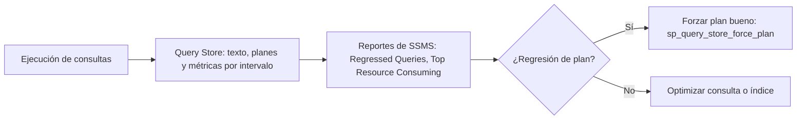

# Query Store

Parte de: [[06-SQL-Server/04 Rendimiento/_Índice Rendimiento|Rendimiento]]

> [!info] Cómo avanzar
> `progreso`: **pendiente** → **viendo** (estudiando) → **visto** (contestaste la autoevaluación sin abrir las respuestas) → **dominado** (hiciste el laboratorio o lo aplicaste de verdad).

## Contenido

### Qué es
**Query Store** es una función de SQL Server (desde 2016) y Azure SQL que actúa como una **caja negra de vuelo** para las consultas de una base: guarda, **de forma persistente dentro de la propia base**, el texto de cada consulta, todos los planes que ha usado y sus estadísticas de ejecución (duración, CPU, lecturas, memoria, esperas) agrupadas por intervalos de tiempo. A diferencia de las [[DMVs]], la información sobrevive a reinicios y a la expulsión de planes de la caché, así que puedes responder "¿qué cambió entre el martes y hoy?".

### Cómo funciona
1. Cada vez que se compila y ejecuta una consulta, Query Store registra la consulta (normalizada), el plan y las métricas en memoria, y las escribe a disco periódicamente.
2. Las métricas se agregan en intervalos configurables (por defecto, de una hora) y se conservan según una política de limpieza por antigüedad y tamaño máximo.
3. Si una consulta cambia de plan (por recompilación, cambio de estadísticas o de nivel de compatibilidad), verás **los dos planes** con sus métricas lado a lado.
4. Puedes **forzar** un plan: le dices al optimizador "para esta consulta, usa siempre este plan". El optimizador intentará generar ese plan en cada compilación.

**¿Está activo por defecto?** En **Azure SQL Database** sí. En **SQL Server 2022**, Query Store viene activado por defecto en las **bases nuevas**; las bases restauradas o migradas desde versiones anteriores conservan su configuración, así que revísalo. En SQL Server 2016 a 2019 hay que activarlo manualmente.



### Ejemplo
```sql
-- Activar y configurar
ALTER DATABASE Tienda SET QUERY_STORE = ON
    (OPERATION_MODE = READ_WRITE,
     QUERY_CAPTURE_MODE = AUTO,          -- ignora consultas triviales y poco frecuentes
     MAX_STORAGE_SIZE_MB = 1024);

-- Consultas con más CPU total en el último día
SELECT TOP (10) q.query_id, qt.query_sql_text, p.plan_id,
       SUM(rs.count_executions)                      AS Ejecuciones,
       SUM(rs.avg_cpu_time * rs.count_executions)    AS CpuTotalUs
FROM   sys.query_store_query q
JOIN   sys.query_store_query_text qt ON qt.query_text_id = q.query_text_id
JOIN   sys.query_store_plan p        ON p.query_id = q.query_id
JOIN   sys.query_store_runtime_stats rs ON rs.plan_id = p.plan_id
JOIN   sys.query_store_runtime_stats_interval i ON i.runtime_stats_interval_id = rs.runtime_stats_interval_id
WHERE  i.start_time >= DATEADD(day, -1, SYSUTCDATETIME())
GROUP  BY q.query_id, qt.query_sql_text, p.plan_id
ORDER  BY CpuTotalUs DESC;

-- Forzar el plan 42 para la consulta 17, y quitarlo después
EXEC sp_query_store_force_plan   @query_id = 17, @plan_id = 42;
EXEC sp_query_store_unforce_plan @query_id = 17, @plan_id = 42;
```

En SSMS, bajo la base, la carpeta *Query Store* trae reportes listos: **Regressed Queries** (consultas que empeoraron), **Top Resource Consuming Queries**, **Queries With Forced Plans** y **Tracked Queries**. Desde el reporte puedes forzar un plan con un botón. Para el laboratorio de [[Parameter sniffing]], es la herramienta que muestra dos planes para el mismo procedimiento y permite fijar el bueno.

**Antes de subir el nivel de compatibilidad**: el nuevo nivel puede cambiar los planes (ver [[Nivel de compatibilidad de la base]]). Si activas Query Store **antes**, capturas una línea base con los planes y tiempos del nivel viejo. Después del cambio, el reporte de regresiones compara contra esa línea base y, si una consulta empeoró, puedes forzar el plan anterior en segundos mientras investigas. Sin la línea base, no hay plan anterior que forzar. En SQL Server 2022 además existen los *Query Store hints* (`sp_query_store_set_hints`) para aplicar sugerencias como `RECOMPILE` a una consulta sin tocar el código, y la corrección automática de planes (*automatic plan correction*) puede forzar planes por sí sola si la activas.

### Cuándo usarlo y cuándo no
- **Actívalo en todas las bases de producción**: es el primer lugar para investigar "¿qué se puso lento?".
- **Fuerza planes** como medida temporal ante una regresión; después corrige la causa (índice, estadísticas, consulta), porque un plan forzado puede volverse malo si los datos cambian o fallar si el índice que usa desaparece.
- Las DMVs siguen siendo útiles para lo que está pasando en este instante; [[Extended Events]] para eventos individuales.

### Errores comunes
- **No activarlo** en bases migradas desde versiones viejas.
- **Que se llene**: al llegar al tamaño máximo pasa a solo lectura (`READ_ONLY`) y deja de capturar; vigila `actual_state_desc` en `sys.database_query_store_options`.
- **Forzar planes y olvidarlos**: revisa periódicamente *Queries With Forced Plans*.
- **Capture mode `ALL`** en sistemas con muchas consultas ad hoc: llena el almacenamiento con consultas irrelevantes.

### Para profundizar
- [Monitor performance by using the Query Store](https://learn.microsoft.com/en-us/sql/relational-databases/performance/monitoring-performance-by-using-the-query-store)
- [Best practices for managing the Query Store](https://learn.microsoft.com/en-us/sql/relational-databases/performance/best-practice-with-the-query-store)
- [Query Store hints](https://learn.microsoft.com/en-us/sql/relational-databases/performance/query-store-hints)

## Autoevaluación

Contesta primero en voz alta o en papel; luego despliega la respuesta.

> [!question]- ¿Qué es Query Store?
> Una función de la base que guarda el historial de consultas, sus planes y estadísticas de ejecución en el tiempo. Permite ver regresiones («ayer usaba otro plan») y **forzar** un plan bueno.

> [!question]- ¿Cómo se activa y está activo por defecto?
> ```sql
> ALTER DATABASE Tienda SET QUERY_STORE = ON (OPERATION_MODE = READ_WRITE);
> ```
> Está activo por defecto en Azure SQL Database y en bases nuevas de SQL Server 2022.

> [!question]- ¿Cómo fuerzas un plan?
> Desde los informes de SSMS («Regressed Queries», «Top Resource Consuming Queries») o con `EXEC sp_query_store_force_plan @query_id = 12, @plan_id = 3;`. Se deshace con `sp_query_store_unforce_plan`.

> [!question]- ¿Por qué activar Query Store antes de subir el nivel de compatibilidad?
> Para tener la línea base de planes con el nivel viejo: si una consulta empeora tras el cambio, ves la regresión y fuerzas el plan anterior.

## Práctica

- [[Lab 8 - Parameter sniffing y Query Store]]

