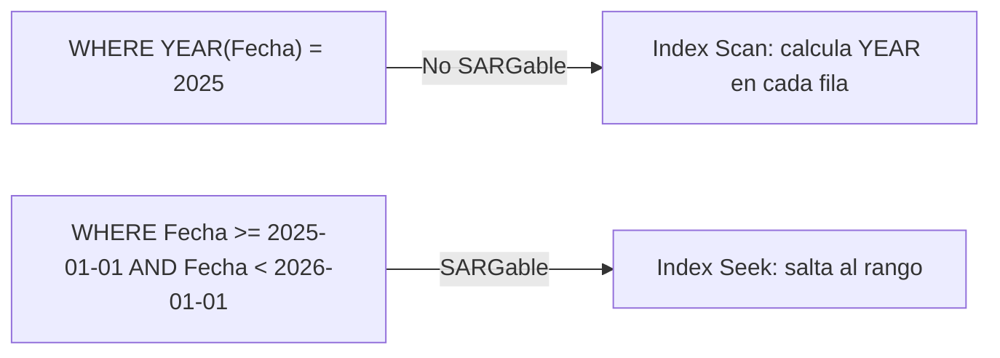

# SARGability

Parte de: [[06-SQL-Server/04 Rendimiento/_Índice Rendimiento|Rendimiento]]

> [!info] Cómo avanzar
> `progreso`: **pendiente** → **viendo** (estudiando) → **visto** (contestaste la autoevaluación sin abrir las respuestas) → **dominado** (hiciste el laboratorio o lo aplicaste de verdad).

## Contenido

### Qué es
Un predicado es **SARGable** (de *Search ARGument able*) cuando SQL Server puede usarlo para **buscar directamente** en un índice (*Index Seek*), en lugar de leer todas las filas y evaluar la condición una por una (*Scan*). En términos prácticos: la columna debe aparecer **"desnuda"** en un lado de la comparación, sin funciones ni operaciones encima, y el otro lado debe ser un valor que se pueda calcular antes de recorrer el índice.

### Cómo funciona
Un índice sobre `Fecha` está ordenado por los valores de `Fecha`. Si preguntas `WHERE Fecha >= '2025-06-01' AND Fecha < '2025-07-01'`, el motor salta al primer 1 de junio en el árbol y lee hasta el último día de junio: un *seek* que lee solo las filas necesarias. Pero si preguntas `WHERE YEAR(Fecha) = 2025 AND MONTH(Fecha) = 6`, el índice está ordenado por `Fecha`, **no** por `MONTH(Fecha)`; el motor no sabe dónde empieza "mes 6" sin calcular la función en cada fila, así que lee todo el índice o la tabla.

**Patrones que rompen la SARGability**:
1. **Funciones sobre la columna**: `YEAR(Fecha)`, `LEFT(Referencia, 4)`, `UPPER(Nombre)`, `ISNULL(Ciudad, '')`, `DATEDIFF(day, Fecha, ...)`.
2. **Aritmética sobre la columna**: `Monto * 1.16 > 1000`, `Fecha + 1 = @d`.
3. **Conversiones implícitas de la columna**: comparar una columna `varchar` contra un parámetro `nvarchar` (ver [[Advertencias del plan (conversiones implícitas y spills)]]).
4. **`LIKE` con comodín al inicio**: `LIKE '%abc'`. (`LIKE 'abc%'` sí es SARGable.)
5. **Condiciones "atrapalotodo"** como `WHERE (@Ciudad IS NULL OR Ciudad = @Ciudad)`, que impiden un plan con *seek* reutilizable (ver [[SQL dinámico y sp_executesql]]).

La receta para arreglarlos: **mueve el cálculo al otro lado** de la comparación, sobre la constante o el parámetro, o expresa la condición como un rango.



**Una excepción útil**: `CAST(FechaHora AS date) = @Dia` sobre una columna `datetime`/`datetime2` **sí** es SARGable. El optimizador reconoce este caso especial y lo transforma internamente en un rango (*dynamic seek*). Aun así, sus estimaciones de filas pueden ser menos precisas que con un rango escrito a mano, así que el rango explícito sigue siendo la opción más predecible.

### Ejemplo
```sql
-- 1) Año y mes
-- Mal:  WHERE YEAR(Fecha) = 2025 AND MONTH(Fecha) = 6
WHERE Fecha >= '2025-06-01' AND Fecha < '2025-07-01'     -- rango semiabierto: funciona con date y datetime2

-- 2) Aritmética
-- Mal:  WHERE Monto * 1.16 > 1000
WHERE Monto > 1000 / 1.16                                 -- el cálculo se hace una vez sobre la constante

-- 3) Prefijo y NULL
-- Mal:  WHERE LEFT(Referencia, 4) = 'REF-'
WHERE Referencia LIKE 'REF-%'
-- Mal:  WHERE ISNULL(Ciudad, N'') = N'CDMX'
WHERE Ciudad = N'CDMX'                                    -- un NULL nunca es igual a 'CDMX', no hace falta ISNULL

-- 4) Últimos 30 días
-- Mal:  WHERE DATEDIFF(day, Fecha, SYSUTCDATETIME()) <= 30
WHERE Fecha >= DATEADD(day, -30, CAST(SYSUTCDATETIME() AS date))
```

En el cuarto caso, `DATEDIFF(day, ...)` cuenta cambios de día calendario, no periodos de 24 horas; por eso la versión equivalente compara contra la medianoche de hace 30 días (`CAST(... AS date)`), no contra "ahora menos 30 días". Revisa siempre que la reescritura devuelva las mismas filas, sobre todo en los límites.

**Desde Dapper**, la trampa más común es la conversión implícita: Dapper envía los `string` de C# como `nvarchar(4000)`. Si la columna es `varchar` (por ejemplo `Referencia varchar(20)` o `Estado varchar(20)`), según la intercalación el motor puede tener que convertir **la columna** y pierdes el *seek*. Se corrige indicando el tipo:

```csharp
var filas = await conn.QueryAsync<Movimiento>(sql,
    new { Ref = new DbString { Value = "REF-0042", IsAnsi = true, Length = 20 } });
```

### Cuándo usarlo y cuándo no
- **Siempre** que la columna tenga (o deba tener) un índice y la consulta sea frecuente: revisa el `WHERE` y los `JOIN` buscando funciones sobre columnas.
- En tablas pequeñas o consultas de un solo uso, la diferencia puede ser irrelevante; prioriza la claridad.
- Si de verdad necesitas buscar por una expresión (`UPPER(Email)`), crea una **columna calculada persistida** con esa expresión y un índice sobre ella.

### Errores comunes
- **`BETWEEN` con fechas y horas**: `BETWEEN '2025-06-01' AND '2025-06-30'` pierde todo lo del día 30 después de medianoche en columnas con hora; usa el rango semiabierto `>= inicio AND < siguiente`.
- **"Arreglar" con `ISNULL` o `COALESCE`** condiciones que ya funcionaban con `NULL`.
- **Strings `nvarchar` contra columnas `varchar`** desde la app.
- **Funciones escalares de usuario en el `WHERE`**: además de no ser SARGables, se ejecutan por fila (ver [[Funciones escalares y de tabla]]).
- **Asumir que el *seek* se dio**: verifica el plan (ver [[Operadores de acceso (Scan, Seek y Key Lookup)]]).

### Para profundizar
- [SQL Server index architecture and design guide](https://learn.microsoft.com/en-us/sql/relational-databases/sql-server-index-design-guide)
- [Data type precedence (conversiones implícitas)](https://learn.microsoft.com/en-us/sql/t-sql/data-types/data-type-precedence-transact-sql)
- [Dapper en GitHub (DbString y parámetros ANSI)](https://github.com/DapperLib/Dapper)

## Ejercicios

Resuélvelos en papel o en la herramienta; la solución está plegada.

> [!question]- Reescribe de forma SARGable: `WHERE YEAR(Fecha) = 2025 AND MONTH(Fecha) = 6`.
> ```sql
> WHERE Fecha >= '2025-06-01' AND Fecha < '2025-07-01'
> ```

> [!question]- Reescribe: `WHERE Monto * 1.16 > 1000`.
> ```sql
> WHERE Monto > 1000 / 1.16
> ```
> (≈ 862.07; cuidado con los decimales y el redondeo del tipo).

> [!question]- Reescribe: `WHERE LEFT(Referencia, 4) = 'REF-'` y `WHERE ISNULL(Ciudad, N'') = N'CDMX'`.
> ```sql
> WHERE Referencia LIKE 'REF-%'
> WHERE Ciudad = N'CDMX'      -- el ISNULL no aporta: NULL nunca es igual a 'CDMX'
> ```

> [!question]- Reescribe: `WHERE DATEDIFF(day, Fecha, SYSUTCDATETIME()) <= 30`.
> ```sql
> WHERE Fecha >= DATEADD(day, -30, SYSUTCDATETIME())
> ```
> (Matiz: `DATEDIFF` cuenta fronteras de día, así que el resultado puede variar unas horas en los bordes.)

## Autoevaluación

Contesta primero en voz alta o en papel; luego despliega la respuesta.

> [!question]- ¿Qué significa que un predicado sea SARGable?
> *Search ARGument able*: que SQL Server puede usarlo para buscar en un índice (seek). Regla: deja la columna «limpia» de un lado y pon los cálculos del lado del valor.

> [!question]- ¿Qué patrones vuelven no SARGable un predicado?
> Funciones sobre la columna (`YEAR(Fecha)`, `ISNULL(Ciudad, '')`, `LEFT(Ref, 4)`), aritmética sobre la columna (`Monto * 1.16 > 1000`), `LIKE '%texto'` y conversiones implícitas de la columna.

> [!question]- ¿`CAST(FechaHora AS date) = @Dia` es SARGable?
> Es un caso especial: SQL Server puede convertirlo en un rango y hacer seek. Aun así, el rango explícito (`>= @Dia AND < DATEADD(day, 1, @Dia)`) es más claro y portable.

## Práctica

- [[Lab 7 - Índices y planes de ejecución antes y después]]

