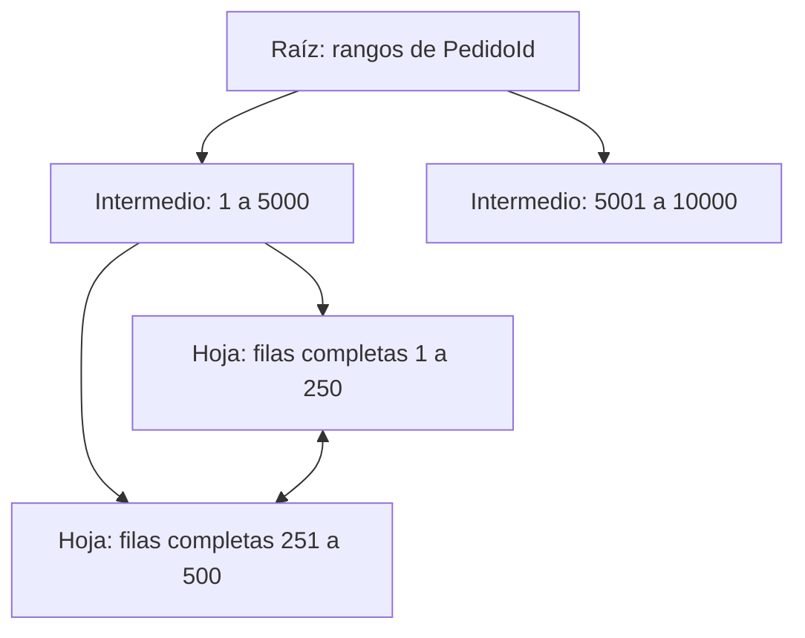

# Índice clustered

Parte de: [[06-SQL-Server/04 Rendimiento/_Índice Rendimiento|Rendimiento]]

> [!info] Cómo avanzar
> `progreso`: **pendiente** → **viendo** (estudiando) → **visto** (contestaste la autoevaluación sin abrir las respuestas) → **dominado** (hiciste el laboratorio o lo aplicaste de verdad).

## Contenido

### Qué es
El **índice clustered** (agrupado) **es la tabla misma** ordenada por su clave: el nivel hoja del árbol B contiene las filas completas, físicamente organizadas según la clave del índice. Por eso **solo puede haber uno por tabla**: los datos no pueden estar ordenados de dos maneras a la vez. Una tabla sin índice clustered se llama **heap** (montículo) y guarda las filas sin orden particular.

### Cómo funciona
El índice es un **árbol B+**: una página raíz, niveles intermedios con rangos de claves y, abajo, las páginas hoja con los datos. Buscar una fila por la clave recorre unos pocos niveles (tres o cuatro incluso en tablas de millones de filas) hasta la página exacta. Leer un rango de claves es eficiente porque las filas contiguas están en páginas contiguas, enlazadas entre sí.

Además, la clave clustered tiene un papel especial: **cada índice nonclustered la guarda** en sus filas como "puntero" para llegar a la fila completa (ver [[Índice nonclustered]]). Eso significa que el tamaño de la clave clustered se multiplica por el número de índices de la tabla.



**Características de una buena clave clustered** (el acrónimo en inglés es *NUSE*: *narrow, unique, static, ever-increasing*):
1. **Angosta**: pocos bytes (`int` de 4 o `bigint` de 8, mejor que un `nvarchar(100)` o una clave compuesta ancha), porque se repite en todos los índices nonclustered.
2. **Única**: si no lo es, SQL Server agrega internamente un *uniquifier* de 4 bytes a las filas duplicadas.
3. **Estática**: que no cambie; cambiar la clave mueve la fila a otra página y obliga a actualizar todos los índices nonclustered.
4. **Creciente**: las filas nuevas van al final del árbol, sin partir páginas a la mitad (*page splits*) ni fragmentar.

Un `int IDENTITY` cumple las cuatro. Un `uniqueidentifier` aleatorio (`NEWID()`, `Guid.NewGuid()`) es ancho (16 bytes) y no creciente: cada inserción cae en un lugar al azar, parte páginas y fragmenta el índice. Si tu modelo usa GUID como identificador (como [[Itzamna.Dionisio]], que genera `Guid.CreateVersion7()`), considera que SQL Server ordena los `uniqueidentifier` dando prioridad a sus **últimos** bytes, así que un UUID v7, cuyo tiempo va al inicio, **no** necesariamente queda en orden creciente para SQL Server; `NEWSEQUENTIALID()` sí genera valores crecientes para su ordenamiento. Una alternativa común es usar un `bigint IDENTITY` como clave clustered y el GUID como clave primaria nonclustered o como columna única. Mide en tu caso antes de decidir (ver [[uniqueidentifier]]).

**¿La clave primaria siempre es el clustered?** No. Por defecto, `PRIMARY KEY` crea un índice **clustered** si la tabla todavía no tiene uno, pero puedes declararla `PRIMARY KEY NONCLUSTERED` y crear el clustered sobre otra columna. Son conceptos distintos: la PK es una **restricción lógica** (identidad única de la fila, referenciada por las FK); el clustered es una **decisión física** de almacenamiento.

### Ejemplo
```sql
-- Caso común: la PK int IDENTITY es el clustered
CREATE TABLE ventas.Pedidos (
    PedidoId int IDENTITY(1,1) NOT NULL CONSTRAINT PK_Pedidos PRIMARY KEY CLUSTERED,
    ClienteId int NOT NULL,
    Fecha     date NOT NULL
);

-- GUID como identidad pública y clustered sobre una clave creciente
CREATE TABLE ventas.Movimientos (
    MovimientoSeq bigint IDENTITY(1,1) NOT NULL,
    MovimientoId  uniqueidentifier NOT NULL
                  CONSTRAINT PK_Movimientos PRIMARY KEY NONCLUSTERED,
    Fecha         datetime2(3) NOT NULL,
    Monto         decimal(12,2) NOT NULL,
    CONSTRAINT UQ_Movimientos_Seq UNIQUE CLUSTERED (MovimientoSeq)
);

-- ¿Qué tablas son heaps?
SELECT OBJECT_SCHEMA_NAME(object_id) AS Esquema, OBJECT_NAME(object_id) AS Tabla
FROM   sys.indexes
WHERE  index_id = 0 AND OBJECTPROPERTY(object_id, 'IsUserTable') = 1;
```

Para tablas de movimientos que casi siempre se consultan por rango de fechas, otra opción válida es un clustered sobre `(Fecha, MovimientoSeq)`: los reportes por periodo leen páginas contiguas.

### Cuándo usarlo y cuándo no
- **Casi toda tabla debe tener un índice clustered**; los heaps tienen problemas de fragmentación, *forwarded records* y búsquedas por RID.
- **Elige la clave según el acceso**: si casi todo se busca por id, la PK; si casi todo son rangos de fecha, considera la fecha (más un desempate único).
- **Heaps** solo en casos específicos, como tablas de staging que se cargan y se vacían completas.

### Errores comunes
- **GUID aleatorio como clustered** en tablas con muchas inserciones: fragmentación y *page splits*.
- **Claves compuestas anchas** como clustered: todos los índices nonclustered crecen.
- **Claves que cambian** (por ejemplo, un código de negocio editable).
- **Creer que el clustered garantiza el orden del `SELECT`** sin `ORDER BY`: el plan puede leer en otro orden (paralelismo, otro índice).

### Para profundizar
- [Clustered and nonclustered indexes described](https://learn.microsoft.com/en-us/sql/relational-databases/indexes/clustered-and-nonclustered-indexes-described)
- [SQL Server index architecture and design guide](https://learn.microsoft.com/en-us/sql/relational-databases/sql-server-index-design-guide)

## Autoevaluación

Contesta primero en voz alta o en papel; luego despliega la respuesta.

> [!question]- ¿Qué es el índice clustered y cuántos puede haber?
> Define el orden físico lógico de la tabla: sus hojas **son** las filas. Solo uno por tabla. Una tabla sin clustered es un *heap*.

> [!question]- ¿Qué características debe tener una buena clave clustered?
> Estrecha (pocos bytes, porque se copia en todos los nonclustered), única, estable (no cambia) y creciente (las inserciones van al final). `int`/`bigint IDENTITY` cumple todo.

> [!question]- ¿La clave primaria siempre es el índice clustered?
> Por defecto sí, si no existe otro clustered, pero son conceptos distintos: puedes tener `PRIMARY KEY NONCLUSTERED` sobre un GUID y el clustered en otra columna (p. ej. un `bigint` secuencial o la fecha).

## Práctica

- [[Lab 7 - Índices y planes de ejecución antes y después]]

