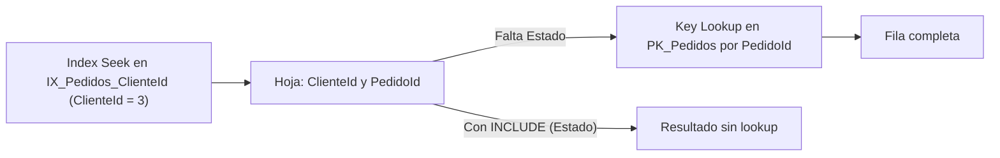

# Índice nonclustered

Parte de: [[06-SQL-Server/04 Rendimiento/_Índice Rendimiento|Rendimiento]]

> [!info] Cómo avanzar
> `progreso`: **pendiente** → **viendo** (estudiando) → **visto** (contestaste la autoevaluación sin abrir las respuestas) → **dominado** (hiciste el laboratorio o lo aplicaste de verdad).

## Contenido

### Qué es
Un **índice nonclustered** (no agrupado) es una estructura **separada de la tabla**, también un árbol B+, ordenada por las columnas que eliges, que guarda una copia de esas columnas más un **puntero** a la fila completa. Es como el índice al final de un libro: está ordenado por tema y te dice en qué página buscar. Una tabla puede tener muchos (hasta 999), y son la herramienta principal para acelerar búsquedas por columnas distintas de la clave clustered.

### Cómo funciona
**Qué guarda en sus hojas**:
1. Las **columnas clave** del índice, ordenadas.
2. El **localizador de fila**: si la tabla tiene [[Índice clustered]], es **la clave clustered** de esa fila; si la tabla es un heap, es un **RID** (identificador físico de archivo, página y ranura).
3. Las **columnas incluidas** (`INCLUDE`), si las definiste (ver [[Columnas incluidas y filtered indexes]]).

**Key Lookup**: si una consulta busca por el índice nonclustered pero necesita columnas que **no** están en él, por cada fila encontrada el motor usa la clave clustered para ir a buscar la fila completa en el índice clustered. Ese salto se llama *Key Lookup* (o *RID Lookup* en un heap). Para pocas filas es barato; para miles, son miles de búsquedas aleatorias y el optimizador puede preferir escanear toda la tabla. Un índice que contiene todas las columnas que pide la consulta se llama **índice cubriente** y evita el lookup.



**Orden de columnas en un índice compuesto**. El índice está ordenado por la primera columna, luego por la segunda dentro de cada valor de la primera, y así sucesivamente, como un directorio telefónico ordenado por apellido y luego nombre. Consecuencias:
- Un índice `(ClienteId, Fecha)` sirve para `WHERE ClienteId = @c`, para `WHERE ClienteId = @c AND Fecha >= @f` y para `WHERE ClienteId = @c ORDER BY Fecha`. **No** sirve para un *seek* con solo `WHERE Fecha >= @f`: es como buscar en el directorio a todos los "Juan" sin saber el apellido.
- Regla práctica: primero las columnas de **igualdad** (`=`), después las de **rango** (`>`, `<`, `BETWEEN`) o de orden. Una vez que una columna se usa como rango, las siguientes ya no ayudan al *seek* (solo como predicado residual).
- La "selectividad primero" es un mito parcial: importa más **cómo se filtra** (igualdad frente a rango) y qué consultas reales se ejecutan que cuál columna es más selectiva.

### Ejemplo
```sql
-- Consulta frecuente de la API
-- SELECT PedidoId, Fecha, Estado FROM ventas.Pedidos
-- WHERE ClienteId = @ClienteId AND Fecha >= @Desde ORDER BY Fecha DESC;

-- Igualdad primero, rango/orden después, y Estado incluido para cubrir
CREATE INDEX IX_Pedidos_ClienteId_Fecha
    ON ventas.Pedidos (ClienteId, Fecha DESC)
    INCLUDE (Estado);

-- Índice en columna FK: acelera JOINs y la validación de borrados en la tabla padre
CREATE INDEX IX_PedidoDetalle_ProductoId ON ventas.PedidoDetalle (ProductoId);

-- Ver si se usa (seeks, scans, lookups contra el costo de mantenerlo)
SELECT i.name, us.user_seeks, us.user_scans, us.user_lookups, us.user_updates
FROM   sys.indexes i
LEFT   JOIN sys.dm_db_index_usage_stats us
       ON us.object_id = i.object_id AND us.index_id = i.index_id AND us.database_id = DB_ID()
WHERE  i.object_id = OBJECT_ID(N'ventas.Pedidos');
```

`PedidoId` no hace falta incluirlo: como es la clave clustered, ya está en cada fila del índice nonclustered.

Para el archivo `.sql` de esa consulta en la API, el índice convierte cada llamada en un *Index Seek* que lee solo las filas del cliente en el rango, ya ordenadas, sin *Sort* ni *Key Lookup*.

### Cuándo usarlo y cuándo no
- **Crea nonclustered** para las columnas de `WHERE`, `JOIN` y `ORDER BY` de las consultas frecuentes, y en las columnas FK.
- **Cubre** con `INCLUDE` las consultas críticas, sin convertir el índice en una copia de la tabla.
- **Consolida**: un índice `(A, B)` hace redundante uno solo en `(A)`.
- **No indexes** columnas que nunca se filtran, ni tablas pequeñas que caben en unas pocas páginas.
- Cada índice cuesta en escrituras; ver el balance en [[Índices]].

### Errores comunes
- **Orden de columnas al revés** (rango antes que igualdad): el *seek* solo usa la primera parte.
- **Un índice por columna** esperando que el motor los combine: rara vez es eficiente; diseña índices compuestos según las consultas.
- **Key Lookups masivos** que llevan al optimizador a escanear.
- **Índices duplicados o solapados** creados por distintas personas.
- **Olvidar indexar las FK**: los `JOIN` y los `DELETE` en la tabla padre escanean la hija.

### Para profundizar
- [Clustered and nonclustered indexes described](https://learn.microsoft.com/en-us/sql/relational-databases/indexes/clustered-and-nonclustered-indexes-described)
- [Create nonclustered indexes](https://learn.microsoft.com/en-us/sql/relational-databases/indexes/create-nonclustered-indexes)
- [SQL Server index architecture and design guide](https://learn.microsoft.com/en-us/sql/relational-databases/sql-server-index-design-guide)

## Autoevaluación

Contesta primero en voz alta o en papel; luego despliega la respuesta.

> [!question]- ¿Qué guarda un índice nonclustered en sus hojas?
> Las columnas clave del índice, las columnas incluidas y un localizador de fila: la clave clustered (o el RID si la tabla es heap).

> [!question]- ¿Qué es un *Key Lookup*?
> Cuando el índice encuentra las filas pero no tiene todas las columnas que pide la consulta, SQL Server va al clustered fila por fila por las faltantes. Con pocas filas es barato; con miles, puede ser peor que un scan.

> [!question]- ¿En qué orden pones las columnas de un índice compuesto?
> Primero las de igualdad (`WHERE ClienteId = @id`), luego las de rango u orden (`Fecha`). Un índice `(ClienteId, Fecha)` sirve para `WHERE ClienteId = 1 AND Fecha >= ...`, pero no para buscar solo por `Fecha`.

## Práctica

- [[Lab 7 - Índices y planes de ejecución antes y después]]

