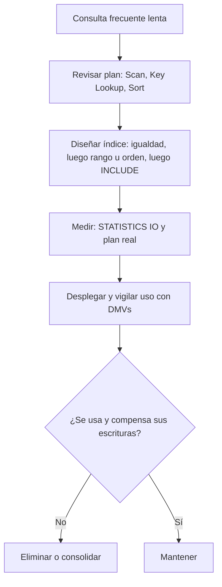

# Índices

Parte de: [[06-SQL-Server/04 Rendimiento/_Índice Rendimiento|Rendimiento]]

> [!info] Cómo avanzar
> `progreso`: **pendiente** → **viendo** (estudiando) → **visto** (contestaste la autoevaluación sin abrir las respuestas) → **dominado** (hiciste el laboratorio o lo aplicaste de verdad).

## Contenido

### Qué es
Un **índice** es una estructura adicional que SQL Server mantiene sobre una tabla para **encontrar filas sin leerla completa**, de forma parecida al índice de un libro. La mayoría son **árboles B+** ordenados por una o varias columnas: buscar un valor recorre unos pocos niveles hasta la página correcta en lugar de revisar millones de filas. Los índices son la palanca de rendimiento más importante de una base relacional, y también una de las más fáciles de usar mal.

### Cómo funciona
Los tipos principales y cómo se relacionan:

- [[Índice clustered]]: **es la tabla** ordenada por su clave. Uno por tabla. Su clave sirve de puntero en todos los demás índices.
- [[Índice nonclustered]]: estructura aparte con columnas clave y un puntero a la fila. Muchos por tabla.
- [[Columnas incluidas y filtered indexes]]: variantes del nonclustered para cubrir consultas o indexar solo un subconjunto de filas.
- [[Columnstore]]: almacenamiento por columnas para consultas analíticas sobre grandes volúmenes.
- Otros especializados: únicos (que además son restricciones), XML, espaciales, de texto completo (ver [[Búsqueda de texto completo]]).

El optimizador decide si usa un índice según las [[Estadísticas]] (cuántas filas espera) y la forma de la consulta (si los predicados son [[SARGability|SARGables]]). Lo que hizo se ve en el [[Planes de ejecución|plan de ejecución]].



**Lo que cuesta tener muchos índices**:
1. **Escrituras más lentas**: cada `INSERT` y `DELETE` actualiza todos los índices de la tabla; cada `UPDATE`, los que contienen las columnas modificadas. Diez índices son diez estructuras que mantener por fila.
2. **Espacio**: en disco, en respaldos y en memoria (el buffer pool compite entre índices).
3. **Bloqueos y deadlocks**: más estructuras que bloquear por operación.
4. **Mantenimiento**: reconstrucción, reorganización y actualización de estadísticas tardan más.
5. **Trabajo para el optimizador**: más opciones que evaluar al compilar.

**Cómo detectar índices que no se usan**: `sys.dm_db_index_usage_stats` cuenta, por índice, cuántas veces se usó para `user_seeks`, `user_scans` y `user_lookups`, y cuántas veces hubo que actualizarlo (`user_updates`). Un índice con muchas actualizaciones y cero lecturas es un costo sin beneficio. Precaución: los contadores se **reinician con el servidor**; un índice que solo usa el cierre de mes parecerá inútil si el servidor se reinició hace dos semanas. Revisa tras un ciclo completo de negocio.

**Índices faltantes**: las DMVs `sys.dm_db_missing_index_details`, `_groups` y `_group_stats` (y la sugerencia verde en los planes de SSMS) proponen índices que el optimizador "habría querido". **No debes crearlos todos**:
- Se generan por consulta, sin mirar los índices que ya existen; proponen índices casi iguales una y otra vez.
- No consideran el costo de escritura del índice.
- El orden de columnas que sugieren es simplista (igualdades y luego desigualdades, en el orden en que aparecen en la tabla) y meten muchas columnas en `INCLUDE`.
- Son una **pista** para analizar: agrupa sugerencias parecidas, compáralas con los índices existentes y diseña uno que sirva a varias consultas.

### Ejemplo
```sql
-- Índices sin lecturas desde el último reinicio, con su costo de escritura
SELECT OBJECT_NAME(i.object_id) AS Tabla, i.name AS Indice,
       ISNULL(us.user_seeks + us.user_scans + us.user_lookups, 0) AS Lecturas,
       ISNULL(us.user_updates, 0) AS Escrituras
FROM   sys.indexes i
LEFT   JOIN sys.dm_db_index_usage_stats us
       ON us.object_id = i.object_id AND us.index_id = i.index_id AND us.database_id = DB_ID()
WHERE  OBJECTPROPERTY(i.object_id, 'IsUserTable') = 1
  AND  i.type_desc = 'NONCLUSTERED' AND i.is_primary_key = 0 AND i.is_unique_constraint = 0
ORDER  BY Lecturas, Escrituras DESC;

-- Sugerencias de índices faltantes (para analizar, no para copiar)
SELECT d.statement AS Tabla, d.equality_columns, d.inequality_columns, d.included_columns,
       s.user_seeks, s.avg_user_impact
FROM   sys.dm_db_missing_index_details d
JOIN   sys.dm_db_missing_index_groups g      ON g.index_handle = d.index_handle
JOIN   sys.dm_db_missing_index_group_stats s ON s.group_handle = g.index_group_handle
WHERE  d.database_id = DB_ID()
ORDER  BY s.user_seeks * s.avg_user_impact DESC;
```

En la práctica de un proyecto con Dapper y SQL en archivos, cada archivo `.sql` es una consulta concreta y conocida: diseñar índices a partir de esa lista (las consultas reales de la API) da mejores resultados que reaccionar a sugerencias sueltas.

### Cuándo usarlo y cuándo no
- **Indexa** las claves foráneas, las columnas de filtro y orden de las consultas frecuentes y las restricciones de unicidad.
- **Prefiere pocos índices bien diseñados** que sirvan a varias consultas, sobre muchos índices de una sola consulta.
- En tablas con muchas escrituras y pocas lecturas (logs, colas), mantén el mínimo.
- Para análisis sobre grandes volúmenes, considera columnstore en lugar de muchos índices rowstore.

### Errores comunes
- **Crear todos los índices sugeridos**: duplicados, escrituras lentas y espacio desperdiciado.
- **Borrar índices "sin uso"** justo después de un reinicio.
- **Índices redundantes**: `(A)` y `(A, B)` juntos; el segundo cubre al primero.
- **Ignorar el costo de escritura** en tablas transaccionales calientes.
- **No verificar el plan** después de crear el índice: puede que la consulta no lo use por un predicado no SARGable.

### Para profundizar
- [SQL Server index architecture and design guide](https://learn.microsoft.com/en-us/sql/relational-databases/sql-server-index-design-guide)
- [Tune nonclustered indexes with missing index suggestions](https://learn.microsoft.com/en-us/sql/relational-databases/indexes/tune-nonclustered-missing-index-suggestions)
- [sys.dm_db_index_usage_stats](https://learn.microsoft.com/en-us/sql/relational-databases/system-dynamic-management-objects/sys-dm-db-index-usage-stats-transact-sql)

## Autoevaluación

Contesta primero en voz alta o en papel; luego despliega la respuesta.

> [!question]- ¿Qué es un índice en SQL Server?
> Una estructura B-tree ordenada por una o más columnas (la clave) que permite encontrar filas sin leer toda la tabla. Hay [[Índice clustered|clustered]] (la tabla misma ordenada) y [[Índice nonclustered|nonclustered]] (estructura aparte que apunta a las filas).

> [!question]- ¿Qué cuesta tener muchos índices?
> Cada `INSERT`, `UPDATE` (de columnas indexadas) y `DELETE` debe mantenerlos: más escritura, más log, más espacio y más memoria. Diseña índices para las consultas importantes, no uno por columna.

> [!question]- ¿Cómo detectas índices que no se usan?
> ```sql
> SELECT OBJECT_NAME(s.object_id) AS Tabla, i.name, s.user_seeks, s.user_scans, s.user_lookups, s.user_updates
> FROM   sys.dm_db_index_usage_stats s
> JOIN   sys.indexes i ON i.object_id = s.object_id AND i.index_id = s.index_id
> WHERE  s.database_id = DB_ID();
> ```
> Muchos `user_updates` y casi ningún seek/scan = candidato a eliminar. Los contadores se reinician con el servidor.

> [!question]- ¿Debes crear todos los índices que sugieren las DMVs de *missing indexes*?
> No a ciegas: sugieren por consulta, a veces duplican otros índices y no consideran el costo de escritura. Úsalas como pista y consolida.

## Práctica

- [[Lab 7 - Índices y planes de ejecución antes y después]]

