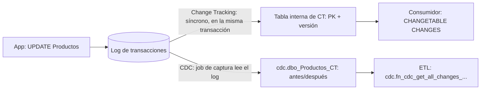

# Auditoría (CDC y Change Tracking)

Parte de: [[06-SQL-Server/05 Administración y avanzado/_Índice Administración y avanzado|Administración y avanzado]]

> [!info] Cómo avanzar
> `progreso`: **pendiente** → **viendo** (estudiando) → **visto** (contestaste la autoevaluación sin abrir las respuestas) → **dominado** (hiciste el laboratorio o lo aplicaste de verdad).

## Contenido

### Qué es
SQL Server trae dos mecanismos integrados para saber **qué cambió** en una tabla sin escribir triggers propios:

- **Change Tracking (CT)**: registra *que* una fila cambió (su clave primaria, el tipo de operación y una versión), pero **no guarda los valores anteriores**. Sirve para sincronizar: "dame las filas que cambiaron desde la versión 1520".
- **Change Data Capture (CDC)**: lee el log de transacciones y copia a tablas de cambios (`cdc.<esquema>_<tabla>_CT`) **los valores antes y después** de cada `INSERT`, `UPDATE` y `DELETE`. Sirve para ETL incremental, réplicas hacia un data lake o reconstruir el historial.

Ninguno de los dos es una auditoría de seguridad completa: ninguno guarda por sí mismo **quién** hizo el cambio. Para eso existe SQL Server Audit, columnas `UpdatedBy` o un trigger que lea `SESSION_CONTEXT`.

### Cómo funciona


- **CT** se escribe en la misma transacción que el cambio (síncrono). Lo consultas con `CHANGETABLE(CHANGES dbo.Tabla, @ultimaVersion)` y guardas `CHANGE_TRACKING_CURRENT_VERSION()` para la siguiente vuelta. Requiere clave primaria y tiene un periodo de retención (por defecto 2 días) con limpieza automática.
- **CDC** es asíncrono: un **job de captura** lee el log y llena las tablas de cambios; un **job de limpieza** borra lo viejo (por defecto 3 días). En SQL Server local esos jobs corren en **SQL Server Agent**, así que el Agent debe estar encendido; además CDC no está en Express. En Azure SQL Database CDC usa un programador interno en lugar del Agent. Mientras el job de captura no lea el log, ese log no se puede truncar, así que un CDC detenido hace crecer el `.ldf`.

### Ejemplo
```sql
-- Change Tracking: sincronizar el catálogo hacia una caché
ALTER DATABASE Tienda SET CHANGE_TRACKING = ON (CHANGE_RETENTION = 2 DAYS, AUTO_CLEANUP = ON);
ALTER TABLE dbo.Productos ENABLE CHANGE_TRACKING WITH (TRACK_COLUMNS_UPDATED = OFF);

DECLARE @desde bigint = 1520;  -- versión guardada en la última sincronización
SELECT ct.ProductoId, ct.SYS_CHANGE_OPERATION, p.Nombre, p.Precio
FROM CHANGETABLE(CHANGES dbo.Productos, @desde) AS ct
LEFT JOIN dbo.Productos AS p ON p.ProductoId = ct.ProductoId;  -- NULL si fue DELETE
SELECT CHANGE_TRACKING_CURRENT_VERSION() AS NuevaVersion;

-- CDC: historial con valores antes/después
EXEC sys.sp_cdc_enable_db;
EXEC sys.sp_cdc_enable_table @source_schema = N'dbo', @source_name = N'Productos', @role_name = NULL;

DECLARE @de binary(10) = sys.fn_cdc_get_min_lsn('dbo_Productos'),
        @a  binary(10) = sys.fn_cdc_get_max_lsn();
SELECT __$operation, ProductoId, Precio   -- 1=DELETE, 2=INSERT, 3=antes del UPDATE, 4=después
FROM cdc.fn_cdc_get_all_changes_dbo_Productos(@de, @a, N'all update old');
```
En un proyecto como Itzamna.Dionisio, CT encaja para avisar a un worker qué productos refrescar en caché; CDC encaja para alimentar Wee.Reporteria con cargas incrementales.

### Cuándo usarlo y cuándo no
- **CT** cuando solo necesitas saber qué filas re-leer (sincronización móvil, cachés, índices de búsqueda). Es ligero.
- **CDC** cuando necesitas los valores históricos o alimentar un ETL/streaming (Debezium, Azure Data Factory).
- **[[Tablas temporales del sistema (temporal tables)]]** cuando quieres consultar "cómo estaba la fila el día X" con SQL normal.
- **SQL Server Audit** o columnas de auditoría cuando la pregunta es *quién* hizo qué (cumplimiento, seguridad).
- Para auditoría de negocio a nivel de aplicación, revisa [[Borrado lógico y auditoría]].

### Errores comunes
1. **Esperar el usuario en CDC.** CDC no guarda quién cambió; agrega una columna `ModificadoPor` en la tabla para que viaje con el cambio.
2. **Agent apagado en local.** La captura se detiene y el log crece sin truncarse. Monitorea los jobs `cdc.<base>_capture`.
3. **Perder la versión de CT.** Si tu consumidor tarda más que la retención, `CHANGE_TRACKING_MIN_VALID_VERSION` supera tu versión y debes resincronizar completo. Compáralas siempre antes de leer.
4. **Cambiar el esquema de la tabla con CDC activo.** Las columnas nuevas no se capturan hasta crear una nueva instancia de captura.
5. **Usarlo como auditoría legal.** Las tablas de cambios se limpian; para conservar años, cópialas a otro almacenamiento.

### Para profundizar
- [Acerca de Change Data Capture (Microsoft Learn)](https://learn.microsoft.com/sql/relational-databases/track-changes/about-change-data-capture-sql-server)
- [Acerca de Change Tracking (Microsoft Learn)](https://learn.microsoft.com/sql/relational-databases/track-changes/about-change-tracking-sql-server)
- [Comparar CDC y Change Tracking](https://learn.microsoft.com/sql/relational-databases/track-changes/track-data-changes-sql-server)

## Autoevaluación

Contesta primero en voz alta o en papel; luego despliega la respuesta.

> [!question]- ¿Qué diferencia hay entre Change Tracking y Change Data Capture?
> **Change Tracking** dice **qué filas** cambiaron (la clave y el tipo de operación) desde una versión, sin los valores anteriores: ideal para sincronizar clientes. **CDC** lee el log y guarda **los valores** de cada cambio (antes y después) en tablas de cambios: ideal para ETL y auditoría de datos.

> [!question]- ¿Qué requiere CDC en SQL Server local?
> Habilitarlo en la base y en cada tabla (`sys.sp_cdc_enable_db`, `sys.sp_cdc_enable_table`) y que SQL Server Agent esté corriendo (los jobs de captura y limpieza). En Azure SQL Database usa su propio programador.

> [!question]- ¿CDC sirve para saber **quién** hizo un cambio?
> No directamente: captura los datos, no el usuario. Para «quién» necesitas una columna de auditoría que llene la app, *SQL Server Audit* o tablas de auditoría propias.

