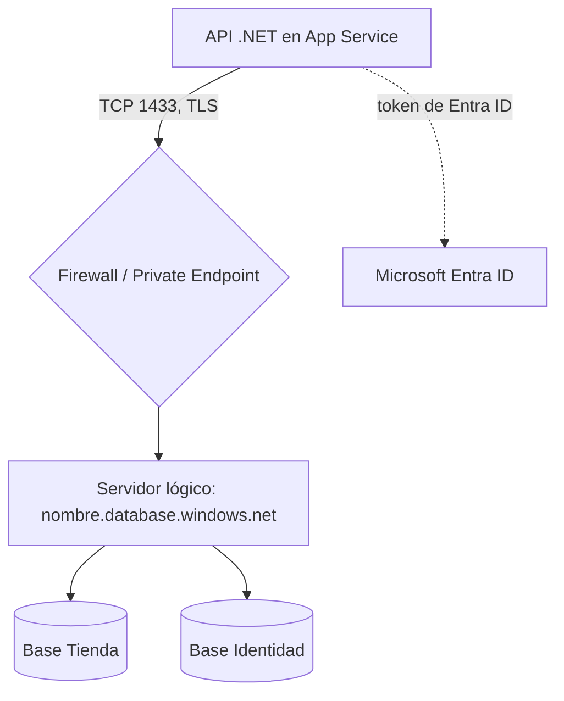

# Azure SQL - diferencias con SQL Server

Parte de: [[06-SQL-Server/05 Administración y avanzado/_Índice Administración y avanzado|Administración y avanzado]]

> [!info] Cómo avanzar
> `progreso`: **pendiente** → **viendo** (estudiando) → **visto** (contestaste la autoevaluación sin abrir las respuestas) → **dominado** (hiciste el laboratorio o lo aplicaste de verdad).

## Contenido

### Qué es
**Azure SQL Database** es SQL Server como servicio (PaaS): Microsoft administra el sistema operativo, los parches, la alta disponibilidad y los backups; tú administras la base, el esquema y las consultas. Comparte el mismo motor que SQL Server, así que el T-SQL de tus procedimientos funciona casi igual, pero cambia el **alcance**: compras una base (o un pool elástico), no un servidor completo. La familia incluye además **Azure SQL Managed Instance** (casi una instancia completa, con Agent y consultas entre bases) y **SQL Server en VM** (IaaS, control total).

### Cómo funciona

Diferencias que impactan al desarrollador:

- **Servidor lógico**: es solo un punto de conexión y frontera de seguridad; las bases no comparten `tempdb` ni puedes hacer `USE OtraBase` ni consultas con nombre de tres partes entre bases. No hay **SQL Server Agent** (usa Elastic Jobs, Azure Functions o Logic Apps), ni linked servers, ni acceso al sistema de archivos (`BULK INSERT` lee de Blob Storage).
- **Backups automáticos** con restauración a un punto en el tiempo; no ejecutas `BACKUP DATABASE` a disco. El modelo de recuperación siempre es FULL.
- **Autenticación sin contraseña** con **Microsoft Entra ID**: la app usa una **identidad administrada** y en la base creas `CREATE USER [mi-app] FROM EXTERNAL PROVIDER`. La cadena de conexión lleva `Authentication=Active Directory Default` y `Microsoft.Data.SqlClient` obtiene el token. Así no hay secretos en el repo.
- **Firewall**: por defecto el servidor rechaza todo. Abres reglas por IP (a nivel servidor o base), la opción "Permitir servicios de Azure" o, mejor, un **Private Endpoint** dentro de tu VNet.
- **Fallos transitorios**: el servicio mueve tu base entre nodos por parches o balanceo (reconfiguraciones). La conexión se corta unos segundos y aparecen errores como 40613, 40197 o 40501. Por eso la app necesita **reintentos** con espera exponencial.
- **Límites por nivel**: CPU, IO del log, sesiones y workers dependen del tier (DTU o vCore). Una consulta que en tu laptop vuela puede quedar limitada por IO del log.
- **Funciones nuevas primero**: Azure SQL recibe cambios del motor antes que las versiones en caja; el nivel de compatibilidad sigue siendo tuyo.

### Ejemplo
```csharp
// Program.cs — conexión sin contraseña con identidad administrada
var cs = builder.Configuration.GetConnectionString("Tienda");
// "Server=tcp:itzamna-sql.database.windows.net,1433;Database=Tienda;
//  Authentication=Active Directory Default;Encrypt=True;"
builder.Services.AddScoped<IDbConnection>(_ => new SqlConnection(cs));
```
```sql
-- En la base, con un administrador de Entra ID
CREATE USER [app-dionisio] FROM EXTERNAL PROVIDER;
ALTER ROLE rol_app ADD MEMBER [app-dionisio];
```
Localmente `DefaultAzureCredential` usa tu sesión de Visual Studio o `az login`; en Azure usa la identidad administrada del App Service.

### Cuándo usarlo y cuándo no
- **Azure SQL Database**: apps nuevas, una base por servicio, pocas dependencias de instancia. Es el destino natural de Itzamna.Dionisio.
- **Managed Instance**: migrar un sistema heredado que usa Agent, CLR, Service Broker o consultas entre bases.
- **SQL Server en VM**: necesitas acceso al SO, versiones específicas o software de terceros instalado en el servidor.
- Para cargas intermitentes revisa [[Azure SQL serverless (auto-pausa y reintentos)]].

### Errores comunes
1. **Abrir el firewall a 0.0.0.0–255.255.255.255** "para probar". Usa tu IP o Private Endpoint.
2. **Contraseña de `sa`-equivalente en appsettings.** Usa identidad administrada; si no se puede, Key Vault.
3. **Sin reintentos.** Las reconfiguraciones son normales; sin reintentos verás errores 500 esporádicos.
4. **Scripts con `USE` o nombres de tres partes.** Fallan en Azure SQL Database; parametriza la base en la cadena de conexión.
5. **Elegir el tier por almacenamiento y no por IO de log.** Mide con `sys.dm_db_resource_stats` antes de decidir.

### Para profundizar
- [Diferencias de T-SQL entre SQL Server y Azure SQL Database](https://learn.microsoft.com/azure/azure-sql/database/transact-sql-tsql-differences-sql-server)
- [Autenticación con Microsoft Entra en Azure SQL](https://learn.microsoft.com/azure/azure-sql/database/authentication-aad-overview)
- [Solucionar errores transitorios de conexión](https://learn.microsoft.com/azure/azure-sql/database/troubleshoot-common-connectivity-issues)

## Autoevaluación

Contesta primero en voz alta o en papel; luego despliega la respuesta.

> [!question]- ¿Qué diferencias principales hay entre Azure SQL Database y un SQL Server instalado?
> Azure SQL Database es una base administrada: parches, alta disponibilidad y backups automáticos; RCSI activado por defecto; sin SQL Agent (usa Elastic Jobs), sin consultas entre bases con nombres de tres partes, sin linked servers, sin `BACKUP DATABASE` ni CLR. Azure SQL Managed Instance está más cerca de un SQL Server completo.

> [!question]- ¿Cómo se autentican las apps en Azure SQL sin contraseña?
> Con Microsoft Entra ID e identidad administrada: `CREATE USER [mi-app-service] FROM EXTERNAL PROVIDER;` y en la cadena `Authentication=Active Directory Managed Identity` (o `Active Directory Default`).

> [!question]- ¿Por qué tu app necesita lógica de reintentos con Azure SQL?
> Por errores **transitorios** (reconfiguraciones, failover, base serverless despertando): 40613, 40197, 40501, 49918, entre otros. SqlClient tiene reintento de conexión (`ConnectRetryCount`) y EF Core `EnableRetryOnFailure`; con Dapper usa Polly o la lógica de reintentos configurable de `Microsoft.Data.SqlClient`.

> [!question]- ¿Qué es el firewall de Azure SQL?
> Reglas a nivel servidor o base que permiten IPs específicas; por defecto todo está bloqueado. Para servicios de Azure se recomiendan *private endpoints* o la opción de permitir servicios de Azure con cuidado.

