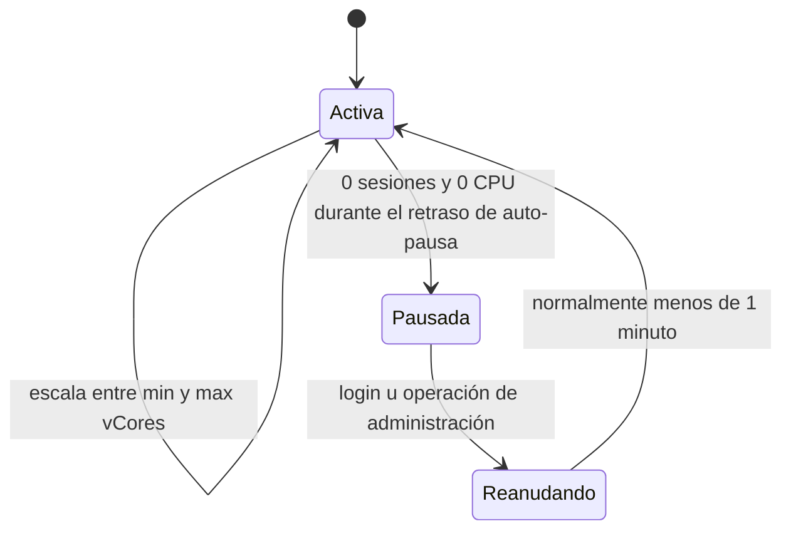

# Azure SQL serverless (auto-pausa y reintentos)

Parte de: [[06-SQL-Server/05 Administración y avanzado/_Índice Administración y avanzado|Administración y avanzado]]

> [!info] Cómo avanzar
> `progreso`: **pendiente** → **viendo** (estudiando) → **visto** (contestaste la autoevaluación sin abrir las respuestas) → **dominado** (hiciste el laboratorio o lo aplicaste de verdad).

## Contenido

### Qué es
**Serverless** es un nivel de cómputo de Azure SQL Database (modelo vCore) en el que defines un **mínimo y un máximo de vCores** y Azure escala automáticamente según la carga, cobrando el cómputo **por segundo**. Además puede **pausarse sola** cuando no hay actividad: mientras está pausada solo pagas almacenamiento. Es ideal para ambientes de desarrollo, QA o apps con uso intermitente, como un portafolio o un sistema interno que se usa en horario de oficina.

### Cómo funciona

- **Retraso de auto-pausa**: en General Purpose va de 15 minutos a 7 días (10,080 min), con 60 min por defecto; `-1` desactiva la pausa. En Hyperscale la auto-pausa está en vista previa y su mínimo es 60 minutos.
- **Reanudación**: el primer intento de conexión a una base pausada **falla** con el error **40613** ("database ... is not currently available"); esa misma conexión dispara la reanudación en segundo plano. Unos segundos después, el reintento entra. Muchas operaciones de administración también la despiertan (ver auditoría, máscaras, Query Store, exportar BACPAC, cambiar etiquetas).
- **Qué impide la pausa**: geo-replicación activa o failover groups, retención de largo plazo (LTR), un alias DNS en el servidor, ser la base de sincronización de SQL Data Sync o la base de trabajos de Elastic Jobs. También cualquier sesión abierta: un pool de conexiones vivo, un health check cada minuto o una herramienta de monitoreo la mantienen despierta.
- **Memoria**: tras escalar hacia abajo se recupera caché, por lo que la primera consulta después de la reanudación es más lenta (caché fría).

### Ejemplo
Reintentos con Dapper usando Polly (paquete `Polly.Core`) solo para errores transitorios:
```csharp
using Microsoft.Data.SqlClient;
using Polly;
using Polly.Retry;

public static class SqlResiliencia
{
    // Errores transitorios típicos de Azure SQL (40613 = base no disponible/reanudando)
    private static readonly HashSet<int> Transitorios = [40613, 40197, 40501, 49918, 49919, 49920, 4060, 4221];

    public static readonly ResiliencePipeline Pipeline = new ResiliencePipelineBuilder()
        .AddRetry(new RetryStrategyOptions
        {
            ShouldHandle = new PredicateBuilder().Handle<SqlException>(e =>
                e.Errors.Cast<SqlError>().Any(x => Transitorios.Contains(x.Number))),
            MaxRetryAttempts = 5,
            BackoffType = DelayBackoffType.Exponential,
            UseJitter = true,
            Delay = TimeSpan.FromSeconds(2)
        })
        .Build();
}

// En el handler del slice
var productos = await SqlResiliencia.Pipeline.ExecuteAsync(async ct =>
{
    await using var cn = new SqlConnection(_cs);
    return await cn.QueryAsync<ProductoDto>(
        new CommandDefinition(_sql.ListarProductos, cancellationToken: ct));
}, cancellationToken);
```
Abrir la conexión **dentro** del delegado es clave: cada reintento usa una conexión nueva. Como alternativa, `Microsoft.Data.SqlClient` tiene reintentos de conexión integrados con `ConnectRetryCount` y `ConnectRetryInterval` en la cadena; sirven para el `Open`, pero no reintentan comandos.

Solo reintenta **lecturas** u operaciones idempotentes; para escrituras usa una clave de idempotencia o transacciones que puedas repetir sin duplicar.

### Cuándo usarlo y cuándo no
- **Sí**: desarrollo y QA, demos, apps internas con horas muertas, cargas impredecibles con picos cortos.
- **No**: APIs públicas que exigen latencia estable 24/7 (la primera petición tras una pausa espera), bases con geo-replicación, o cargas constantes donde el aprovisionado sale más barato.
- Si no quieres pausa pero sí autoescala, configura `-1` en el retraso.
- Las diferencias generales están en [[Azure SQL - diferencias con SQL Server]].

### Errores comunes
1. **Health check que hace `SELECT 1` cada minuto.** La base nunca se pausa y pagas cómputo todo el día. Haz que el health check no toque la base o que lo haga con poca frecuencia.
2. **Reintentar cualquier excepción.** Un error de sintaxis o de permisos no mejora con reintentos; filtra por número de error.
3. **Timeout de conexión corto.** La reanudación puede tardar; usa `Connect Timeout=30` o más y reintentos.
4. **Pensar que el mínimo de vCores es gratis.** Mientras está activa cobras al menos el mínimo (y la memoria mínima), aunque no haya consultas.
5. **No avisar al front.** Muestra un estado "despertando" en Itzamna.Clio en lugar de un error genérico.

### Para profundizar
- [Nivel de cómputo serverless de Azure SQL Database](https://learn.microsoft.com/azure/azure-sql/database/serverless-tier-overview)
- [Auto-pausa y reanudación en serverless](https://learn.microsoft.com/azure/azure-sql/database/serverless-tier-auto-pause-resume)
- [Estrategias de reintento de Polly](https://www.pollydocs.org/strategies/retry.html)

## Autoevaluación

Contesta primero en voz alta o en papel; luego despliega la respuesta.

> [!question]- ¿Cómo funciona el nivel serverless de Azure SQL Database?
> Escala el cómputo automáticamente entre un mínimo y un máximo de vCores y cobra por vCore-segundo usado. Tras un periodo sin conexiones (el *auto-pause delay* que configuras) se pausa y solo cobra almacenamiento; la siguiente conexión la reanuda.

> [!question]- ¿Qué ve la aplicación cuando la base está pausada?
> La primera conexión falla con un error transitorio (típicamente 40613, «Database ... is not currently available») mientras la base se reanuda, que puede tardar de segundos a alrededor de un minuto. Con reintentos y un `Connect Timeout` amplio, el usuario solo nota una espera.

> [!question]- ¿Qué impide que la base se pause?
> Cualquier conexión o sesión activa: health checks que consultan la base, jobs, herramientas de monitoreo, una conexión abierta en SSMS. Algunas funciones también impiden la auto-pausa (p. ej. geo-replicación; Pendiente de confirmar la lista actual en la documentación).

> [!question]- ¿Cómo implementas reintentos con Dapper?
> ```csharp
> var retry = Policy
>     .Handle<SqlException>(ex => ex.Number is 40613 or 40197 or 40501 or 49918 or 4060)
>     .WaitAndRetryAsync(5, n => TimeSpan.FromSeconds(Math.Pow(2, n)));
> var datos = await retry.ExecuteAsync(() => cn.QueryAsync<Dto>(sql, p));
> ```
> Solo reintenta operaciones idempotentes o transacciones completas; un `INSERT` que falló a media respuesta podría haberse aplicado.

