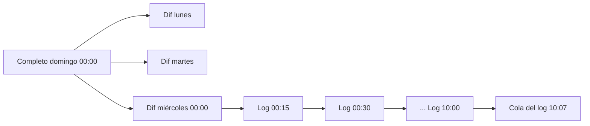

# Backup completo, diferencial y de log

Parte de: [[Backup y restore]]

> [!info] Cómo avanzar
> `progreso`: **pendiente** → **viendo** (estudiando) → **visto** (contestaste la autoevaluación sin abrir las respuestas) → **dominado** (hiciste el laboratorio o lo aplicaste de verdad).

## Contenido

### Qué es
SQL Server tiene tres tipos principales de backup que se combinan en una estrategia:

- **Completo (FULL)**: copia todas las páginas usadas de la base más la porción del log necesaria para que la copia sea consistente. Es el punto de partida de cualquier restauración.
- **Diferencial**: copia solo las *extensiones* que cambiaron desde el **último completo** (no desde el último diferencial). Crece a lo largo de la semana hasta el siguiente completo.
- **De log (transaction log)**: copia los registros del log desde el último backup de log y permite **truncar** el log. Solo existe en modelos FULL o BULK_LOGGED y es lo que habilita restaurar a un minuto exacto.

### Cómo funciona

Cada diferencial depende solo del completo; los logs dependen del anterior.
- El **diferencial** usa un mapa de bits (DCM) que marca las extensiones cambiadas; por eso es rápido de calcular.
- Los **logs** forman una **cadena** continua identificada por LSN. Si falta uno, no puedes pasar de ahí.
- Restaurar = último completo + **el diferencial más reciente** (solo uno) + **todos** los logs posteriores en orden, con `NORECOVERY` hasta el último, que va con `RECOVERY`.
- **`COPY_ONLY`**: un backup fuera de la secuencia. Un completo `COPY_ONLY` **no reinicia la base diferencial**, así que no rompe los diferenciales del plan; un log `COPY_ONLY` no trunca el log ni altera la cadena. Úsalo para sacar una copia para desarrollo o antes de una migración sin interferir con el plan de producción.

### Ejemplo
```sql
-- Completo (domingo)
BACKUP DATABASE Tienda TO DISK = N'D:\Backups\Tienda_full_20261108.bak'
  WITH COMPRESSION, CHECKSUM, STATS = 10;

-- Diferencial (diario)
BACKUP DATABASE Tienda TO DISK = N'D:\Backups\Tienda_diff_20261111.bak'
  WITH DIFFERENTIAL, COMPRESSION, CHECKSUM;

-- Log (cada 15 minutos)
BACKUP LOG Tienda TO DISK = N'D:\Backups\Tienda_log_20261111_1000.trn'
  WITH COMPRESSION, CHECKSUM;

-- Copia para el equipo de desarrollo sin afectar la cadena
BACKUP DATABASE Tienda TO DISK = N'D:\Backups\Tienda_copia_dev.bak'
  WITH COPY_ONLY, COMPRESSION;

-- Verificar que el archivo es legible
RESTORE VERIFYONLY FROM DISK = N'D:\Backups\Tienda_full_20261108.bak' WITH CHECKSUM;
```
Caso práctico: completo el domingo, diferenciales diarios a las 00:00 y log cada 15 minutos. Si el servidor falla el miércoles a las 10:07, restauras el completo del domingo, el diferencial del miércoles 00:00 y luego todos los logs del miércoles desde las 00:15 hasta el de 10:00. Si el disco del log sigue vivo, intenta un **backup de la cola del log** (`BACKUP LOG ... WITH NO_TRUNCATE`) para recuperar también de 10:00 a 10:07. Los diferenciales del lunes y martes no se usan.

### Cuándo usarlo y cuándo no
- **Completo** siempre, al menos semanal.
- **Diferencial** cuando la base es grande y el completo diario es caro; reduce la cantidad de logs a aplicar.
- **Log** en cualquier base con modelo FULL que no tolere perder horas de datos. La frecuencia define tu RPO (cuánto puedes perder).
- En Azure SQL Database no los ejecutas tú: el servicio los hace automáticamente (ver [[Backup y restore]]).
- Para entender qué modelo permite logs, revisa [[Modelos de recuperación]].

### Errores comunes
1. **Romper la cadena con un completo "rápido"** sin `COPY_ONLY`: los diferenciales siguientes dependen de ese archivo que quizá borraste.
2. **Guardar los backups en el mismo disco que la base.** Si muere el disco, mueren ambos. Copia a otro almacenamiento (por ejemplo, `BACKUP ... TO URL` en Azure Blob).
3. **No usar `CHECKSUM`.** Sin él, una página corrupta se copia sin aviso.
4. **Aplicar diferenciales en cadena.** Solo se aplica el más reciente.
5. **No probar la restauración.** Un `.bak` que nunca restauraste es una suposición.

### Para profundizar
- [BACKUP (Transact-SQL)](https://learn.microsoft.com/sql/t-sql/statements/backup-transact-sql)
- [Backups diferenciales](https://learn.microsoft.com/sql/relational-databases/backup-restore/differential-backups-sql-server)
- [Backups de solo copia](https://learn.microsoft.com/sql/relational-databases/backup-restore/copy-only-backups-sql-server)

## Autoevaluación

Contesta primero en voz alta o en papel; luego despliega la respuesta.

> [!question]- Escribe los comandos de un backup completo, uno diferencial y uno de log.
> ```sql
> BACKUP DATABASE Tienda TO DISK = N'C:\Backups\Tienda_full.bak'  WITH CHECKSUM, INIT;
> BACKUP DATABASE Tienda TO DISK = N'C:\Backups\Tienda_diff.bak'  WITH DIFFERENTIAL, CHECKSUM, INIT;
> BACKUP LOG      Tienda TO DISK = N'C:\Backups\Tienda_log1.trn' WITH CHECKSUM, INIT;
> ```

> [!question]- ¿Qué es un backup `COPY_ONLY` y cuándo lo usas?
> Un backup que no altera la secuencia de backups (no se vuelve la base de los diferenciales ni corta la cadena de logs). Úsalo para copias puntuales (llevar la base a desarrollo) sin romper el plan de respaldo.

> [!question]- Tienes completo del domingo, diferenciales diarios y logs cada 15 min. Falla el miércoles a las 10:07. ¿Qué restauras?
> El completo del domingo `WITH NORECOVERY`, el diferencial más reciente (martes o miércoles) `WITH NORECOVERY`, todos los logs posteriores a ese diferencial en orden `WITH NORECOVERY`, y por último `RESTORE DATABASE Tienda WITH RECOVERY`. Si puedes respaldar el *tail-log* tras la falla, pierdes casi nada.

