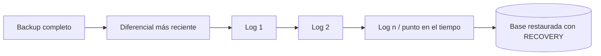

# Backup y restore

Parte de: [[06-SQL-Server/05 Administración y avanzado/_Índice Administración y avanzado|Administración y avanzado]]

> [!info] Cómo avanzar
> `progreso`: **pendiente** → **viendo** (estudiando) → **visto** (contestaste la autoevaluación sin abrir las respuestas) → **dominado** (hiciste el laboratorio o lo aplicaste de verdad).

## Contenido

### Qué es
**Backup y restore** es el conjunto de prácticas para poder recuperar una base después de un fallo de hardware, un error humano (el clásico `DELETE` sin `WHERE`), corrupción o ransomware. Un backup es una copia consistente de la base en un momento; un restore es reconstruir la base a partir de esas copias. La estrategia se diseña con dos números de negocio: **RPO** (cuántos datos puedes perder, p. ej. 15 minutos) y **RTO** (cuánto tiempo puedes estar caído, p. ej. 1 hora).

### Cómo funciona

Los subtemas profundizan cada parte:

- [[Backup completo, diferencial y de log]]: los tres tipos, cómo se encadenan y `COPY_ONLY`.
- [[Restauración a un punto en el tiempo]]: cómo usar los logs para volver al minuto anterior a un error.

Qué tipos puedes usar depende del [[Modelos de recuperación|modelo de recuperación]]: en SIMPLE solo hay completos y diferenciales; en FULL hay además backups de log.

**Un backup que nunca restauraste no es un backup**, es una esperanza. Los archivos pueden estar corruptos, la cadena de logs incompleta, faltar el certificado de TDE o la restauración tardar más que tu RTO. La única prueba real es restaurar periódicamente en otro servidor, correr `DBCC CHECKDB` y medir el tiempo.

**En Azure SQL Database** no ejecutas `BACKUP`: el servicio hace completos semanales, diferenciales cada 12 o 24 horas y logs aproximadamente cada 10 minutos. La **restauración a un punto en el tiempo (PITR)** se conserva 7 días por defecto, configurable de 1 a 35 (1 a 7 en Basic), y la **retención de largo plazo (LTR)** guarda completos hasta 10 años si la activas. La restauración siempre crea **una base nueva** en el mismo servidor; luego renombras o copias los datos. La redundancia del almacenamiento de backup puede ser LRS, ZRS, GRS o GZRS; con LRS o ZRS pierdes la geo-restauración.

### Ejemplo
Estrategia para la base de Itzamna.Dionisio en un SQL Server local de QA con RPO de 15 min:

| Tipo | Frecuencia | Retención |
|---|---|---|
| Completo | Domingo 01:00 | 4 semanas |
| Diferencial | Diario 01:00 | 1 semana |
| Log | Cada 15 min | 1 semana |
| Prueba de restore | Mensual en otra instancia | Bitácora con tiempos |

```sql
-- Prueba mensual: restaurar con otro nombre y validar
RESTORE DATABASE Tienda_Prueba
  FROM DISK = N'D:\Backups\Tienda_full_20261108.bak'
  WITH MOVE N'Tienda' TO N'E:\Data\Tienda_Prueba.mdf',
       MOVE N'Tienda_log' TO N'E:\Log\Tienda_Prueba.ldf',
       RECOVERY, STATS = 10;
DBCC CHECKDB (Tienda_Prueba) WITH NO_INFOMSGS;

-- ¿Cuándo fue el último backup de cada tipo?
SELECT database_name, type, MAX(backup_finish_date) AS ultimo
FROM msdb.dbo.backupset GROUP BY database_name, type;
```
En Azure lo equivalente es `az sql db restore --dest-name Tienda_Prueba --time "2026-11-09T09:58:00Z" ...` o desde el portal.

### Cuándo usarlo y cuándo no
- Toda base con datos que importan necesita backups; la discusión es frecuencia y retención.
- Los backups **no sustituyen** alta disponibilidad (Always On, réplicas): protegen contra pérdida de datos, no evitan la caída.
- Para errores lógicos recientes, una [[Tablas temporales del sistema (temporal tables)|tabla temporal]] o el borrado lógico pueden ser más rápidos que restaurar.

### Errores comunes
1. **Backups en el mismo servidor.** Cópialos fuera (otro disco, Blob Storage con inmutabilidad) para sobrevivir a ransomware.
2. **Olvidar el certificado de TDE.** Sin él, el `.bak` de una base cifrada no se puede restaurar en otro servidor.
3. **Nunca medir el RTO.** Restaurar 500 GB puede tardar horas; descúbrelo antes del incidente.
4. **Confiar en que Azure "lo hace todo".** Configura la retención PITR que necesitas y activa LTR si la normativa pide años.

### Para profundizar
- [Información general de backup y restore (SQL Server)](https://learn.microsoft.com/sql/relational-databases/backup-restore/back-up-and-restore-of-sql-server-databases)
- [Backups automáticos en Azure SQL Database](https://learn.microsoft.com/azure/azure-sql/database/automated-backups-overview)
- [Restaurar una base de Azure SQL a un punto en el tiempo](https://learn.microsoft.com/azure/azure-sql/database/recovery-using-backups)

## Subtemas

- [[Backup completo, diferencial y de log]]
- [[Restauración a un punto en el tiempo]]

## Autoevaluación

Contesta primero en voz alta o en papel; luego despliega la respuesta.

> [!question]- ¿Qué tipos de backup hay en SQL Server?
> Completo, diferencial (cambios desde el último completo) y de log (el log desde el último backup de log; solo en modelos FULL/BULK_LOGGED). Detalle en [[Backup completo, diferencial y de log]].

> [!question]- ¿Un backup que nunca restauraste es un backup?
> No sabes si sirve. Prueba restauraciones periódicas en otro servidor, usa `WITH CHECKSUM` y `RESTORE VERIFYONLY` como verificación mínima, y mide cuánto tardas en restaurar (RTO).

> [!question]- ¿Cómo funcionan los backups en Azure SQL Database?
> Son automáticos (completos, diferenciales y de log) y permiten restaurar a un punto en el tiempo dentro del periodo de retención configurado (de 1 a 35 días; Pendiente de confirmar el valor por defecto de tu nivel). No puedes ejecutar `BACKUP DATABASE`; para una copia portable se exporta un `.bacpac`.

## Progreso de los subtemas

```base
filters:
  and:
    - file.inFolder("06-SQL-Server/05 Administración y avanzado/Backup y restore")
    - file.name != "Backup y restore"
views:
  - type: table
    name: Progreso
    order:
      - file.name
      - progreso
      - nivel
```
