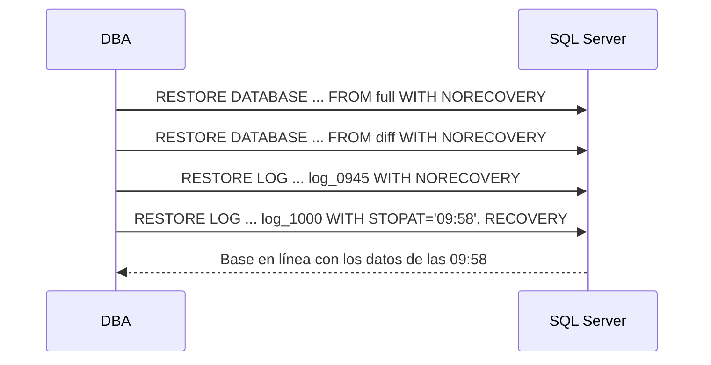

# Restauración a un punto en el tiempo

Parte de: [[Backup y restore]]

> [!info] Cómo avanzar
> `progreso`: **pendiente** → **viendo** (estudiando) → **visto** (contestaste la autoevaluación sin abrir las respuestas) → **dominado** (hiciste el laboratorio o lo aplicaste de verdad).

## Contenido

### Qué es
La **restauración a un punto en el tiempo** (*point-in-time restore*, PITR) reconstruye la base exactamente como estaba en un instante dado, por ejemplo a las 09:58, un minuto antes de que alguien ejecutara un `DELETE` sin `WHERE` a las 09:59. Es posible porque el **log de transacciones** registra cada cambio en orden; al reaplicarlo puedes detenerte en una hora concreta o en una marca.

### Cómo funciona
Requisitos:

1. La base debe estar en **modelo FULL** (o BULK_LOGGED sin operaciones mínimamente registradas en el intervalo) durante todo el periodo.
2. Un **backup completo** anterior al momento deseado.
3. Opcionalmente el **diferencial** más reciente posterior a ese completo y anterior al momento.
4. La **cadena de logs completa** desde ahí hasta un log que contenga el instante (o un backup de la cola del log).


`NORECOVERY` deja la base en estado "Restoring" para aceptar más archivos; `RECOVERY` hace el rollback de lo no confirmado y la pone en línea. `STOPAT` detiene la reaplicación en la hora indicada; también existen `STOPATMARK` (para transacciones marcadas con `BEGIN TRAN ... WITH MARK`) y `STANDBY`, que deja la base de solo lectura entre logs para inspeccionar.

### Ejemplo
Restaurar en una base nueva, `Tienda_0958`, para no tocar la original:
```sql
RESTORE DATABASE Tienda_0958 FROM DISK = N'D:\Backups\Tienda_full_20261108.bak'
  WITH MOVE N'Tienda' TO N'E:\Data\Tienda_0958.mdf',
       MOVE N'Tienda_log' TO N'E:\Log\Tienda_0958.ldf',
       NORECOVERY;
RESTORE DATABASE Tienda_0958 FROM DISK = N'D:\Backups\Tienda_diff_20261111.bak' WITH NORECOVERY;
RESTORE LOG Tienda_0958 FROM DISK = N'D:\Backups\Tienda_log_20261111_0945.trn' WITH NORECOVERY;
RESTORE LOG Tienda_0958 FROM DISK = N'D:\Backups\Tienda_log_20261111_1000.trn'
  WITH STOPAT = N'2026-11-11T09:58:00', RECOVERY;

-- Recuperar solo las filas borradas hacia producción
INSERT INTO Tienda.dbo.Pedidos (PedidoId, ClienteId, Total, CreadoEn)
SELECT r.PedidoId, r.ClienteId, r.Total, r.CreadoEn
FROM Tienda_0958.dbo.Pedidos AS r
WHERE NOT EXISTS (SELECT 1 FROM Tienda.dbo.Pedidos AS p WHERE p.PedidoId = r.PedidoId);
```
Si la tabla tiene `IDENTITY`, envuelve el `INSERT` con `SET IDENTITY_INSERT dbo.Pedidos ON/OFF`.

En Azure SQL Database se hace igual de forma conceptual pero administrada: eliges la hora en el portal o con `az sql db restore --time` y el servicio crea una base nueva dentro de la ventana de retención (7 días por defecto, hasta 35).

**Por qué en una base aparte**: restaurar encima de producción pierde todo lo que pasó **después** de las 09:58 (pedidos legítimos de 10:00 a 10:30). En una base aparte comparas, extraes solo lo dañado y la operación sigue viva. Además, si te equivocas de hora, puedes repetir sin consecuencias.

### Cuándo usarlo y cuándo no
- **Sí**: errores lógicos (borrados, updates masivos equivocados, un despliegue que dañó datos).
- **No** como primera opción si hay alternativas más finas: [[Tablas temporales del sistema (temporal tables)]] o un borrado lógico recuperan filas sin restaurar nada.
- Si el problema es el servidor completo, restauras al último momento disponible (con la cola del log), no a un punto anterior.
- Los tipos de archivo que intervienen se explican en [[Backup completo, diferencial y de log]].

### Errores comunes
1. **Zona horaria.** `STOPAT` usa la hora del servidor; en Azure, la hora es UTC. Verifica la hora real del incidente en la bitácora.
2. **Base en SIMPLE.** No hay logs que aplicar; solo puedes volver al último completo o diferencial.
3. **Un log faltante.** La cadena se rompe; revisa `msdb.dbo.backupset` (`first_lsn`, `last_lsn`) antes de empezar.
4. **Olvidar `NORECOVERY`** en un paso intermedio: la base queda en línea y ya no acepta más logs; hay que empezar de nuevo.
5. **Sobrescribir producción con `REPLACE`** por prisa.

### Para profundizar
- [Restaurar a un punto en el tiempo (SQL Server)](https://learn.microsoft.com/sql/relational-databases/backup-restore/restore-a-sql-server-database-to-a-point-in-time-full-recovery-model)
- [RESTORE (Transact-SQL)](https://learn.microsoft.com/sql/t-sql/statements/restore-statements-transact-sql)
- [Recuperación con backups en Azure SQL Database](https://learn.microsoft.com/azure/azure-sql/database/recovery-using-backups)

## Autoevaluación

Contesta primero en voz alta o en papel; luego despliega la respuesta.

> [!question]- ¿Qué necesitas para restaurar a un momento exacto (p. ej. 09:58, antes de un `DELETE` erróneo)?
> Modelo FULL con cadena de backups de log intacta desde un backup completo; restaurar completo (y diferencial) con `NORECOVERY` y los logs hasta el que contiene ese momento con `STOPAT`.

> [!question]- Escribe la restauración a las 09:58 en una base nueva para no tocar la original.
> ```sql
> RESTORE DATABASE Tienda_0958 FROM DISK = N'C:\Backups\Tienda_full.bak'
>   WITH MOVE N'Tienda' TO N'C:\Data\Tienda_0958.mdf',
>        MOVE N'Tienda_log' TO N'C:\Data\Tienda_0958.ldf', NORECOVERY;
> RESTORE LOG Tienda_0958 FROM DISK = N'C:\Backups\Tienda_log1.trn'
>   WITH STOPAT = '2025-06-04T09:58:00', RECOVERY;
> ```
> Los nombres lógicos (`Tienda`, `Tienda_log`) se ven con `RESTORE FILELISTONLY`.

> [!question]- ¿Por qué restaurar en una base aparte y no encima de la de producción?
> Para recuperar solo las filas borradas (copiándolas con `INSERT ... SELECT`) sin perder lo que se hizo después del error en la base de producción.

