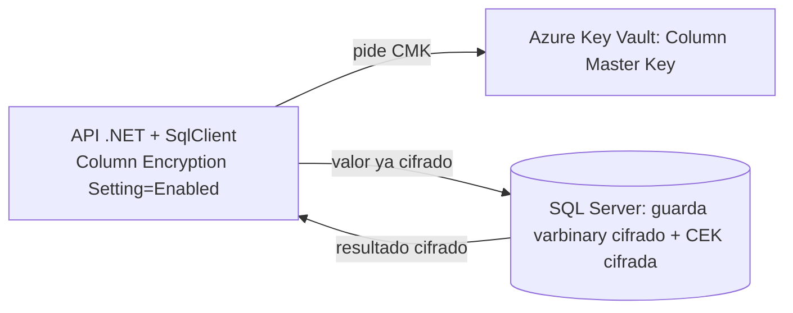

# Cifrado y Always Encrypted

Parte de: [[06-SQL-Server/05 Administración y avanzado/_Índice Administración y avanzado|Administración y avanzado]]

> [!info] Cómo avanzar
> `progreso`: **pendiente** → **viendo** (estudiando) → **visto** (contestaste la autoevaluación sin abrir las respuestas) → **dominado** (hiciste el laboratorio o lo aplicaste de verdad).

## Contenido

### Qué es
SQL Server ofrece varias capas para proteger datos, y cada una defiende contra un atacante distinto:

- **TLS** cifra los datos **en tránsito** entre la app y el servidor (`Encrypt=True` en la cadena de conexión).
- **TDE (Transparent Data Encryption)** cifra los archivos **en reposo**: `.mdf`, `.ldf` y backups. Protege si alguien roba el disco o el `.bak`. Es transparente: cualquier usuario con permisos lee los datos en claro.
- **Always Encrypted** cifra columnas específicas **en el cliente**: el driver cifra antes de enviar y descifra al recibir. El servidor (y el DBA) solo ven bytes cifrados, porque las llaves nunca llegan al motor.
- **Dynamic Data Masking** solo **oculta** valores en los resultados (`XXXX-1234`) a usuarios sin el permiso `UNMASK`. No es cifrado: el dato está en claro en disco y se puede inferir con filtros.

### Cómo funciona

- **TDE**: una *Database Encryption Key* cifra las páginas al escribirlas a disco; esa llave está protegida por un certificado en `master` (o por una llave en Key Vault). En Azure SQL Database TDE viene activado por defecto. Si mueves un backup cifrado a otro servidor necesitas el certificado.
- **Always Encrypted**: hay una **Column Master Key (CMK)** guardada fuera de SQL (Key Vault, almacén de certificados de Windows) y una **Column Encryption Key (CEK)** que el servidor guarda cifrada con la CMK. El driver obtiene la CEK, la descifra con la CMK y cifra/descifra los parámetros.
  - **Determinista**: el mismo texto produce siempre el mismo cifrado. Permite `WHERE Curp = @curp`, joins, `GROUP BY` e índices, pero revela patrones (cuántas filas comparten valor).
  - **Aleatorio**: el mismo texto produce cifrados distintos. Más seguro, pero no permite búsquedas ni comparaciones salvo con **enclaves seguros** (Always Encrypted with secure enclaves), que permiten operaciones dentro de un área protegida del servidor.
  - Las columnas de texto deterministas requieren una intercalación `*_BIN2`.

### Ejemplo
```sql
-- Tabla con columnas cifradas (las llaves se crean antes con SSMS o PowerShell)
CREATE TABLE dbo.Pacientes (
  PacienteId int IDENTITY PRIMARY KEY,
  Nombre nvarchar(100) NOT NULL,
  Curp char(18) COLLATE Latin1_General_BIN2
       ENCRYPTED WITH (COLUMN_ENCRYPTION_KEY = CEK_Datos,
                       ENCRYPTION_TYPE = DETERMINISTIC,
                       ALGORITHM = 'AEAD_AES_256_CBC_HMAC_SHA_256') NOT NULL,
  Diagnostico nvarchar(400)
       ENCRYPTED WITH (COLUMN_ENCRYPTION_KEY = CEK_Datos,
                       ENCRYPTION_TYPE = RANDOMIZED,
                       ALGORITHM = 'AEAD_AES_256_CBC_HMAC_SHA_256') NULL
);
```
```csharp
// Cadena: "...;Column Encryption Setting=Enabled;"
// Registrar el proveedor de Key Vault (paquete Microsoft.Data.SqlClient.AlwaysEncrypted.AzureKeyVaultProvider)
var proveedor = new SqlColumnEncryptionAzureKeyVaultProvider(new DefaultAzureCredential());
SqlConnection.RegisterColumnEncryptionKeyStoreProviders(
    new Dictionary<string, SqlColumnEncryptionKeyStoreProvider>
    { [SqlColumnEncryptionAzureKeyVaultProvider.ProviderName] = proveedor });

// Dapper: el parámetro debe ser tipado para que el driver lo cifre
var p = new DynamicParameters();
p.Add("@curp", curp, DbType.AnsiStringFixedLength, size: 18);
var paciente = await cn.QuerySingleOrDefaultAsync<PacienteDto>(_sql.PacientePorCurp, p);
```

### Cuándo usarlo y cuándo no
- **TDE**: siempre que puedas; costo bajo y cumple requisitos de cifrado en reposo.
- **Always Encrypted**: datos muy sensibles (CURP, datos médicos, números de cuenta) donde ni el DBA ni un atacante con acceso al servidor deban leerlos.
- **No** uses Always Encrypted en columnas que necesitas ordenar, buscar con `LIKE` o agregar; diseña alrededor (busca por hash, cifra solo lo necesario).
- **Masking**: para pantallas de soporte, nunca como control de seguridad principal. Para limitar filas en lugar de columnas, mira [[Row-level security]].

### Errores comunes
1. **Creer que TDE protege de un usuario con `SELECT`.** No: descifra todo al leer.
2. **Parámetros sin tipo con Dapper.** Si mandas un `string` genérico (`nvarchar(4000)`), falla el emparejamiento con la columna cifrada `char(18)`; declara tipo y tamaño.
3. **Literales en el SQL.** `WHERE Curp = 'ABCD...'` no puede cifrarse; siempre parámetros.
4. **Perder la CMK.** Sin ella los datos son irrecuperables; respáldala en Key Vault con protección de purga.
5. **Usar masking como cifrado.** Con `WHERE Salario > 50000` alguien deduce el valor oculto.

### Para profundizar
- [Always Encrypted (Microsoft Learn)](https://learn.microsoft.com/sql/relational-databases/security/encryption/always-encrypted-database-engine)
- [Transparent Data Encryption](https://learn.microsoft.com/sql/relational-databases/security/encryption/transparent-data-encryption)
- [Dynamic Data Masking](https://learn.microsoft.com/sql/relational-databases/security/dynamic-data-masking)

## Autoevaluación

Contesta primero en voz alta o en papel; luego despliega la respuesta.

> [!question]- ¿Qué protege TDE y qué no?
> *Transparent Data Encryption* cifra los archivos de datos, log y backups **en reposo** (si roban el disco o el backup). No protege contra alguien con acceso a la base: las consultas ven los datos en claro. En Azure SQL Database viene activado por defecto en bases nuevas.

> [!question]- ¿Qué tiene de distinto Always Encrypted?
> Cifra columnas **en el cliente**: el driver cifra y descifra con llaves que el motor nunca ve (p. ej. en Key Vault). Ni un DBA puede leer los valores. Se activa en la cadena con `Column Encryption Setting=Enabled`.

> [!question]- ¿Qué diferencia hay entre cifrado determinista y aleatorio en Always Encrypted?
> **Determinista**: el mismo valor cifra igual; permite igualdad, joins e índices, pero revela patrones. **Aleatorio**: más seguro, pero no permite buscar (salvo con *secure enclaves*).

> [!question]- ¿Dynamic Data Masking es cifrado?
> No: solo enmascara lo que **ven** usuarios sin permiso `UNMASK` (`XXXX@correo.com`); el dato está en claro y se puede inferir con consultas. Es una capa de presentación, no de seguridad fuerte.

