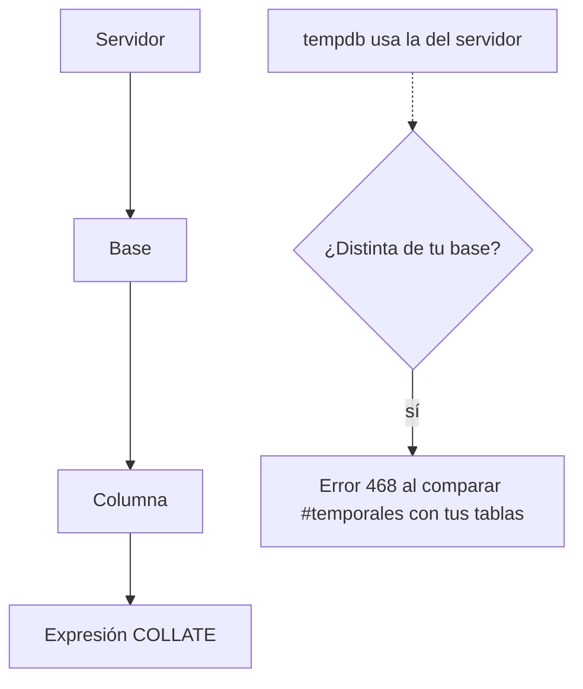

# Collation

Parte de: [[06-SQL-Server/05 Administración y avanzado/_Índice Administración y avanzado|Administración y avanzado]]

> [!info] Cómo avanzar
> `progreso`: **pendiente** → **viendo** (estudiando) → **visto** (contestaste la autoevaluación sin abrir las respuestas) → **dominado** (hiciste el laboratorio o lo aplicaste de verdad).

## Contenido

### Qué es
Una **intercalación** (*collation*) define cómo SQL Server **compara y ordena** texto y qué **página de códigos** usa para `char`/`varchar`. Decide si `'mendez' = 'Méndez'` es verdadero, si la `ñ` va después de la `n` y si `ORDER BY` pone las mayúsculas primero. Su nombre describe sus reglas: `Modern_Spanish_CI_AS` significa reglas del español moderno, **CI** (*case insensitive*: no distingue mayúsculas) y **AS** (*accent sensitive*: sí distingue acentos).

Sufijos frecuentes: `CS`/`CI` (mayúsculas), `AS`/`AI` (acentos), `KS` (kana), `WS` (ancho), `_SC` (caracteres suplementarios, emojis), `_UTF8` (guardar UTF-8 en `varchar`) y `_BIN2` (comparación binaria por punto de código, la más rápida y estricta).

### Cómo funciona
La intercalación se define en cuatro niveles, y cada uno hereda del anterior si no se especifica:

1. **Servidor (instancia)**: se elige al instalar; la usan `master`, `tempdb` y las bases nuevas por defecto. En Azure SQL Database el servidor lógico no tiene una propia; por defecto las bases usan `SQL_Latin1_General_CP1_CI_AS`.
2. **Base de datos**: `CREATE DATABASE ... COLLATE ...`; aplica a columnas nuevas y a literales.
3. **Columna**: `Nombre nvarchar(100) COLLATE Modern_Spanish_CI_AI`.
4. **Expresión**: `WHERE Nombre COLLATE Latin1_General_CI_AI = @nombre`, solo para esa comparación.



**Error 468** ("Cannot resolve the collation conflict between X and Y in the equal to operation"): ocurre al comparar dos columnas con intercalaciones distintas e implícitas. El caso clásico: tu base es `Modern_Spanish_CI_AS`, el servidor es `SQL_Latin1_General_CP1_CI_AS`, y haces un join entre tu tabla y una tabla temporal `#Tmp` creada en `tempdb`, que hereda la intercalación del servidor. Se resuelve declarando la columna temporal con `COLLATE DATABASE_DEFAULT` o forzando una en la comparación.

### Ejemplo
```sql
-- Ver intercalaciones
SELECT SERVERPROPERTY('Collation') AS Servidor,
       DATABASEPROPERTYEX(DB_NAME(), 'Collation') AS Base;
SELECT name, collation_name FROM sys.columns WHERE object_id = OBJECT_ID('dbo.Clientes');

-- Búsqueda sin importar acentos ni mayúsculas: "mendez" encuentra "Méndez"
DECLARE @apellido nvarchar(60) = N'mendez';
SELECT ClienteId, Apellido
FROM dbo.Clientes
WHERE Apellido COLLATE Latin1_General_CI_AI LIKE @apellido + N'%';

-- Evitar el error 468 con temporales
CREATE TABLE #Codigos (Codigo varchar(20) COLLATE DATABASE_DEFAULT PRIMARY KEY);

-- Columna de búsqueda normalizada e indexable
ALTER TABLE dbo.Clientes ADD ApellidoBusqueda AS (Apellido COLLATE Latin1_General_CI_AI);
CREATE INDEX IX_Clientes_ApellidoBusqueda ON dbo.Clientes (ApellidoBusqueda);
```
Aplicar `COLLATE` sobre la columna en el `WHERE` hace que un índice sobre `Apellido` (con otra intercalación) no se pueda usar con *seek*: es como envolver la columna en una función (ver [[SARGability]]). Por eso la columna calculada indexada es mejor en tablas grandes.

### Cuándo usarlo y cuándo no
- Elige la intercalación de la **base** al crearla y mantenla igual en todos los ambientes (local, QA, Azure). Cambiarla después no cambia las columnas existentes.
- `CI_AI` en columnas de búsqueda de personas o productos en español.
- `BIN2` para códigos, tokens, hashes o columnas cifradas deterministas con [[Cifrado y Always Encrypted|Always Encrypted]]; comparar es más rápido y exacto.
- `_UTF8` si necesitas `varchar` con caracteres internacionales y quieres ahorrar espacio frente a `nvarchar` (ver [[Tipos de datos (varchar vs nvarchar, decimal vs float)]]).

### Errores comunes
1. **Servidor y base con intercalación distinta** sin saberlo: aparecen errores 468 con temporales. Usa `COLLATE DATABASE_DEFAULT`.
2. **Comparar con `COLLATE` en la columna** en consultas calientes: escaneo completo. Usa columnas calculadas indexadas.
3. **Asumir que una clave `UNIQUE` distingue mayúsculas.** En `CI`, `"ABC"` y `"abc"` son duplicados.
4. **Cambiar la intercalación de la base esperando que cambien las columnas.** Hay que alterar cada columna (y reconstruir índices y restricciones que dependan de ella).
5. **Ordenar en la app y en la base con reglas distintas.** La paginación por cursor se desordena; ordena en un solo lugar.

### Para profundizar
- [Intercalación y compatibilidad con Unicode](https://learn.microsoft.com/sql/relational-databases/collations/collation-and-unicode-support)
- [COLLATE (Transact-SQL)](https://learn.microsoft.com/sql/t-sql/statements/collations)
- [Establecer o cambiar la intercalación de la base](https://learn.microsoft.com/sql/relational-databases/collations/set-or-change-the-database-collation)

## Autoevaluación

Contesta primero en voz alta o en papel; luego despliega la respuesta.

> [!question]- ¿Qué define una intercalación (*collation*)?
> Las reglas de comparación y orden de texto: sensibilidad a mayúsculas (`CI`/`CS`), a acentos (`AI`/`AS`), la página de códigos para `varchar` y, en las `_UTF8`, la codificación UTF-8. Ej.: `Modern_Spanish_CI_AS`, `SQL_Latin1_General_CP1_CI_AS`.

> [!question]- ¿En qué niveles se define?
> Servidor (incluye `tempdb` y bases de sistema), base de datos (predeterminado para columnas nuevas), columna y expresión (`COLLATE Latin1_General_CS_AS`).

> [!question]- ¿Qué es el error 468 «Cannot resolve the collation conflict»?
> Comparas columnas con intercalaciones distintas, típico al unir una tabla de tu base con una `#temporal` (que hereda la de `tempdb`). Solución: crear las columnas de la temporal con `COLLATE DATABASE_DEFAULT` o forzar `COLLATE` en la comparación.

> [!question]- ¿Cómo buscas sin importar acentos («Mendez» encuentra «Méndez»)?
> `WHERE Nombre COLLATE Modern_Spanish_CI_AI LIKE N'%mendez%'` (ojo: aplicar `COLLATE` a la columna impide usar su índice). Si es frecuente, crea la columna con una intercalación `_AI` o una columna calculada indexada.

