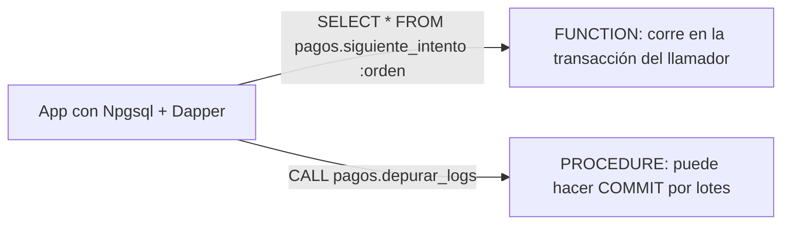

# Funciones y procedimientos en PostgreSQL

Parte de: [[06-SQL-Server/05 Administración y avanzado/_Índice Administración y avanzado|Administración y avanzado]]

> [!info] Cómo avanzar
> `progreso`: **pendiente** → **viendo** (estudiando) → **visto** (contestaste la autoevaluación sin abrir las respuestas) → **dominado** (hiciste el laboratorio o lo aplicaste de verdad).

## Contenido

### Qué es
PostgreSQL tiene dos tipos de rutinas en el servidor:

- **`FUNCTION`**: devuelve un valor, un registro o un conjunto de filas y se invoca **dentro de una consulta** (`SELECT mi_funcion(...)` o `SELECT * FROM mi_funcion(...)`). Se ejecuta dentro de la transacción de quien la llama y **no puede** hacer `COMMIT` ni `ROLLBACK`.
- **`PROCEDURE`** (desde PostgreSQL 11): se invoca con `CALL`, no devuelve un resultado como función (solo parámetros `INOUT`/`OUT`) y **sí puede** controlar transacciones con `COMMIT`/`ROLLBACK` dentro, útil para procesos por lotes.

El lenguaje más común es **PL/pgSQL**, pero también hay funciones en SQL puro (más simples y a veces "inlineables" por el planificador). En Pochteca.Nomisma, que usa Postgres, esto reemplaza lo que en SQL Server harías con [[Stored procedures]].

### Cómo funciona

Diferencias frente a T-SQL que conviene tener presentes:

- Las variables se declaran en un bloque `DECLARE` y el cuerpo va entre `$$ ... $$`.
- Para devolver filas usas `RETURNS TABLE(...)` o `RETURNS SETOF tipo` y `RETURN QUERY`.
- La volatilidad (`IMMUTABLE`, `STABLE`, `VOLATILE`) le dice al planificador si puede cachear o reordenar llamadas; marcar mal una función produce resultados incorrectos.
- Los errores se manejan con `BEGIN ... EXCEPTION WHEN ... THEN ... END`. Cada bloque con `EXCEPTION` crea un *savepoint* implícito, así que tiene costo: úsalo solo donde lo necesitas.
- Los errores se identifican por `SQLSTATE`: `23505` es `unique_violation`, `23503` es `foreign_key_violation`.

### Ejemplo
Función que calcula el siguiente número de intento de pago de una orden y atrapa duplicados:
```sql
CREATE OR REPLACE FUNCTION pagos.registrar_intento(p_orden_id uuid, p_monto_centavos bigint)
RETURNS integer
LANGUAGE plpgsql
AS $$
DECLARE
  v_intento integer;
BEGIN
  SELECT COALESCE(MAX(numero_intento), 0) + 1
    INTO v_intento
    FROM pagos.intentos
   WHERE orden_id = p_orden_id;

  INSERT INTO pagos.intentos (orden_id, numero_intento, monto_centavos, creado_en)
  VALUES (p_orden_id, v_intento, p_monto_centavos, now());

  RETURN v_intento;
EXCEPTION
  WHEN unique_violation THEN   -- SQLSTATE 23505: otra sesión tomó el mismo número
    RAISE EXCEPTION 'Intento duplicado para la orden %', p_orden_id
      USING ERRCODE = '23505', HINT = 'Reintenta la operación';
END;
$$;
```
Con una restricción `UNIQUE (orden_id, numero_intento)` la carrera entre dos sesiones termina en `unique_violation` en lugar de dos intentos con el mismo número.

```csharp
// Dapper + Npgsql: una FUNCTION se llama con SELECT, como texto
const string sql = "SELECT pagos.registrar_intento(@ordenId, @monto)";
var intento = await cn.ExecuteScalarAsync<int>(sql, new { ordenId, monto = montoCentavos });

// Un PROCEDURE se llama con CALL
await cn.ExecuteAsync("CALL pagos.depurar_logs(@dias)", new { dias = 30 });
```
**Error común con Npgsql**: usar `commandType: CommandType.StoredProcedure` para una **función**. Desde Npgsql 7, `StoredProcedure` genera `CALL nombre(...)`, que solo funciona con procedimientos; con una función obtienes un error de que `pagos.registrar_intento` "is not a procedure". Llama las funciones con `SELECT` como `CommandType.Text`.

### Cuándo usarlo y cuándo no
- **Función** para lógica que devuelve datos o se reutiliza en consultas, y para encapsular reglas atómicas como numeración.
- **Procedimiento** para mantenimiento o procesos largos que conviene confirmar por lotes.
- **No** pongas toda la lógica de negocio en PL/pgSQL si tu equipo prueba y despliega en .NET; mantén SQL en archivos `.sql` versionados como haces con SQL Server.
- El panorama general de Postgres está en [[PostgreSQL]].

### Errores comunes
1. **`StoredProcedure` con funciones en Npgsql** (ver arriba).
2. **Marcar `IMMUTABLE` una función que lee tablas.** El planificador puede cachear resultados viejos; usa `STABLE`.
3. **`EXCEPTION WHEN OTHERS` que se traga todo.** Oculta errores reales; atrapa solo lo que sabes manejar.
4. **Esperar `COMMIT` dentro de una función.** No se permite; usa un procedimiento.
5. **Sobrecargas accidentales.** `CREATE OR REPLACE` con otra firma crea una segunda función; borra la vieja con `DROP FUNCTION nombre(tipos)`.

### Para profundizar
- [CREATE FUNCTION (PostgreSQL)](https://www.postgresql.org/docs/current/sql-createfunction.html)
- [CREATE PROCEDURE (PostgreSQL)](https://www.postgresql.org/docs/current/sql-createprocedure.html)
- [PL/pgSQL: control de errores](https://www.postgresql.org/docs/current/plpgsql-control-structures.html#PLPGSQL-ERROR-TRAPPING)

## Autoevaluación

Contesta primero en voz alta o en papel; luego despliega la respuesta.

> [!question]- ¿Qué diferencia hay entre `FUNCTION` y `PROCEDURE` en PostgreSQL?
> Una **función** devuelve un valor o tabla, se llama dentro de un `SELECT` y corre dentro de la transacción del llamador. Un **procedimiento** (PostgreSQL 11+) se llama con `CALL`, no devuelve resultado como función (salvo parámetros `INOUT`) y puede hacer `COMMIT`/`ROLLBACK` dentro.

> [!question]- Escribe una función que devuelva el siguiente número de intento de una orden.
> ```sql
> CREATE OR REPLACE FUNCTION payment.sp_sesion_checkout_siguiente_numero_intento(
>     p_orden_id uuid, p_livemode boolean)
> RETURNS integer
> LANGUAGE sql
> AS $$
>     SELECT COALESCE(MAX(numero_intento), 0) + 1
>     FROM payment.sesiones_checkout
>     WHERE orden_id = p_orden_id AND livemode = p_livemode;
> $$;
> ```
> Se llama con `SELECT payment.sp_...(@OrdenId, @Livemode);` desde Dapper. (Nombres de tabla y columnas de ejemplo.)

> [!question]- ¿Cómo atrapas un duplicado dentro de una función PL/pgSQL?
> ```sql
> BEGIN
>     INSERT INTO payment.webhook_inbox (evento_id, payload) VALUES (p_evento_id, p_payload);
>     RETURN true;
> EXCEPTION WHEN unique_violation THEN
>     RETURN false;
> END;
> ```
> O más simple y sin excepción: `INSERT ... ON CONFLICT (evento_id) DO NOTHING` y revisar `FOUND`/`ROW_COUNT`.

> [!question]- Error común con Npgsql: llamas una **función** con `commandType: CommandType.StoredProcedure`. ¿Qué pasa?
> Desde Npgsql 7, `StoredProcedure` genera `CALL nombre(...)`, que solo sirve para procedimientos; con una función falla. Llama funciones con texto: `SELECT * FROM payment.f(@a, @b)`. Además, `CREATE OR REPLACE FUNCTION` no puede cambiar el tipo de retorno: hay que hacer `DROP FUNCTION` y crearla de nuevo.

