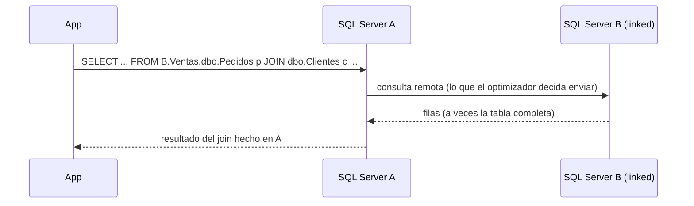

# Linked servers

Parte de: [[06-SQL-Server/05 Administración y avanzado/_Índice Administración y avanzado|Administración y avanzado]]

> [!info] Cómo avanzar
> `progreso`: **pendiente** → **viendo** (estudiando) → **visto** (contestaste la autoevaluación sin abrir las respuestas) → **dominado** (hiciste el laboratorio o lo aplicaste de verdad).

## Contenido

### Qué es
Un **linked server** es una definición dentro de una instancia de SQL Server que le permite conectarse a **otra fuente de datos** (otro SQL Server, Oracle, un archivo de Excel, cualquier proveedor OLE DB u ODBC) y consultarla como si fuera local, con nombres de **cuatro partes**: `servidor.base.esquema.tabla`. Se usaba mucho para integrar sistemas en la misma red sin construir una API.

### Cómo funciona

1. Se crea con `sp_addlinkedserver` (destino y proveedor) y `sp_addlinkedsrvlogin` (cómo se autentica: misma cuenta, cuenta fija o suplantación).
2. Al consultar con cuatro partes, el optimizador de A decide qué parte de la consulta "empujar" al remoto. Con estadísticas remotas limitadas y funciones que no se pueden traducir, muchas veces **trae todas las filas** a A y filtra localmente.
3. Alternativas de sintaxis: `OPENQUERY(B, 'SELECT ...')` envía el texto tal cual al remoto y solo regresa el resultado; `EXEC (...) AT B` ejecuta en el remoto.
4. Las transacciones que modifican datos en ambos lados se vuelven **distribuidas** (MSDTC), más lentas y frágiles.

**Por qué dan problemas de rendimiento**: el optimizador no conoce bien los datos remotos, los joins entre servidores se resuelven moviendo filas por la red, los planes se vuelven impredecibles y la consulta queda acoplada a la disponibilidad del otro servidor. Además suelen configurarse con una cuenta con demasiados permisos, lo que los vuelve un riesgo de seguridad.

### Ejemplo
```sql
-- Definición (en la instancia A)
EXEC sp_addlinkedserver @server = N'VENTAS', @srvproduct = N'',
     @provider = N'MSOLEDBSQL', @datasrc = N'sql-ventas.interno,1433';
EXEC sp_addlinkedsrvlogin @rmtsrvname = N'VENTAS', @useself = N'FALSE',
     @rmtuser = N'lector_ventas', @rmtpassword = N'<desde un almacén seguro>';

-- Peor opción: join con cuatro partes (puede traer toda la tabla remota)
SELECT c.Nombre, p.Total
FROM VENTAS.Ventas.dbo.Pedidos AS p
JOIN dbo.Clientes AS c ON c.ClienteId = p.ClienteId
WHERE p.Fecha >= '2026-11-01';

-- Mejor: filtrar en el remoto con OPENQUERY y luego unir
SELECT c.Nombre, p.Total
FROM OPENQUERY(VENTAS, 'SELECT ClienteId, Total FROM Ventas.dbo.Pedidos WHERE Fecha >= CONVERT(date, ''20261101'', 112)') AS p
JOIN dbo.Clientes AS c ON c.ClienteId = p.ClienteId;
```

### Cuándo usarlo y cuándo no
- **Sí**: tareas administrativas puntuales, migraciones únicas, consultas de soporte o integraciones heredadas que aún no puedes reemplazar.
- **No** en el camino crítico de una API. Si Itzamna.Dionisio necesita datos de otro sistema, consúmelos por una API o por mensajes, o replica los datos con un proceso [[ETL (conceptos)|ETL]] o [[Auditoría (CDC y Change Tracking)|CDC]].
- **Azure SQL Database no tiene linked servers.** Las alternativas son **consultas elásticas** (*elastic query*, tablas externas hacia otras bases de Azure SQL, en vista previa), mover datos con Azure Data Factory o resolver en la aplicación. **Azure SQL Managed Instance** sí los soporta.

### Errores comunes
1. **Login remoto con `sa` o `db_owner`.** Cualquiera con acceso al linked server hereda ese poder; usa una cuenta de solo lectura con permisos mínimos.
2. **Joins grandes entre servidores.** Filtra en el remoto con `OPENQUERY` o copia primero los datos necesarios a una tabla temporal.
3. **Transacciones distribuidas sin necesidad.** Un `INSERT` local con `SELECT` remoto dentro de `BEGIN TRAN` puede escalar a MSDTC.
4. **Dependencias ocultas.** Vistas o procedimientos que usan el linked server fallan cuando el otro servidor cambia de nombre o está caído; documenta y monitorea.

### Para profundizar
- [Linked servers (Microsoft Learn)](https://learn.microsoft.com/sql/relational-databases/linked-servers/linked-servers-database-engine)
- [OPENQUERY (Transact-SQL)](https://learn.microsoft.com/sql/t-sql/functions/openquery-transact-sql)
- [Consultas elásticas en Azure SQL Database](https://learn.microsoft.com/azure/azure-sql/database/elastic-query-overview)

## Autoevaluación

Contesta primero en voz alta o en papel; luego despliega la respuesta.

> [!question]- ¿Qué es un linked server?
> Una conexión configurada desde SQL Server a otro origen (otro SQL Server, Oracle, etc.) para consultarlo con nombres de cuatro partes (`SRV.Base.esquema.Tabla`) o con `OPENQUERY(SRV, 'SELECT ...')`.

> [!question]- ¿Por qué suelen dar problemas de rendimiento?
> Con nombres de cuatro partes, a veces el filtro no se envía al servidor remoto y se traen tablas completas por la red. `OPENQUERY` ejecuta la consulta entera en el remoto. Además, las estadísticas remotas pueden no estar disponibles.

> [!question]- ¿Hay linked servers en Azure SQL Database?
> No (sí en Managed Instance). Las alternativas son *elastic query* o mover la integración a la aplicación o a un proceso ETL.

