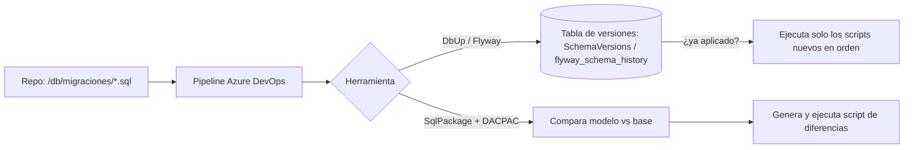

# Migraciones de base de datos (scripts versionados, DACPAC, DbUp y Flyway)

Parte de: [[06-SQL-Server/05 Administración y avanzado/_Índice Administración y avanzado|Administración y avanzado]]

> [!info] Cómo avanzar
> `progreso`: **pendiente** → **viendo** (estudiando) → **visto** (contestaste la autoevaluación sin abrir las respuestas) → **dominado** (hiciste el laboratorio o lo aplicaste de verdad).

## Contenido

### Qué es
Una **migración de base de datos** es un cambio de esquema o de datos (crear tabla, agregar columna, cambiar un procedimiento) que se aplica de forma **controlada, repetible y versionada** en todos los ambientes: local, QA y producción. Existen dos enfoques:

- **Por scripts versionados (*migration-based*)**: escribes scripts en orden (`0001_crear_productos.sql`, `0002_agregar_sku.sql`) y una herramienta como **DbUp** (librería .NET) o **Flyway** (herramienta Java/CLI) aplica los que faltan. Tú decides exactamente qué SQL corre.
- **Por estado (*state-based*)**: describes cómo **debe quedar** el esquema (un proyecto SQL que compila a un **DACPAC**) y **SqlPackage** compara contra la base destino y genera el script de diferencias.

### Cómo funciona

- **DbUp** guarda en la tabla `SchemaVersions` el nombre de cada script ejecutado; al arrancar compara la lista de scripts incrustados o en carpeta contra esa tabla y ejecuta los faltantes, ordenados por nombre.
- **Flyway** usa `flyway_schema_history` con versión, descripción y **checksum**; si alguien edita un script ya aplicado, `validate` falla porque el checksum no coincide.
- **DACPAC**: un proyecto SQL (SDK `Microsoft.Build.Sql`) contiene `CREATE TABLE`, vistas y procedimientos; el build valida referencias y produce el `.dacpac`. En el despliegue, SqlPackage decide los `ALTER`. Si un cambio implicaría perder datos (quitar columna, reducir tamaño), por defecto **se bloquea** (`BlockOnPossibleDataLoss=True`); si alguien lo desactiva, puede borrar datos o reconstruir tablas completas.

**Por qué hacer scripts idempotentes aunque haya tabla de versiones**: la tabla protege del flujo normal, pero hay escenarios fuera de él: un script que falló a medias en un motor sin DDL transaccional completo, un hotfix aplicado a mano en producción, una base restaurada de un backup viejo o un ambiente creado desde otro. Con `IF NOT EXISTS` o `CREATE OR ALTER` el script puede repetirse sin romper (ver [[CREATE OR ALTER y scripts idempotentes]]).

### Ejemplo
Migrador DbUp como app de consola en la solución de Itzamna.Dionisio:
```csharp
// Itzamna.Dionisio.Migraciones/Program.cs
using DbUp;

var cs = Environment.GetEnvironmentVariable("DIONISIO_MIGRACIONES_CS")
         ?? throw new InvalidOperationException("Falta la cadena de conexión");

var motor = DeployChanges.To
    .SqlDatabase(cs)
    .WithScriptsEmbeddedInAssembly(typeof(Program).Assembly,
        nombre => nombre.Contains(".Migraciones.Scripts."))
    .WithTransactionPerScript()
    .LogToConsole()
    .Build();

var resultado = motor.PerformUpgrade();
if (!resultado.Successful)
{
    Console.Error.WriteLine(resultado.Error);
    return 1;   // el pipeline falla
}
return 0;
```
```sql
-- Scripts/0007_agregar_sku_productos.sql
IF COL_LENGTH('catalogo.Productos', 'Sku') IS NULL
    ALTER TABLE catalogo.Productos ADD Sku varchar(30) NULL;
GO
CREATE OR ALTER PROCEDURE catalogo.ProductoPorSku @sku varchar(30) AS
    SELECT ProductoId, Nombre, Precio FROM catalogo.Productos WHERE Sku = @sku;
```
En Azure DevOps, una etapa ejecuta el migrador con una cuenta de migraciones (distinta de la cuenta de la app) **antes** de desplegar la API.

### Cuándo usarlo y cuándo no
- **Scripts versionados**: equipos que quieren control total del SQL, cambios de datos, migraciones sin caídas. Encaja con tu regla de SQL en archivos.
- **DACPAC**: bases con muchos objetos donde quieres validación en compilación y detección de *drift*; revisa siempre el script generado (`SqlPackage /Action:Script`).
- Combinarlos es posible: DACPAC para objetos programables y scripts para cambios de datos.
- Para cambios sin interrumpir el servicio, aplica [[Migraciones sin caídas (expand y contract)]].

### Errores comunes
1. **Editar un script ya aplicado.** DbUp no lo vuelve a correr y Flyway falla por checksum; crea uno nuevo.
2. **Desactivar `BlockOnPossibleDataLoss`** para que "pase el pipeline". Puede borrar una columna con datos.
3. **Migrar con la cuenta de la app.** La app necesitaría `ALTER`; separa cuentas (ver [[Roles y permisos]]).
4. **Nombres que no ordenan bien** (`1_`, `10_`, `2_`). Usa prefijos con ceros o fecha.
5. **Scripts no idempotentes con `GO` y transacciones mezcladas.** Prueba cada script dos veces en local.

### Para profundizar
- [DbUp: documentación](https://dbup.readthedocs.io/)
- [Flyway: documentación](https://documentation.red-gate.com/flyway)
- [SqlPackage Publish (Microsoft Learn)](https://learn.microsoft.com/sql/tools/sqlpackage/sqlpackage-publish)
- [Proyectos SQL con Microsoft.Build.Sql](https://learn.microsoft.com/sql/tools/sql-database-projects/sql-database-projects)

## Autoevaluación

Contesta primero en voz alta o en papel; luego despliega la respuesta.

> [!question]- ¿Qué diferencia hay entre migraciones por scripts versionados y por estado (DACPAC)?
> **Versionadas** (DbUp, Flyway, EF Migrations): escribes cada cambio como un script numerado (`V1__...`, `V2__...`) que se aplica una vez y se registra en una tabla de historial. **Por estado** (DACPAC/SqlPackage, proyectos SQL): describes cómo debe quedar el esquema y la herramienta calcula el *diff* contra la base destino.

> [!question]- ¿Cómo sabe DbUp o Flyway qué scripts ya se aplicaron?
> Por una tabla de historial en la base: DbUp usa `SchemaVersions` y Flyway `flyway_schema_history` (con checksum de cada script). Por eso **nunca** se edita un script ya aplicado: se crea uno nuevo.

> [!question]- ¿Por qué hacer los scripts además idempotentes si ya hay tabla de versiones?
> Para poder re-ejecutarlos sin daño si una ejecución quedó a medias, si alguien aplicó un cambio a mano o si el mismo script corre en ambientes con historia distinta. `CREATE OR ALTER`, `IF COL_LENGTH(...) IS NULL`, `IF NOT EXISTS (... sys.indexes ...)`.

> [!question]- ¿Qué riesgo tiene un despliegue por DACPAC con datos?
> El *diff* puede decidir recrear una tabla o borrar una columna renombrada (pérdida de datos). Usa `/p:BlockOnPossibleDataLoss=true` (valor por defecto) y revisa el script generado (`/Action:Script`) antes de publicar en producción.

## Práctica

- [[Lab 9 - Script de migración idempotente con tabla de versiones]]

