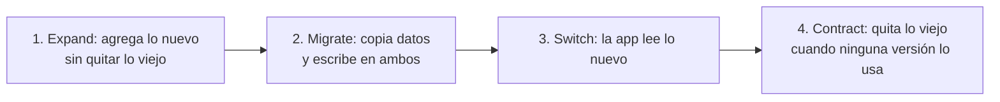

# Migraciones sin caídas (expand y contract)

Parte de: [[06-SQL-Server/05 Administración y avanzado/_Índice Administración y avanzado|Administración y avanzado]]

> [!info] Cómo avanzar
> `progreso`: **pendiente** → **viendo** (estudiando) → **visto** (contestaste la autoevaluación sin abrir las respuestas) → **dominado** (hiciste el laboratorio o lo aplicaste de verdad).

## Contenido

### Qué es
**Expand and contract** (también llamado *parallel change*) es un patrón para cambiar el esquema de una base **sin detener la aplicación**. En lugar de un cambio rompedor de golpe (renombrar una columna y desplegar la app al mismo tiempo), divides el cambio en fases compatibles hacia atrás: primero **expandes** el esquema para que soporte la versión vieja y la nueva de la app, migras datos y tráfico, y al final **contraes** quitando lo viejo. Es imprescindible cuando despliegas con *slots* o *rolling updates*, donde dos versiones de la API corren a la vez contra la misma base.

### Cómo funciona

Cada fase es un despliegue separado y cada uno es reversible hasta el *contract*. La regla: **la base siempre debe aceptar la versión actual y la anterior de la app**.

### Ejemplo
Renombrar `Clientes.Nombre` a `NombreCompleto` sin caída:

```sql
-- Fase 1 (expand): migración 0010
IF COL_LENGTH('dbo.Clientes', 'NombreCompleto') IS NULL
    ALTER TABLE dbo.Clientes ADD NombreCompleto nvarchar(200) NULL;  -- NULL: cambio solo de metadatos
GO
-- Procedimiento compatible: escribe ambas columnas
CREATE OR ALTER PROCEDURE dbo.ClienteActualizar @id int, @nombre nvarchar(200) AS
    UPDATE dbo.Clientes SET Nombre = @nombre, NombreCompleto = @nombre WHERE ClienteId = @id;
GO

-- Fase 2 (migrate): rellenar por lotes para no bloquear la tabla ni llenar el log
WHILE 1 = 1
BEGIN
    UPDATE TOP (5000) dbo.Clientes SET NombreCompleto = Nombre WHERE NombreCompleto IS NULL;
    IF @@ROWCOUNT = 0 BREAK;
END
```
- **Fase 3 (switch)**: despliegas la API que lee `NombreCompleto` (los procedimientos de lectura devuelven la columna nueva).
- **Fase 4 (contract)**, días después y cuando ya no hay versiones viejas: haces la columna `NOT NULL`, actualizas el procedimiento para escribir solo la nueva y eliminas `Nombre` (antes, quita índices o restricciones que la usen).

**Operaciones que suelen bloquear la tabla** y cómo mitigarlas:

| Operación | Riesgo | Mitigación |
|---|---|---|
| Agregar columna `NOT NULL` con `DEFAULT` | En ediciones antiguas reescribía la tabla | Desde SQL Server 2012 Enterprise y en Azure SQL es solo metadatos si el default es constante; si no, agrégala `NULL`, rellena por lotes y luego cambia |
| Cambiar tipo o tamaño de columna | Reescribe la tabla con bloqueo Sch-M | Columna nueva + copia por lotes + cambio de lectura |
| Crear índice | Bloquea escrituras en modo offline | `WITH (ONLINE = ON, RESUMABLE = ON)` en Enterprise o Azure SQL |
| Agregar `FOREIGN KEY` o `CHECK` | Valida todas las filas con bloqueo | `WITH NOCHECK` y luego `ALTER TABLE ... WITH CHECK CHECK CONSTRAINT` en ventana tranquila |
| `UPDATE` masivo | Escalamiento de bloqueos y log enorme | Lotes de miles de filas |

Configura además `SET LOCK_TIMEOUT` o `WAIT_AT_LOW_PRIORITY` en el DDL para que, si no consigue el bloqueo de esquema, se rinda en lugar de formar una fila de bloqueos detrás.

**Por qué un procedimiento almacenado complica el patrón**: la tabla puede tener columnas viejas y nuevas a la vez, pero un procedimiento solo tiene **una definición**. Si cambias `dbo.ClienteObtener` para devolver `NombreCompleto` en lugar de `Nombre`, la versión vieja de la API, que sigue viva durante el despliegue, recibe una columna que no espera y Dapper deja la propiedad vacía. Soluciones: hacer el procedimiento **compatible con ambas versiones** (devolver las dos columnas durante la transición), o crear un **procedimiento versionado** (`dbo.ClienteObtener_v2`) que use la nueva API y borrar el viejo en el *contract*.

### Cuándo usarlo y cuándo no
- **Sí**: APIs con despliegue continuo, slots de App Service, varias instancias o apps móviles que tardan en actualizarse.
- **No hace falta** en una app interna que puedes detener 5 minutos en una ventana acordada; ahí un cambio directo es más simple.
- Necesita disciplina en las migraciones: ver [[Migraciones de base de datos (scripts versionados, DACPAC, DbUp y Flyway)]].

### Errores comunes
1. **Hacer *contract* en el mismo despliegue que *expand*.** La versión vieja falla durante el *rolling update*.
2. **Rellenar millones de filas en un solo `UPDATE`.** Bloquea la tabla y llena el log; usa lotes.
3. **Olvidar los procedimientos y vistas.** El esquema es compatible pero el procedimiento no.
4. **No tener una fecha para el *contract*.** Las columnas duplicadas se quedan para siempre; registra la deuda.
5. **DDL sin timeout de bloqueo.** Un `ALTER` esperando un bloqueo detiene todas las consultas detrás de él.

### Para profundizar
- [Parallel Change (Martin Fowler)](https://martinfowler.com/bliki/ParallelChange.html)
- [ALTER TABLE: operaciones en línea](https://learn.microsoft.com/sql/t-sql/statements/alter-table-transact-sql)
- [Operaciones de índice reanudables](https://learn.microsoft.com/sql/relational-databases/indexes/guidelines-for-online-index-operations)

## Autoevaluación

Contesta primero en voz alta o en papel; luego despliega la respuesta.

> [!question]- ¿Qué es el patrón *expand and contract*?
> Cambiar el esquema en pasos compatibles con la versión vieja y la nueva de la app: **expandir** (agregar lo nuevo sin quitar lo viejo), migrar datos y código, y **contraer** (quitar lo viejo) cuando ya nadie lo usa.

> [!question]- ¿Cómo renombras `Clientes.Nombre` a `NombreCompleto` sin caída?
> 1) Agregar `NombreCompleto` (nullable). 2) Desplegar la app que escribe en ambas y lee la nueva con respaldo a la vieja. 3) Copiar datos en lotes. 4) Desplegar la app que solo usa la nueva. 5) Hacerla `NOT NULL` y borrar `Nombre`. `sp_rename` directo rompería a la versión vieja durante el despliegue.

> [!question]- ¿Qué operaciones de esquema suelen bloquear la tabla y cómo las mitigas?
> Cambiar el tipo de una columna, agregar `NOT NULL` con validación de datos o crear índices en tablas grandes. Mitigación: crear índices con `ONLINE = ON` (Enterprise/Azure SQL), agregar restricciones `WITH NOCHECK` y validarlas después, y llenar columnas en lotes. Agregar una columna `NOT NULL` con `DEFAULT` constante es solo de metadatos en Enterprise y Azure SQL (Pendiente de confirmar para otras ediciones).

> [!question]- ¿Por qué un procedimiento almacenado complica expand/contract y cómo lo resuelves?
> Porque la app vieja y la nueva llaman al mismo nombre. Mantén la firma compatible (parámetros nuevos con valor por defecto) o crea una versión nueva (`Pedido_Crear_v2`) y borra la vieja en la fase de contracción.

## Práctica

- [[Lab 9 - Script de migración idempotente con tabla de versiones]]

