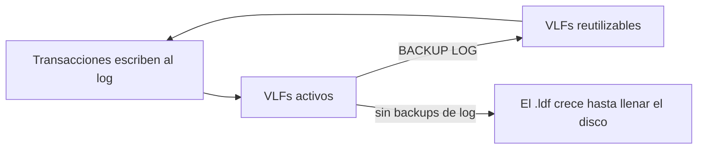

# Modelo de recuperación FULL

Parte de: [[Modelos de recuperación]]

> [!info] Cómo avanzar
> `progreso`: **pendiente** → **viendo** (estudiando) → **visto** (contestaste la autoevaluación sin abrir las respuestas) → **dominado** (hiciste el laboratorio o lo aplicaste de verdad).

## Contenido

### Qué es
En el modelo **FULL** SQL Server registra **completamente** cada modificación en el log de transacciones y **no reutiliza** el espacio del log hasta que haces un **backup de log**. A cambio, permite la protección más fuerte: restaurar a **cualquier momento** cubierto por la cadena de backups de log, incluso al segundo anterior a un error, y recuperar la cola del log si fallan los archivos de datos. Es el modelo requerido para Always On availability groups y el que usa Azure SQL Database siempre.

### Cómo funciona
El log es un archivo circular dividido en **VLFs** (archivos de log virtuales). En FULL, un VLF solo puede marcarse como reutilizable (truncarse) cuando se cumplen dos cosas: sus registros ya no se necesitan para transacciones activas o replicación **y** ya fueron copiados en un backup de log.


Esto explica el **error más común**: una base en FULL (el modelo por defecto si `model` está en FULL) sin backups de log programados. El log nunca se trunca, crece con cada transacción y un día llena el disco; entonces la base deja de aceptar escrituras con el error 9002 ("The transaction log for database is full").

Para diagnosticar por qué no se trunca:
```sql
SELECT name, recovery_model_desc, log_reuse_wait_desc
FROM sys.databases WHERE name = N'Tienda';
-- LOG_BACKUP = falta backup de log; ACTIVE_TRANSACTION = una transacción abierta;
-- REPLICATION / AVAILABILITY_REPLICA = un consumidor no ha leído el log
```

### Ejemplo
Arreglar una base de QA cuyo log creció a 80 GB:
```sql
-- 1. Confirmar la causa
SELECT log_reuse_wait_desc FROM sys.databases WHERE name = N'Tienda';  -- LOG_BACKUP

-- 2. Hacer backup de log (esto trunca, pero no reduce el archivo)
BACKUP LOG Tienda TO DISK = N'D:\Backups\Tienda_log_rescate.trn' WITH COMPRESSION;

-- 3. Programar backups de log periódicos (job del Agent cada 15 min)

-- 4. Solo entonces, si el tamaño es excesivo, reducir una vez a un tamaño razonable
USE Tienda;
DBCC SHRINKFILE (N'Tienda_log', 8192);  -- 8 GB, no a cero
```
**¿Reducir el log con `DBCC SHRINKFILE` resuelve el problema?** No: solo libera espacio en disco momentáneamente. Si no programas backups de log, volverá a crecer; y encogerlo a un tamaño mínimo provoca muchos crecimientos automáticos pequeños, que pausan la escritura y fragmentan el log en miles de VLFs. Primero quita la causa (backups de log o cambiar a SIMPLE si no necesitas restauración puntual) y luego, si acaso, reduce **una vez** a un tamaño de trabajo.

### Cuándo usarlo y cuándo no
- **Sí**: producción con datos que no puedes perder (pedidos, pagos, identidad como Xolotl.Hecate).
- **Sí**, obligatorio: Always On availability groups, log shipping (o BULK_LOGGED) y restauración a punto en el tiempo.
- **No** en bases de desarrollo o *staging* que puedes recrear: ahí [[Modelo de recuperación SIMPLE]] evita el mantenimiento.
- Para cargas masivas ocasionales, considera cambiar temporalmente a [[Modelo de recuperación BULK_LOGGED]].
- Los backups que lo hacen útil están en [[Backup completo, diferencial y de log]].

### Errores comunes
1. **FULL sin backups de log.** Es lo peor de ambos mundos: pagas el crecimiento del log y, si nunca hiciste un completo, ni siquiera tienes restauración puntual.
2. **Shrink programado.** Crece, se encoge, crece... Dimensiona bien el log y deja un crecimiento fijo en MB (no en porcentaje).
3. **Transacción abierta olvidada.** Una sesión con `BEGIN TRAN` sin `COMMIT` impide truncar; búscala con `sys.dm_tran_active_transactions` o `DBCC OPENTRAN`.
4. **Cambiar a SIMPLE y de vuelta a FULL** para "limpiar" el log. Rompe la cadena de logs; tras volver a FULL necesitas un backup completo o diferencial antes de que los logs sirvan.

### Para profundizar
- [Modelos de recuperación (Microsoft Learn)](https://learn.microsoft.com/sql/relational-databases/backup-restore/recovery-models-sql-server)
- [Solucionar un log de transacciones lleno (error 9002)](https://learn.microsoft.com/sql/relational-databases/logs/troubleshoot-a-full-transaction-log-sql-server-error-9002)
- [Administrar el tamaño del log de transacciones](https://learn.microsoft.com/sql/relational-databases/logs/manage-the-size-of-the-transaction-log-file)

## Autoevaluación

Contesta primero en voz alta o en papel; luego despliega la respuesta.

> [!question]- ¿Qué permite el modelo FULL?
> Registrar todo en el log y respaldarlo, lo que permite restaurar a cualquier momento cubierto por la cadena de logs.

> [!question]- Error común: la base está en FULL y el log crece hasta llenar el disco. ¿Por qué?
> Nadie hace backups de log: en FULL el log solo se libera tras un `BACKUP LOG`. `log_reuse_wait_desc = LOG_BACKUP` en `sys.databases` lo confirma. Programa backups de log (p. ej. cada 15 min).

> [!question]- ¿Reducir el log con `DBCC SHRINKFILE` resuelve el problema?
> No: si no respaldas el log volverá a crecer, y encogerlo y crecerlo repetidamente fragmenta el archivo. Primero arregla la causa (backups de log o una transacción abierta).

