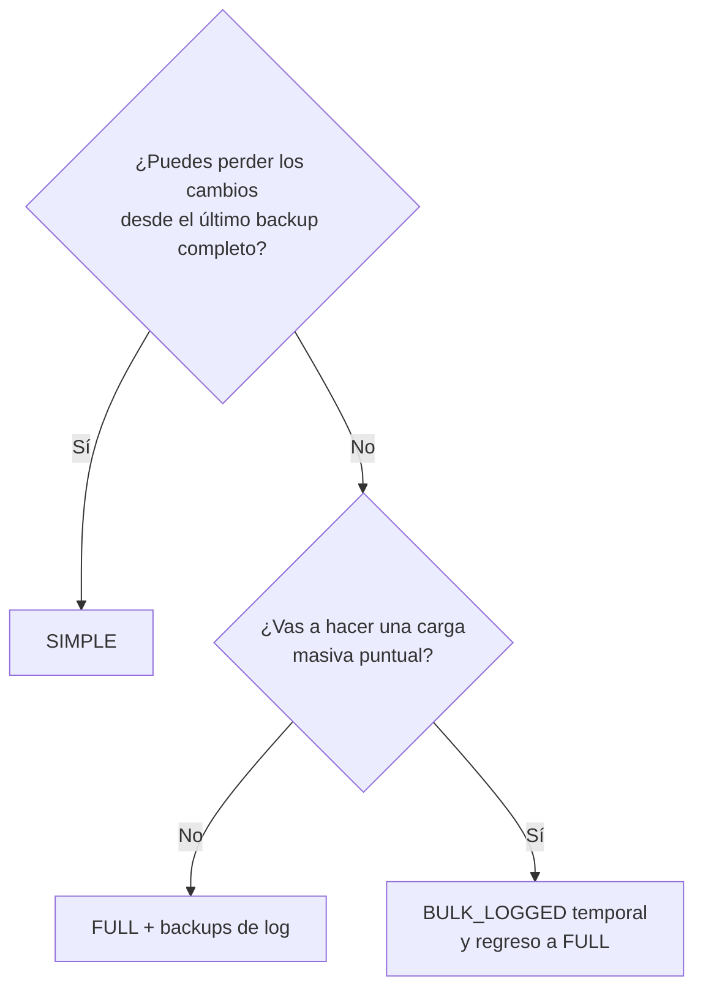

# Modelos de recuperación

Parte de: [[06-SQL-Server/05 Administración y avanzado/_Índice Administración y avanzado|Administración y avanzado]]

> [!info] Cómo avanzar
> `progreso`: **pendiente** → **viendo** (estudiando) → **visto** (contestaste la autoevaluación sin abrir las respuestas) → **dominado** (hiciste el laboratorio o lo aplicaste de verdad).

## Contenido

### Qué es
El **modelo de recuperación** es una propiedad de cada base de SQL Server que determina **cómo se registran las transacciones en el log**, **si el log debe respaldarse** para liberar espacio y, en consecuencia, **qué tipos de backup y restauración** son posibles. Es una decisión de negocio disfrazada de opción técnica: define cuántos datos puedes perder (RPO) y cuánto trabajo de mantenimiento aceptas.

### Cómo funciona
| Modelo | Registro en el log | ¿Backups de log? | Restauración a punto en el tiempo | Mantenimiento |
|---|---|---|---|---|
| SIMPLE | Completo, pero se trunca en cada checkpoint | No | No; solo al último completo o diferencial | Mínimo |
| FULL | Completo; se conserva hasta el backup de log | Sí, obligatorios | Sí, a cualquier momento | Programar logs |
| BULK_LOGGED | Mínimo en operaciones masivas | Sí | Sí, excepto en intervalos con operaciones masivas | Uso temporal |

El detalle de cada uno está en [[Modelo de recuperación SIMPLE]], [[Modelo de recuperación FULL]] y [[Modelo de recuperación BULK_LOGGED]].


Las bases nuevas heredan el modelo de la base de sistema `model` (en ediciones Standard y Enterprise suele ser FULL; en Express y Developer depende de la instalación). Por eso es frecuente encontrar bases en FULL sin que nadie lo haya decidido, y con el log creciendo.

### Ejemplo
```sql
-- Ver el modelo de todas las bases y por qué no se trunca el log
SELECT name, recovery_model_desc, log_reuse_wait_desc
FROM sys.databases
ORDER BY name;

-- Cambiarlo
ALTER DATABASE Tienda SET RECOVERY FULL;
ALTER DATABASE Tienda_Dev SET RECOVERY SIMPLE;

-- Al pasar de SIMPLE a FULL, la cadena de logs empieza con el siguiente completo o diferencial
BACKUP DATABASE Tienda TO DISK = N'D:\Backups\Tienda_full_inicio_cadena.bak' WITH COMPRESSION;
```
También puedes verlo en SSMS: clic derecho en la base, *Properties*, *Options*, *Recovery model*.

Propuesta para tus ambientes:
- Laptop y contenedores de desarrollo: SIMPLE.
- QA compartido: SIMPLE con un completo diario (o FULL si practicas restauraciones).
- Producción en SQL Server local: FULL con logs cada 5–15 minutos.
- Azure SQL Database: no se elige.

**En Azure SQL Database** todas las bases usan **FULL** y no se puede cambiar: el servicio necesita el log completo para sus backups automáticos de log (aproximadamente cada 10 minutos), la restauración a un punto en el tiempo y la geo-replicación. Tú no administras el log; Azure lo hace. En Azure SQL Managed Instance también es FULL.

### Cuándo usarlo y cuándo no
- Revisa el modelo de cada base **al crearla** y documenta la decisión junto al plan de [[Backup y restore]].
- Cambia de modelo de forma deliberada y con un backup después del cambio; no como truco para reducir el log.
- Si la base participa en alta disponibilidad (availability groups) o en CDC/replicación, el modelo y el truncado del log dependen de esas funciones también.

### Errores comunes
1. **FULL por defecto sin backups de log**: el log crece hasta llenar el disco (error 9002).
2. **Pasar a SIMPLE para encoger el log** y volver a FULL: rompe la cadena; los logs posteriores no sirven hasta un nuevo completo o diferencial.
3. **Asumir que en Azure SQL Database puedes poner SIMPLE** para ahorrar; no es configurable.
4. **No revisar `log_reuse_wait_desc`** antes de culpar al modelo: a veces el problema es una transacción abierta o una réplica atrasada.

### Para profundizar
- [Modelos de recuperación (Microsoft Learn)](https://learn.microsoft.com/sql/relational-databases/backup-restore/recovery-models-sql-server)
- [Ver o cambiar el modelo de recuperación](https://learn.microsoft.com/sql/relational-databases/backup-restore/view-or-change-the-recovery-model-of-a-database-sql-server)
- [Factores que retrasan el truncado del log](https://learn.microsoft.com/sql/relational-databases/logs/the-transaction-log-sql-server#FactorsThatDelayTruncation)

## Subtemas

- [[Modelo de recuperación SIMPLE]]
- [[Modelo de recuperación FULL]]
- [[Modelo de recuperación BULK_LOGGED]]

## Autoevaluación

Contesta primero en voz alta o en papel; luego despliega la respuesta.

> [!question]- ¿Qué determina el modelo de recuperación?
> Cómo se maneja el log de transacciones y, por lo tanto, qué restauraciones son posibles: [[Modelo de recuperación SIMPLE|SIMPLE]], [[Modelo de recuperación FULL|FULL]] o [[Modelo de recuperación BULK_LOGGED|BULK_LOGGED]].

> [!question]- ¿Cómo ves y cambias el modelo?
> ```sql
> SELECT name, recovery_model_desc, log_reuse_wait_desc FROM sys.databases;
> ALTER DATABASE Tienda SET RECOVERY FULL;
> ```
> Al pasar a FULL, haz un backup completo para iniciar la cadena de logs.

> [!question]- ¿Qué modelo usan las bases de Azure SQL Database?
> FULL, administrado por el servicio; no se puede cambiar y los backups de log son automáticos.

## Progreso de los subtemas

```base
filters:
  and:
    - file.inFolder("06-SQL-Server/05 Administración y avanzado/Modelos de recuperación")
    - file.name != "Modelos de recuperación"
views:
  - type: table
    name: Progreso
    order:
      - file.name
      - progreso
      - nivel
```
