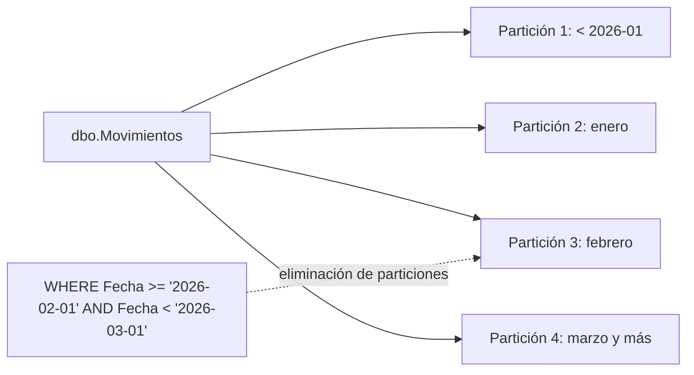

# Particionamiento

Parte de: [[06-SQL-Server/05 Administración y avanzado/_Índice Administración y avanzado|Administración y avanzado]]

> [!info] Cómo avanzar
> `progreso`: **pendiente** → **viendo** (estudiando) → **visto** (contestaste la autoevaluación sin abrir las respuestas) → **dominado** (hiciste el laboratorio o lo aplicaste de verdad).

## Contenido

### Qué es
El **particionamiento de tablas** divide físicamente una tabla (y sus índices) en varias **particiones** según el valor de una columna, normalmente una fecha. Para las consultas sigue siendo una sola tabla: el `SELECT` no cambia. Internamente cada partición es una unidad independiente que se puede mover, truncar, comprimir o reconstruir por separado, e incluso colocar en distintos grupos de archivos.

### Cómo funciona
Se necesitan tres piezas:

1. **Función de partición**: define los límites (`RANGE RIGHT FOR VALUES ('2026-01-01', '2026-02-01', ...)`).
2. **Esquema de partición**: asigna cada partición a un grupo de archivos (puede ser todo a `PRIMARY`).
3. **Tabla o índice creado sobre el esquema**, indicando la columna de partición.


**Para qué sirve principalmente**: **administración de datos grandes**, no velocidad mágica. El caso estrella es la ventana deslizante: cargar el mes nuevo en una tabla de *staging* y meterlo con `SWITCH` (solo metadatos, instantáneo), o sacar el mes más viejo a una tabla de archivo y truncarlo, sin `DELETE` masivos que llenen el log. También permite reconstruir índices o comprimir solo las particiones recientes y mantener estadísticas incrementales.

**Eliminación de particiones** (*partition elimination*): cuando el `WHERE` filtra por la columna de partición, el optimizador lee solo las particiones relevantes. **No ocurre** cuando:
- la consulta no filtra por la columna de partición (por ejemplo, busca por `ClienteId`): se revisan todas;
- la columna está envuelta en una función (`WHERE YEAR(Fecha) = 2026`) o hay conversión implícita de tipos (ver [[SARGability]]);
- el filtro llega por un join o una variable que el optimizador no puede evaluar al compilar (a veces se resuelve en tiempo de ejecución, a veces no).

### Ejemplo
```sql
CREATE PARTITION FUNCTION pfMes (date)
AS RANGE RIGHT FOR VALUES ('2026-01-01', '2026-02-01', '2026-03-01');

CREATE PARTITION SCHEME psMes AS PARTITION pfMes ALL TO ([PRIMARY]);

CREATE TABLE dbo.Movimientos (
  MovimientoId bigint IDENTITY NOT NULL,
  Fecha date NOT NULL,
  CuentaId int NOT NULL,
  Importe decimal(18,2) NOT NULL,
  CONSTRAINT PK_Movimientos PRIMARY KEY CLUSTERED (Fecha, MovimientoId)  -- la columna de partición en la clave
) ON psMes (Fecha);

-- ¿Cuántas filas hay en cada partición?
SELECT $PARTITION.pfMes(Fecha) AS Particion, COUNT(*) AS Filas
FROM dbo.Movimientos GROUP BY $PARTITION.pfMes(Fecha);

-- Ventana deslizante: sacar enero a una tabla de archivo con estructura idéntica
ALTER TABLE dbo.Movimientos SWITCH PARTITION 2 TO dbo.Movimientos_Archivo;
-- O vaciar una partición directamente
TRUNCATE TABLE dbo.Movimientos WITH (PARTITIONS (2));
```
En el plan de ejecución real, la propiedad *Actual Partition Count* del operador muestra cuántas particiones se leyeron.

### Cuándo usarlo y cuándo no
- **Sí**: tablas de cientos de millones de filas con datos por fecha, cargas y depuraciones periódicas (bitácoras, movimientos, eventos), y mantenimiento que ya no cabe en la ventana nocturna.
- **No** para "acelerar" consultas en tablas medianas: un buen índice suele ganar. Particionar mal puede empeorar consultas que no filtran por la columna.
- Disponible en todas las ediciones desde SQL Server 2016 SP1 y en Azure SQL Database (en Azure SQL Database todas las particiones viven en `PRIMARY`).
- Para analítica sobre muchas filas combina con [[Columnstore]].

### Errores comunes
1. **Particionar por una columna que las consultas no usan.** Nunca hay eliminación de particiones.
2. **Índices no alineados.** Un índice no particionado impide `SWITCH`; crea los índices sobre el mismo esquema.
3. **Olvidar dividir (`SPLIT`) la siguiente partición a tiempo.** Todo cae en la última y dividirla con datos es costoso; deja siempre una partición vacía al final.
4. **Funciones sobre la columna** en el `WHERE` (`CONVERT`, `YEAR`), que impiden la eliminación.
5. **Demasiadas particiones pequeñas** (por día durante años) que complican el mantenimiento y las estadísticas.

### Para profundizar
- [Tablas e índices particionados (Microsoft Learn)](https://learn.microsoft.com/sql/relational-databases/partitions/partitioned-tables-and-indexes)
- [CREATE PARTITION FUNCTION](https://learn.microsoft.com/sql/t-sql/statements/create-partition-function-transact-sql)
- [ALTER TABLE ... SWITCH](https://learn.microsoft.com/sql/t-sql/statements/alter-table-transact-sql)

## Autoevaluación

Contesta primero en voz alta o en papel; luego despliega la respuesta.

> [!question]- ¿Qué es el particionamiento de tablas en SQL Server?
> Dividir una tabla (y sus índices) en partes según el valor de una columna, normalmente una fecha: una **función de partición** define los límites y un **esquema de partición** asigna cada parte a un filegroup. Para las consultas sigue siendo una sola tabla.

> [!question]- ¿Para qué sirve principalmente?
> Para **administrar** datos grandes: cargar o archivar meses completos casi al instante con `ALTER TABLE ... SWITCH PARTITION` o `TRUNCATE TABLE ... WITH (PARTITIONS (n))`, y mantener índices por partición. No es, por sí solo, una mejora de velocidad.

> [!question]- ¿Qué es la eliminación de particiones y cuándo no ocurre?
> Que el motor lea solo las particiones que cumplen el filtro (`WHERE Fecha >= '2025-01-01'`). No ocurre si el filtro no usa la columna de partición o la usa de forma no SARGable.

