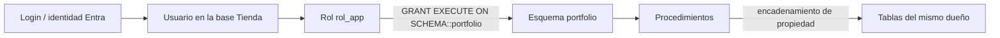

# Roles y permisos

Parte de: [[06-SQL-Server/05 Administración y avanzado/_Índice Administración y avanzado|Administración y avanzado]]

> [!info] Cómo avanzar
> `progreso`: **pendiente** → **viendo** (estudiando) → **visto** (contestaste la autoevaluación sin abrir las respuestas) → **dominado** (hiciste el laboratorio o lo aplicaste de verdad).

## Contenido

### Qué es
La seguridad de SQL Server separa dos preguntas:

- **Autenticación (¿quién eres?)**: la resuelve el **login**, que vive a nivel **servidor** (`CREATE LOGIN`). Puede ser de SQL (usuario y contraseña), de Windows o de Microsoft Entra ID.
- **Autorización (¿qué puedes hacer aquí?)**: la resuelve el **usuario**, que vive en **cada base** y se asocia a un login (`CREATE USER ... FOR LOGIN ...`). Un login puede tener usuarios en varias bases con permisos distintos.

En Azure SQL Database lo recomendado son **usuarios contenidos**, que existen solo en la base sin login en `master`: `CREATE USER [app-dionisio] FROM EXTERNAL PROVIDER` para una identidad administrada de Entra ID.

Los permisos se agrupan en **roles**: roles fijos de base (`db_owner`, `db_datareader`, `db_datawriter`, `db_ddladmin`), roles de servidor (`sysadmin`) y **roles propios** que creas para tu aplicación.

### Cómo funciona

Los permisos se dan con `GRANT`, se quitan con `REVOKE` y se niegan explícitamente con `DENY` (que gana sobre cualquier `GRANT`). Se pueden otorgar a nivel objeto, **esquema** o base. Dar permisos por esquema es lo más mantenible: cada procedimiento nuevo en `portfolio` queda cubierto automáticamente.

**Encadenamiento de propiedad** (*ownership chaining*): cuando un procedimiento accede a una tabla y **ambos tienen el mismo dueño** (normalmente `dbo`, dueño del esquema), SQL Server solo revisa el permiso `EXECUTE` sobre el procedimiento y no revisa los permisos sobre la tabla. Por eso la app puede ejecutar `portfolio.ProyectoCrear` sin tener `INSERT` sobre `portfolio.Proyectos`. La cadena **se rompe** con SQL dinámico (`sp_executesql` se evalúa con los permisos del llamador), con dueños distintos y entre bases. Si necesitas SQL dinámico, usa `EXECUTE AS` o firma el procedimiento con un certificado.

### Ejemplo
```sql
-- Rol para la API: solo ejecutar procedimientos del esquema portfolio
CREATE ROLE rol_app_portfolio;
GRANT EXECUTE ON SCHEMA::portfolio TO rol_app_portfolio;

-- Usuario de la app (Azure SQL con identidad administrada)
CREATE USER [app-portfolio] FROM EXTERNAL PROVIDER;
ALTER ROLE rol_app_portfolio ADD MEMBER [app-portfolio];

-- Cuenta de migraciones, separada, con permisos de DDL
CREATE USER [pipeline-migraciones] FROM EXTERNAL PROVIDER;
ALTER ROLE db_ddladmin ADD MEMBER [pipeline-migraciones];
GRANT SELECT, INSERT, UPDATE, DELETE ON SCHEMA::portfolio TO [pipeline-migraciones];

-- Revisar qué puede hacer alguien
EXECUTE AS USER = 'app-portfolio';
SELECT * FROM fn_my_permissions('portfolio', 'SCHEMA');
REVERT;
```
Con esto, si un atacante logra inyección SQL en un endpoint que usa SQL dinámico mal hecho, la cuenta no puede leer tablas directamente ni borrar objetos.

### Cuándo usarlo y cuándo no
- **Siempre** aplica mínimo privilegio: una cuenta por aplicación, permisos por esquema y una cuenta distinta para migraciones.
- Usa **roles propios** en lugar de dar permisos a usuarios individuales; así cambiar a la persona o la app no implica rehacer permisos.
- `db_datareader` es útil para cuentas de reportes o de soporte de solo lectura.
- Si además necesitas limitar **qué filas** ve cada usuario, combina con [[Row-level security]]; para columnas sensibles, con [[Cifrado y Always Encrypted]].
- Practica el patrón completo en el laboratorio de usuario de aplicación con permisos mínimos.

### Errores comunes
1. **La app como `db_owner`.** Una inyección o un bug puede hacer `DROP TABLE`, leer todo, cambiar permisos o desactivar auditoría. Además oculta qué permisos necesita realmente la app.
2. **Dar `SELECT` sobre tablas "por si acaso"** además de `EXECUTE`: anula la ventaja de encapsular en procedimientos.
3. **Usuarios huérfanos** tras restaurar en otro servidor (el SID del login no coincide). Usa usuarios contenidos o `ALTER USER ... WITH LOGIN = ...`.
4. **SQL dinámico en procedimientos** que de pronto pide permisos de tabla; es la cadena de propiedad rota.
5. **Contraseñas de SQL en el repo.** Prefiere Entra ID o Key Vault.

### Para profundizar
- [Introducción a permisos del motor de base de datos](https://learn.microsoft.com/sql/relational-databases/security/authentication-access/getting-started-with-database-engine-permissions)
- [Understanding SQL Server ownership chaining (MSSQLTips)](https://www.mssqltips.com/sqlservertip/6394/understanding-sql-server-ownership-chaining/)
- [Usuarios de base de datos contenidos](https://learn.microsoft.com/sql/relational-databases/security/contained-database-users-making-your-database-portable)

## Autoevaluación

Contesta primero en voz alta o en papel; luego despliega la respuesta.

> [!question]- ¿Qué diferencia hay entre login y usuario?
> El **login** vive en el servidor (autentica: quién eres). El **usuario** vive en cada base y se asocia a un login (autoriza: qué puedes hacer ahí). En Azure SQL también hay **usuarios contenidos** sin login (`CREATE USER app WITH PASSWORD = ...` o `FROM EXTERNAL PROVIDER` para identidades de Entra ID).

> [!question]- ¿Cómo das a la app solo permiso de ejecutar procedimientos del esquema `portfolio`?
> ```sql
> CREATE ROLE rol_app;
> GRANT EXECUTE ON SCHEMA::portfolio TO rol_app;
> ALTER ROLE rol_app ADD MEMBER app_portfolio;
> ```
> Sin `SELECT` ni `UPDATE` directos sobre tablas.

> [!question]- ¿Por qué funciona `EXECUTE` sin permisos sobre las tablas?
> Por el **encadenamiento de propiedad**: si el procedimiento y las tablas tienen el mismo dueño (el del esquema), SQL Server no revisa permisos de las tablas. Se rompe con SQL dinámico y entre bases.

> [!question]- Error común: la cuenta de la app es `db_owner`. ¿Qué riesgo tiene?
> Una inyección SQL o un error en la app puede borrar tablas, leer todo o cambiar permisos. La app debe tener lo mínimo; las migraciones corren con otra cuenta.

## Práctica

- [[Lab 10 - Usuario de aplicación con permisos mínimos por esquema]]

