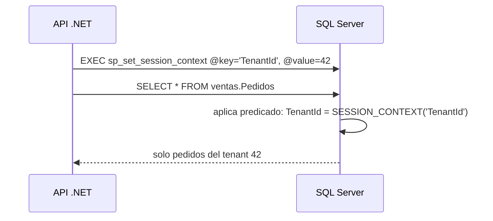

# Row-level security

Parte de: [[06-SQL-Server/05 Administración y avanzado/_Índice Administración y avanzado|Administración y avanzado]]

> [!info] Cómo avanzar
> `progreso`: **pendiente** → **viendo** (estudiando) → **visto** (contestaste la autoevaluación sin abrir las respuestas) → **dominado** (hiciste el laboratorio o lo aplicaste de verdad).

## Contenido

### Qué es
**Row-Level Security (RLS)** permite que SQL Server filtre automáticamente **qué filas** puede ver o modificar cada sesión, según una regla que defines una vez en la base. La consulta de la app sigue siendo `SELECT * FROM ventas.Pedidos`, pero el motor agrega por debajo la condición, por ejemplo `TenantId = <tenant de la sesión>`. Es una defensa en profundidad típica de aplicaciones **multi-tenant**: aunque un desarrollador olvide el `WHERE TenantId = @tenant`, la base no devuelve datos de otro cliente.

### Cómo funciona

Piezas:

1. Una **función de tabla en línea** con `SCHEMABINDING` que devuelve una fila cuando el acceso está permitido.
2. Una **política de seguridad** (`CREATE SECURITY POLICY`) que la aplica a una o varias tablas.

Hay dos tipos de predicado:

- **Filtro (*FILTER PREDICATE*)**: oculta en silencio las filas no permitidas en `SELECT`, `UPDATE` y `DELETE`. La sesión simplemente no las ve.
- **Bloqueo (*BLOCK PREDICATE*)**: impide **escribir** filas que violen la regla y lanza error. Puede ser `AFTER INSERT`, `AFTER UPDATE` (impide insertar o mover una fila a otro tenant), `BEFORE UPDATE` o `BEFORE DELETE`. Sin él, una sesión podría insertar una fila con otro `TenantId`.

**`SESSION_CONTEXT`** guarda pares clave-valor en la sesión. Es lo que permite usar RLS cuando toda la app entra con **una sola cuenta de base**: el usuario de base es el mismo para todos, así que la regla no puede basarse en `USER_NAME()`; en cambio la API pone el tenant (tomado del JWT validado) en el contexto al abrir la conexión. Con `@read_only = 1` la clave no se puede cambiar en el resto de la sesión.

### Ejemplo
```sql
CREATE SCHEMA seguridad;
GO
CREATE FUNCTION seguridad.fn_PorTenant (@TenantId int)
RETURNS TABLE
WITH SCHEMABINDING
AS RETURN
    SELECT 1 AS Permitido
    WHERE @TenantId = CAST(SESSION_CONTEXT(N'TenantId') AS int);
GO
CREATE SECURITY POLICY seguridad.PoliticaTenant
    ADD FILTER PREDICATE seguridad.fn_PorTenant(TenantId) ON ventas.Pedidos,
    ADD BLOCK  PREDICATE seguridad.fn_PorTenant(TenantId) ON ventas.Pedidos AFTER INSERT,
    ADD BLOCK  PREDICATE seguridad.fn_PorTenant(TenantId) ON ventas.Pedidos AFTER UPDATE
WITH (STATE = ON);
```
```csharp
// Fábrica de conexiones: fija el tenant del usuario autenticado en cada conexión
public async Task<SqlConnection> AbrirAsync(CancellationToken ct)
{
    var cn = new SqlConnection(_cs);
    await cn.OpenAsync(ct);
    await cn.ExecuteAsync(
        "EXEC sp_set_session_context @key = N'TenantId', @value = @tenant, @read_only = 1;",
        new { tenant = _usuarioActual.TenantId });
    return cn;
}
```
**Cuidado con el pool de conexiones**: ADO.NET reutiliza conexiones físicas. Al devolver una conexión al pool y volver a pedirla, SqlClient ejecuta `sp_reset_connection`, que **limpia** el `SESSION_CONTEXT`; por eso debes fijarlo **cada vez que abres** la conexión, nunca asumir que "ya estaba". Y si fijas el valor con `@read_only = 1`, no intentes cambiarlo en la misma conexión: falla. El riesgo real aparece si alguien abre la conexión sin pasar por tu fábrica: sin contexto, el filtro devuelve cero filas (falla segura), pero un código que reutiliza una conexión abierta entre peticiones de distintos tenants sí podría mezclar datos.

### Cuándo usarlo y cuándo no
- **Sí**: multi-tenant con base compartida, datos por sucursal o por vendedor, requisitos de aislamiento verificables.
- **No** como único control: la API debe seguir validando permisos. Los usuarios con permisos elevados (`db_owner`, quien puede alterar la política) pueden saltarla.
- Una base por tenant evita RLS pero multiplica operaciones; RLS es el punto medio.
- Complementa a [[Roles y permisos]] (qué objetos) con qué filas.

### Errores comunes
1. **Predicados complejos** con joins a varias tablas: se ejecutan en cada consulta y afectan el rendimiento. Mantén la función simple e indexa `TenantId`.
2. **Olvidar el predicado de bloqueo**: la app puede insertar filas en otro tenant aunque no pueda verlas.
3. **No fijar el contexto en cada apertura** por confiar en el pool.
4. **Canales laterales**: un error de división entre cero o de clave duplicada puede revelar existencia de filas ajenas. Considera claves únicas que incluyan `TenantId`.

### Para profundizar
- [Row-Level Security (Microsoft Learn)](https://learn.microsoft.com/sql/relational-databases/security/row-level-security)
- [SESSION_CONTEXT (Transact-SQL)](https://learn.microsoft.com/sql/t-sql/functions/session-context-transact-sql)
- [sp_set_session_context](https://learn.microsoft.com/sql/relational-databases/system-stored-procedures/sp-set-session-context-transact-sql)

## Autoevaluación

Contesta primero en voz alta o en papel; luego despliega la respuesta.

> [!question]- ¿Qué es Row-Level Security (RLS)?
> Una política que filtra automáticamente las filas que cada usuario puede leer o modificar, con una función de predicado. Útil en multi-tenant: cada inquilino solo ve sus filas aunque la consulta no lo filtre. Ver [[Multi-tenancy]].

> [!question]- ¿Cómo se implementa con `SESSION_CONTEXT` para una app con una sola cuenta de base?
> ```sql
> CREATE FUNCTION seg.fn_TenantPredicate (@TenantId uniqueidentifier)
> RETURNS TABLE WITH SCHEMABINDING AS
> RETURN SELECT 1 AS ok
>        WHERE @TenantId = CAST(SESSION_CONTEXT(N'TenantId') AS uniqueidentifier);
> GO
> CREATE SECURITY POLICY seg.TenantPolicy
>   ADD FILTER PREDICATE seg.fn_TenantPredicate(TenantId) ON portfolio.Portfolios,
>   ADD BLOCK  PREDICATE seg.fn_TenantPredicate(TenantId) ON portfolio.Portfolios AFTER INSERT
>   WITH (STATE = ON);
> ```
> La app ejecuta al abrir la conexión `EXEC sp_set_session_context @key = N'TenantId', @value = @id, @read_only = 1;`.

> [!question]- ¿Qué diferencia hay entre predicado de filtro y de bloqueo?
> El de **filtro** oculta filas en `SELECT`, `UPDATE` y `DELETE`. El de **bloqueo** impide escribir filas que no cumplen (p. ej. insertar con el `TenantId` de otro).

> [!question]- ¿Qué cuidado hay con el pool de conexiones?
> `SESSION_CONTEXT` vive en la sesión: al reutilizar una conexión del pool, debes fijarlo en cada uso (SqlClient restablece la sesión al sacarla del pool, pero no confíes en un valor anterior). `@read_only = 1` impide que código posterior lo cambie.

## Práctica

- [[Lab 10 - Usuario de aplicación con permisos mínimos por esquema]]

