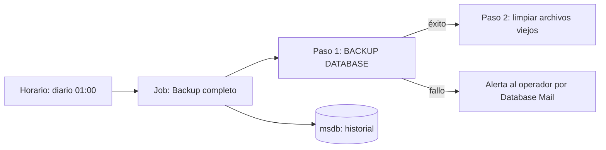

# SQL Server Agent y jobs

Parte de: [[06-SQL-Server/05 Administración y avanzado/_Índice Administración y avanzado|Administración y avanzado]]

> [!info] Cómo avanzar
> `progreso`: **pendiente** → **viendo** (estudiando) → **visto** (contestaste la autoevaluación sin abrir las respuestas) → **dominado** (hiciste el laboratorio o lo aplicaste de verdad).

## Contenido

### Qué es
**SQL Server Agent** es un servicio de Windows (o Linux) que acompaña al motor de SQL Server y ejecuta **tareas programadas** llamadas *jobs*. Cada job tiene uno o más **pasos** (T-SQL, PowerShell, comandos del sistema operativo, paquetes SSIS), uno o más **horarios** y **notificaciones** a operadores cuando falla. Toda su configuración e historial se guarda en la base de sistema `msdb`.

### Cómo funciona

- **Pasos**: cada uno define qué hacer si tiene éxito o falla (seguir, saltar a otro paso, terminar con éxito o fallo) y cuántas veces reintentar.
- **Proxies y credenciales**: los pasos que no son T-SQL pueden correr con una identidad distinta a la del servicio del Agent, con permisos mínimos.
- **Alertas**: reaccionan a errores de cierta severidad o a condiciones de rendimiento.
- **Operadores**: personas o buzones que reciben las notificaciones mediante Database Mail.

**Dónde no está disponible**:
- **SQL Server Express**: no incluye el Agent; programas tareas con el Programador de tareas de Windows y `sqlcmd`.
- **Azure SQL Database**: no hay Agent. Las alternativas son **Elastic Jobs** (trabajos elásticos de Azure SQL), Azure Automation, Azure Functions con disparador de tiempo, Logic Apps o una tarea programada en Azure DevOps. Los backups ya son automáticos.
- **Azure SQL Managed Instance** sí incluye SQL Server Agent.

### Ejemplo
Crear un job de backup de log cada 15 minutos con T-SQL:
```sql
USE msdb;
EXEC dbo.sp_add_job @job_name = N'Tienda - Backup de log';
EXEC dbo.sp_add_jobstep @job_name = N'Tienda - Backup de log',
     @step_name = N'BACKUP LOG', @subsystem = N'TSQL', @database_name = N'master',
     @command = N'DECLARE @f nvarchar(260) = N''D:\Backups\Tienda_log_''
                   + FORMAT(SYSDATETIME(), ''yyyyMMdd_HHmm'') + N''.trn'';
                 BACKUP LOG Tienda TO DISK = @f WITH COMPRESSION, CHECKSUM;',
     @retry_attempts = 2, @retry_interval = 1;
EXEC dbo.sp_add_schedule @schedule_name = N'Cada 15 minutos',
     @freq_type = 4, @freq_interval = 1, @freq_subday_type = 4, @freq_subday_interval = 15;
EXEC dbo.sp_attach_schedule @job_name = N'Tienda - Backup de log', @schedule_name = N'Cada 15 minutos';
EXEC dbo.sp_add_jobserver @job_name = N'Tienda - Backup de log';

-- Historial de fallos recientes
SELECT j.name, h.run_date, h.run_time, h.message
FROM dbo.sysjobhistory h JOIN dbo.sysjobs j ON j.job_id = h.job_id
WHERE h.run_status = 0 ORDER BY h.instance_id DESC;
```
En la práctica muchos equipos usan la solución de mantenimiento de Ola Hallengren, que crea jobs probados para backups, integridad e índices.

**Jobs típicos de un servidor de producción**:
1. **Backups**: completo semanal o diario, diferencial diario y log cada 5–15 minutos (ver [[Backup completo, diferencial y de log]]).
2. **Integridad**: `DBCC CHECKDB` semanal para detectar corrupción a tiempo.
3. **Índices y estadísticas**: reorganizar o reconstruir según fragmentación y actualizar estadísticas (ver [[Estadísticas]]).
4. **Limpieza**: historial de backups y jobs en `msdb`, archivos de backup viejos, bitácoras de la aplicación.
5. **Procesos de negocio**: cargas ETL nocturnas, cierres, depuración de sesiones o tokens expirados (por ejemplo, tokens de refresco vencidos de Xolotl.Hecate).
6. **CDC**: los jobs de captura y limpieza que crea [[Auditoría (CDC y Change Tracking)|CDC]].

### Cuándo usarlo y cuándo no
- **Sí** para mantenimiento de la base y tareas que viven junto a los datos.
- **No** para lógica de negocio compleja que llama APIs externas o envía correos a clientes: es más fácil de probar, versionar y observar en un worker .NET (`BackgroundService`) o una Azure Function.
- Versiona la definición de los jobs como scripts en el repo, no solo en `msdb`.

### Errores comunes
1. **Jobs sin notificación de fallo.** El backup lleva semanas fallando y nadie se entera; configura Database Mail y operadores.
2. **Agent detenido o en inicio manual** tras reiniciar el servidor; configúralo en automático.
3. **Cuenta del servicio con permisos excesivos.** Usa una cuenta dedicada y proxies para pasos de SO.
4. **Jobs que se enciman** (un ETL largo y el reindexado a la misma hora) generando bloqueos.

### Para profundizar
- [SQL Server Agent (Microsoft Learn)](https://learn.microsoft.com/sql/ssms/agent/sql-server-agent)
- [Elastic Jobs en Azure SQL Database](https://learn.microsoft.com/azure/azure-sql/database/elastic-jobs-overview)
- [Solución de mantenimiento de Ola Hallengren](https://ola.hallengren.com/)

## Autoevaluación

Contesta primero en voz alta o en papel; luego despliega la respuesta.

> [!question]- ¿Qué es SQL Server Agent?
> El servicio que ejecuta **jobs** programados (pasos T-SQL, PowerShell, SSIS) con horarios, alertas y operadores a quienes notificar. Su configuración vive en `msdb`.

> [!question]- ¿Dónde no está disponible?
> En SQL Server Express ni en Azure SQL Database. En Azure SQL Database se usan *Elastic Jobs*, Azure Automation o una Function/Logic App programada; Azure SQL Managed Instance sí tiene Agent.

> [!question]- ¿Qué jobs típicos tiene un servidor de producción?
> Backups (completo, diferencial, log), mantenimiento de índices y estadísticas, `DBCC CHECKDB`, purgas de datos viejos y limpieza del historial de `msdb`.

