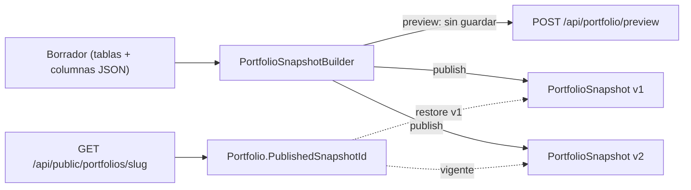

# Snapshot inmutable versionado

> Al publicar, se congela el estado del borrador en un documento (JSON) que nunca se modifica y lleva un número de versión; el sitio público lee solo ese documento. [[Itzamna.Dionisio]] lo usa para separar el borrador del Studio de lo que ven los visitantes.

## Qué es y qué problema resuelve
Si el sitio público leyera directo las tablas del borrador, cada cambio a medias del creador se vería en vivo, y armar la página costaría muchas consultas por visita. Con snapshots:
- **Borrador** y **publicado** son cosas distintas: editar no afecta al sitio hasta "Publicar".
- La lectura pública es **una fila** con el JSON listo (barato y cacheable).
- Cada publicación es una **versión**: se puede listar, comparar y **restaurar**.

Es la misma idea que un *release* de software, un commit de Git o el "publish" de un CMS headless.

## Cómo funciona por dentro
1. **Builder**: una función pura-ish `borrador → DTO público` (la misma para vista previa y publicación).
2. **Publicar**: `version = max + 1`, serializar el DTO, insertar fila nueva (nunca `UPDATE`) y mover el puntero "versión vigente".
3. **Leer**: buscar el puntero y devolver el `Payload` tal cual.
4. **Restaurar**: mover el puntero a una versión anterior; no se copia ni se borra nada.
5. **Evolución**: un `SchemaVersion` en la fila para saber con qué forma se escribió el JSON.



## Cuándo usarla y cuándo no
### Ventajas
- Lo publicado no cambia por accidente; historial gratis.
- Lectura pública rapidísima y fácil de cachear ([[Output caching]]).
- "Lo que previsualizas es lo que publicas" si comparten builder.
### Desventajas
- Duplicación de datos (cada versión guarda el documento completo).
- El JSON viejo puede no coincidir con el contrato nuevo: el lector debe tolerar campos faltantes.
- Referencias externas congeladas (URLs de imágenes) deben seguir existiendo.

## Alternativas
| Alternativa | En qué se diferencia |
|---|---|
| Leer el borrador en vivo | Sin duplicación; sin separación borrador/publicado. |
| Bandera `IsPublished` por fila | Publicación parcial por elemento; difícil restaurar un estado completo. |
| Event sourcing | Guarda cada cambio; el estado se reconstruye. Más potente y complejo. |
| Generación estática (SSG) | El snapshot se convierte en HTML; requiere build/despliegue por publicación. |

## Cómo se usó en Itzamna
- **Entidad** `PortfolioSnapshot` (`Itzamna.Dionisio/src/Itzamna.Dionisio.Core/Publishing/PortfolioSnapshot.cs`): `PortfolioId`, `Version`, `SchemaVersion` (`CurrentSchemaVersion = 1`), `TemplateId`, `Payload` (`nvarchar(max)`), `PublishedAt`, `PublishedBy`. Todos los setters son privados: la inmutabilidad está en el modelo (no hay handler que lo modifique). Índice único `(PortfolioId, Version)`.
- **Puntero**: `Portfolio.PublishedSnapshotId` + `Status` + `PublishedAt`; `HasUnpublishedChanges => PublishedAt is null || DraftUpdatedAt > PublishedAt`. Cada cambio del borrador llama `TouchPortfolioAsync` para mover `DraftUpdatedAt`.
- **Builder**: `PortfolioSnapshotBuilder` ("Lo usan la vista previa y Publicar, así lo que se previsualiza es exactamente lo que se publica"). Resuelve medios a URLs públicas, filtra lo no visible y aplica overrides solo en preview.

Publicar (`Itzamna.Dionisio/src/Itzamna.Dionisio.Application/Features/Publishing/PublishingFeatures.cs`):
```csharp
var lastVersion = await db.PortfolioSnapshots.Where(s => s.PortfolioId == portfolioId).MaxAsync(s => (int?)s.Version, ct) ?? 0;
var version = lastVersion + 1;
var now = DateTime.UtcNow;
var dto = await builder.BuildAsync(data, null, new SnapshotInfo(false, version, now), ct);
var payload = JsonSerializer.Serialize(dto, PublicJson.Options);

var snapshot = new PortfolioSnapshot(portfolioId, version, dto.TemplateId, payload, user.Subject);
db.PortfolioSnapshots.Add(snapshot);

var portfolio = await db.CurrentPortfolioAsync(tenant, ct);
portfolio.MarkPublished(snapshot.Id, snapshot.PublishedAt);
await db.SaveChangesAsync(ct);
await cache.InvalidateAsync(portfolio.Slug, ct);
```
- Antes de publicar, `ReadinessCalculator` exige perfil, foto y contacto (409 con la lista si falta algo).
- **Restaurar**: `MarkPublished(snapshot.Id, now)`; "el borrador no se toca" y, si el borrador era más nuevo que esa versión, `Touch()` para que siga marcado como "cambios sin publicar".
- **Historial**: `GET /api/portfolio/versions` devuelve las últimas 20.
- **Lectura pública**: `GetPublicPortfolioHandler` devuelve el `Payload` sin deserializar; el controller responde `Content(json, "application/json")` ([[Portfolio público]]).
- **Compatibilidad**: "Snapshots anteriores no traen `collaborations`: las plantillas lo tratan como lista vacía" (`.ai/03_ROADMAP.md`). El lector (front) tolera campos faltantes.
- **Medios**: borrar un medio conserva sus variantes públicas para no romper versiones publicadas ([[Borrado lógico y auditoría]]).

Funcionalidades: [[Publicación y versiones]], [[Vista previa en vivo]], [[Portfolio público]].

> [!note] Pendiente de confirmar
> El `Payload` guarda URLs absolutas de imágenes (`storage.GetPublicUrl`), así que cambiar `Storage:PublicBaseUrl` (p. ej. al poner un CDN) dejaría versiones viejas apuntando al dominio anterior. `SchemaVersion` se guarda pero no encontré código que lo lea. No hay límite ni purga de versiones antiguas.

> [!tip] Reutilizable
> "Builder único para preview y publish + fila inmutable con `Version` y `SchemaVersion` + puntero en el agregado + restaurar = mover puntero" sirve para cualquier CMS, configurador o documento publicable.

## Errores comunes y buenas prácticas
- Builder distinto para preview y publicación: lo previsualizado no coincide con lo publicado.
- `UPDATE` sobre un snapshot "para corregir": rompe el historial; publicar una versión nueva.
- Calcular `max + 1` sin índice único: dos publicaciones simultáneas duplicarían la versión. Aquí el índice lo impide (ver [[Concurrencia optimista]]).
- Lectores que fallan con campos nuevos o faltantes: tratar el JSON como contrato versionado.

## Qué estudiar después
- [[Output caching]], [[Concurrencia optimista]], [[CQRS y mediador]] (lectura separada)
- Event sourcing, versionado de esquemas JSON.

## Documentación oficial
- https://martinfowler.com/eaaDev/EventSourcing.html
- https://learn.microsoft.com/azure/architecture/patterns/materialized-view

## Autoevaluación

Contesta primero en voz alta o en papel; luego despliega la respuesta.

> [!question]- ¿Qué problema resuelve el snapshot inmutable versionado?
> Separa borrador y publicado: al publicar se congela el estado en un documento (JSON) con número de versión que nunca se modifica; el sitio público lee una sola fila y restaurar es mover un puntero.

> [!question]- ¿Cómo evitas que dos publicaciones simultáneas generen la misma versión en SQL Server?
> Índice único `(PortfolioId, Version)` como defensa final, y calcular `MAX(Version) + 1` dentro de la transacción con `WITH (UPDLOCK, HOLDLOCK)` o validar con el `rowversion` del portfolio; el error 2627/2601 o el conflicto se traduce a 409.

> [!question]- ¿Por qué guardar un `SchemaVersion` en cada snapshot?
> Porque el JSON viejo se escribió con otro contrato; el lector puede adaptar o tolerar campos faltantes según la versión, en lugar de fallar con publicaciones antiguas.

