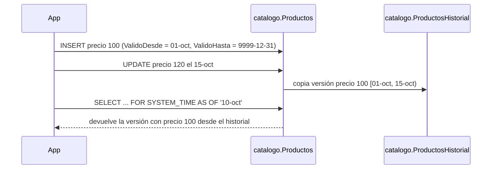

# Tablas temporales del sistema (temporal tables)

Parte de: [[06-SQL-Server/05 Administración y avanzado/_Índice Administración y avanzado|Administración y avanzado]]

> [!info] Cómo avanzar
> `progreso`: **pendiente** → **viendo** (estudiando) → **visto** (contestaste la autoevaluación sin abrir las respuestas) → **dominado** (hiciste el laboratorio o lo aplicaste de verdad).

## Contenido

### Qué es
Una **tabla temporal versionada por el sistema** (*system-versioned temporal table*) guarda automáticamente **el historial completo de cada fila**. SQL Server mantiene dos tablas: la **actual** (los datos vigentes) y la **de historial** (cada versión anterior, con el intervalo en que fue válida). No escribes triggers ni lógica en la app: cada `UPDATE` o `DELETE` copia la versión previa al historial. Luego puedes consultar "cómo estaba esta fila el 1 de octubre" con la cláusula `FOR SYSTEM_TIME`.

No confundir con las tablas temporales `#tmp` de `tempdb` (ver [[Tablas temporales y variables de tabla]]): son conceptos distintos con nombre parecido.

### Cómo funciona
La tabla tiene dos columnas `datetime2` marcadas como `GENERATED ALWAYS AS ROW START` y `ROW END` y un `PERIOD FOR SYSTEM_TIME`. Los valores son en **UTC** y los pone el motor con la hora de inicio de la transacción.


Variantes de `FOR SYSTEM_TIME`: `AS OF` (un instante), `FROM ... TO`, `BETWEEN ... AND`, `CONTAINED IN (...)` y `ALL` (todas las versiones).

### Ejemplo
```sql
-- Convertir una tabla existente en temporal
ALTER TABLE catalogo.Productos ADD
    ValidoDesde datetime2(3) GENERATED ALWAYS AS ROW START HIDDEN
        CONSTRAINT DF_Productos_ValidoDesde DEFAULT SYSUTCDATETIME() NOT NULL,
    ValidoHasta datetime2(3) GENERATED ALWAYS AS ROW END HIDDEN
        CONSTRAINT DF_Productos_ValidoHasta DEFAULT CONVERT(datetime2(3), '9999-12-31 23:59:59.999') NOT NULL,
    PERIOD FOR SYSTEM_TIME (ValidoDesde, ValidoHasta);

ALTER TABLE catalogo.Productos
    SET (SYSTEM_VERSIONING = ON (HISTORY_TABLE = catalogo.ProductosHistorial,
                                 HISTORY_RETENTION_PERIOD = 2 YEARS));

-- ¿Qué precio tenía el producto 7 el 10 de octubre (hora de México)?
DECLARE @fechaLocal datetime2 = '2026-10-10T12:00:00';
DECLARE @utc datetime2 = CONVERT(datetime2,
    @fechaLocal AT TIME ZONE 'Central Standard Time (Mexico)' AT TIME ZONE 'UTC');

SELECT ProductoId, Precio
FROM catalogo.Productos FOR SYSTEM_TIME AS OF @utc
WHERE ProductoId = 7;

-- Historial completo de cambios de precio
SELECT Precio, ValidoDesde, ValidoHasta
FROM catalogo.Productos FOR SYSTEM_TIME ALL
WHERE ProductoId = 7 ORDER BY ValidoDesde;
```
`HIDDEN` evita que `SELECT *` devuelva las columnas de periodo, así los DTO de Dapper no cambian.

**Diferencia con columnas `UpdatedAt/UpdatedBy`**: esas columnas solo dicen **cuándo y quién hizo el último cambio**; la versión anterior se pierde. La tabla temporal conserva **todas las versiones** y permite consultas en el tiempo, pero **no guarda quién** hizo cada cambio. Lo común es combinarlas: una columna `ModificadoPor` en la tabla viaja con cada versión al historial, y así tienes quién y qué.

### Cuándo usarlo y cuándo no
- **Sí**: precios, tarifas, configuraciones, datos maestros y cualquier entidad donde preguntas "¿cómo estaba en tal fecha?", auditorías de cambios y recuperación rápida de errores (copiar de vuelta desde el historial sin restaurar backups).
- **No** para tablas con altísima frecuencia de actualización (contadores, colas): el historial crece muy rápido. Ahí considera [[Auditoría (CDC y Change Tracking)|CDC]] o eventos.
- **No** reemplaza un registro de eventos de negocio (quién aprobó un pago y por qué); para eso diseña tablas de bitácora explícitas (ver [[Snapshot inmutable versionado]]).

### Errores comunes
1. **Mezclar hora local y UTC** en `AS OF`. Las columnas de periodo están en UTC; convierte antes.
2. **Esperar el usuario en el historial.** Agrega `ModificadoPor` en la tabla actual.
3. **No configurar retención ni índices en el historial.** Crece sin límite y las consultas `AS OF` se vuelven lentas; usa `HISTORY_RETENTION_PERIOD` y un índice por clave y periodo (o columnstore).
4. **Cambiar el esquema con versionado activo** sin entender las reglas: algunos `ALTER` requieren apagar `SYSTEM_VERSIONING`, alterar ambas tablas y volver a encenderlo dentro de una transacción.
5. **Varias actualizaciones en la misma transacción** generan versiones con intervalo vacío; no es un error, pero sorprende al leer el historial.

### Para profundizar
- [Tablas temporales (Microsoft Learn)](https://learn.microsoft.com/sql/relational-databases/tables/temporal-tables)
- [Consultar datos en una tabla temporal](https://learn.microsoft.com/sql/relational-databases/tables/querying-data-in-a-system-versioned-temporal-table)
- [Política de retención del historial](https://learn.microsoft.com/sql/relational-databases/tables/manage-retention-of-historical-data-in-system-versioned-temporal-tables)

## Autoevaluación

Contesta primero en voz alta o en papel; luego despliega la respuesta.

> [!question]- ¿Qué es una tabla temporal del sistema (*system-versioned temporal table*)?
> Una tabla en la que SQL Server guarda automáticamente cada versión anterior de las filas en una tabla de historial, con el periodo de validez (`ValidFrom`/`ValidTo`, en UTC). Disponible desde SQL Server 2016 y en Azure SQL.

> [!question]- ¿Cómo conviertes una tabla en temporal?
> ```sql
> ALTER TABLE ventas.Productos ADD
>     ValidFrom datetime2(0) GENERATED ALWAYS AS ROW START HIDDEN NOT NULL
>         CONSTRAINT DF_Productos_ValidFrom DEFAULT SYSUTCDATETIME(),
>     ValidTo   datetime2(0) GENERATED ALWAYS AS ROW END HIDDEN NOT NULL
>         CONSTRAINT DF_Productos_ValidTo DEFAULT CONVERT(datetime2(0), '9999-12-31 23:59:59'),
>     PERIOD FOR SYSTEM_TIME (ValidFrom, ValidTo);
> ALTER TABLE ventas.Productos
>     SET (SYSTEM_VERSIONING = ON (HISTORY_TABLE = ventas.ProductosHistorial));
> ```

> [!question]- ¿Cómo consultas el precio que tenía un producto en una fecha?
> ```sql
> SELECT Nombre, Precio
> FROM   ventas.Productos FOR SYSTEM_TIME AS OF '2025-03-01T00:00:00'
> WHERE  ProductoId = 1;
> ```
> También existen `FROM ... TO`, `BETWEEN ... AND`, `CONTAINED IN` y `ALL`.

> [!question]- ¿En qué se diferencia de las columnas `UpdatedAt/UpdatedBy`?
> Las columnas de auditoría guardan solo el **último** cambio; la tabla temporal guarda **todas** las versiones. No registra quién hizo el cambio: si lo necesitas, agrega una columna `ModificadoPor` que la app llene.

## Práctica

- [[Lab 9 - Script de migración idempotente con tabla de versiones]]

