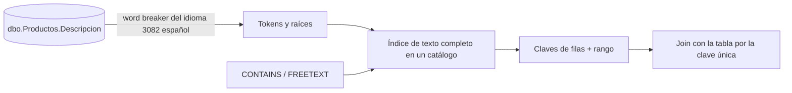

# Búsqueda de texto completo

Parte de: [[06-SQL-Server/06 Otros datos/_Índice Otros datos|Otros datos]]

> [!info] Cómo avanzar
> `progreso`: **pendiente** → **viendo** (estudiando) → **visto** (contestaste la autoevaluación sin abrir las respuestas) → **dominado** (hiciste el laboratorio o lo aplicaste de verdad).

## Contenido

### Qué es
La **búsqueda de texto completo** (*Full-Text Search*, FTS) de SQL Server permite buscar palabras y frases dentro de columnas de texto grandes de forma eficiente y con reglas lingüísticas. Frente a `LIKE '%palabra%'`, que revisa carácter por carácter cada fila y no puede usar un índice normal cuando el patrón empieza con `%`, FTS usa un **índice invertido** (palabra → filas donde aparece) y ofrece:

- búsqueda por **palabras completas** y **prefijos** (`"compu*"`),
- **formas flexionadas** del idioma (`FORMSOF(INFLECTIONAL, correr)` encuentra "corrió", "corriendo"),
- **sinónimos** mediante tesauro, **proximidad** (`NEAR`) y **ranking** de relevancia con `CONTAINSTABLE` y `FREETEXTTABLE`,
- **palabras vacías** (*stopwords*) que se ignoran ("de", "la", "el"),
- indexación de documentos binarios (PDF, Word) con filtros instalados.

### Cómo funciona

**Qué necesitas para crear un índice de texto completo**:

1. Que el componente **Full-Text Search** esté instalado en la instancia (en Azure SQL Database ya viene incluido).
2. Un **catálogo de texto completo** (contenedor lógico).
3. Un **índice único de una sola columna, no anulable** en la tabla (normalmente la clave primaria), que FTS usa como `KEY INDEX` para mapear resultados a filas.
4. Elegir columnas de tipo `char`, `varchar`, `nchar`, `nvarchar`, `xml` o `varbinary(max)` (con columna de tipo de documento) y su **idioma** (LCID, por ejemplo 3082 para español).
5. Solo **un índice de texto completo por tabla**, que puede cubrir varias columnas.

El índice se llena de forma **asíncrona**: tras un `INSERT`, la fila tarda unos segundos en aparecer en las búsquedas (`CHANGE_TRACKING AUTO` por defecto).

### Ejemplo
```sql
CREATE FULLTEXT CATALOG ftCatalogo AS DEFAULT;

CREATE FULLTEXT INDEX ON catalogo.Productos (Nombre LANGUAGE 3082, Descripcion LANGUAGE 3082)
    KEY INDEX PK_Productos
    WITH CHANGE_TRACKING AUTO, STOPLIST = SYSTEM;

-- Palabras con prefijo y forma flexionada, ordenado por relevancia
SELECT TOP (20) p.ProductoId, p.Nombre, k.[RANK]
FROM CONTAINSTABLE(catalogo.Productos, (Nombre, Descripcion),
       N'"impresora*" AND FORMSOF(INFLECTIONAL, imprimir)') AS k
JOIN catalogo.Productos AS p ON p.ProductoId = k.[KEY]
ORDER BY k.[RANK] DESC;

-- Lenguaje natural: más tolerante, menos preciso
SELECT ProductoId, Nombre
FROM catalogo.Productos
WHERE FREETEXT(Descripcion, N'cámara para video vertical');
```
Desde la API con Dapper, construye la expresión de `CONTAINS` en C# a partir de lo que escribe el usuario, escapando comillas dobles y rodeando cada término con `"..."`; nunca concatenes la entrada en el texto SQL, pásala como parámetro (`CONTAINS(Nombre, @expr)`).

### Cuándo usarlo y cuándo no
- **FTS de SQL Server** sirve bien para catálogos, notas, tickets o documentos de tamaño moderado cuando quieres todo en la misma base, transaccional y sin otro servicio.
- **`LIKE 'texto%'`** (sin comodín inicial) sigue siendo correcto para autocompletar sobre una columna corta indexada.
- **Un servicio aparte** como **Azure AI Search**, **Elasticsearch** u **OpenSearch** conviene cuando necesitas: tolerancia a errores de dedo (*fuzzy*), facetas y filtros dinámicos, sugerencias mientras se escribe, ranking configurable (BM25, *boosting*), búsqueda vectorial o semántica con embeddings, millones de documentos con mucha concurrencia, o indexar contenido de varias fuentes. El costo es operar y sincronizar otro sistema (por ejemplo con [[Auditoría (CDC y Change Tracking)|Change Tracking]] o eventos).
- Las intercalaciones `AI` ayudan con acentos en búsquedas simples (ver [[Collation]]).

### Errores comunes
1. **Esperar que FTS encuentre fragmentos dentro de palabras** (`"presor"` en "impresora"). Solo indexa palabras y prefijos.
2. **Idioma incorrecto** (inglés por defecto en algunas instancias): las raíces y palabras vacías no funcionan en español.
3. **Probar justo después de insertar** y creer que no funciona: el llenado es asíncrono.
4. **Errores de sintaxis por la entrada del usuario.** Caracteres como `"` o palabras como `AND` rompen la expresión de `CONTAINS`; sanitiza y arma la expresión tú.
5. **Usar `LIKE '%texto%'` sobre millones de filas** esperando que un índice lo resuelva.

### Para profundizar
- [Búsqueda de texto completo (Microsoft Learn)](https://learn.microsoft.com/sql/relational-databases/search/full-text-search)
- [CONTAINS (Transact-SQL)](https://learn.microsoft.com/sql/t-sql/queries/contains-transact-sql)
- [Azure AI Search](https://learn.microsoft.com/azure/search/search-what-is-azure-search)

## Autoevaluación

Contesta primero en voz alta o en papel; luego despliega la respuesta.

> [!question]- ¿Qué ofrece la búsqueda de texto completo (Full-Text Search) de SQL Server sobre `LIKE`?
> Índices de palabras con reglas por idioma (separación de palabras, raíces gramaticales, palabras vacías) y predicados como `CONTAINS(Descripcion, N'"teclad*" AND mecánico')`, `FREETEXT` y `CONTAINSTABLE` con ranking. Es mucho más rápido que `LIKE '%texto%'` en textos largos.

> [!question]- ¿Qué necesitas para crear un índice de texto completo?
> Un catálogo (`CREATE FULLTEXT CATALOG`) y un índice único de una sola columna, no nulo, como llave de la tabla:
> ```sql
> CREATE FULLTEXT CATALOG ftc_tienda;
> CREATE FULLTEXT INDEX ON ventas.Productos (Nombre LANGUAGE 3082)
>   KEY INDEX PK_Productos ON ftc_tienda;
> ```
> 3082 = español (internacional).

> [!question]- ¿Cuándo usarías un servicio aparte (Azure AI Search, Elasticsearch)?
> Cuando necesitas tolerancia a errores de escritura, facetas, sinónimos, relevancia ajustable, búsqueda vectorial o escalar la búsqueda sin cargar la base transaccional.

