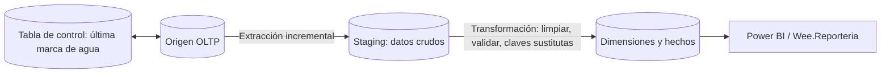

# ETL (conceptos)

Parte de: [[06-SQL-Server/06 Otros datos/_Índice Otros datos|Otros datos]]

> [!info] Cómo avanzar
> `progreso`: **pendiente** → **viendo** (estudiando) → **visto** (contestaste la autoevaluación sin abrir las respuestas) → **dominado** (hiciste el laboratorio o lo aplicaste de verdad).

## Contenido

### Qué es
**ETL** (*Extract, Transform, Load*) es el proceso de **extraer** datos de sistemas origen (la base de Itzamna.Dionisio, archivos de Excel, una API de pagos), **transformarlos** (limpiar, unificar formatos, calcular, aplicar reglas de negocio) y **cargarlos** en un destino pensado para análisis: un data warehouse, un data mart o el modelo de Power BI. En **ELT** el orden cambia: primero cargas los datos crudos al destino y transformas **dentro** de él, aprovechando su poder de cómputo (Azure Synapse, Fabric, Databricks, Snowflake). ETL tiene sentido cuando el destino es limitado o hay que filtrar datos sensibles antes de cargarlos; ELT cuando el destino escala bien y quieres conservar lo crudo para reprocesar.

### Cómo funciona

**Carga incremental**: en lugar de copiar todo cada noche, extraes solo lo que cambió desde la última ejecución. Opciones en SQL Server, de la más simple a la más robusta:

1. **Marca de agua por fecha** (`ModificadoEn > @ultimaMarca`): simple, pero no detecta borrados físicos y depende de que la app siempre actualice la columna.
2. **`rowversion`**: un número que SQL Server incrementa en cada cambio; más confiable que la fecha. Guardas el máximo leído.
3. **[[Auditoría (CDC y Change Tracking)|Change Tracking o CDC]]**: el motor te dice qué filas cambiaron, incluidos los borrados.

Siempre guarda la marca en una tabla de control y actualízala **solo** cuando la carga terminó bien.

**Idempotencia**: un ETL falla a la mitad (red, timeout, datos inválidos) y se vuelve a correr. Si no es idempotente, la segunda ejecución duplica filas o suma dos veces. Un proceso idempotente produce el mismo resultado sin importar cuántas veces se ejecute para el mismo periodo: se logra con `MERGE` o *upsert* por clave natural, borrando e insertando la partición del periodo, o cargando en *staging* y cambiando de golpe.

**Dimensión de cambio lento tipo 2 (SCD2)**: en un modelo dimensional, cuando cambia un atributo (el cliente se muda de Puebla a Monterrey), en lugar de sobrescribir agregas **una fila nueva** con su propia clave sustituta y marcas la anterior como vencida (`VigenteDesde`, `VigenteHasta`, `EsActual`). Así las ventas de antes siguen apuntando a "Puebla" y las nuevas a "Monterrey". El tipo 1 sobrescribe (sin historia) y el tipo 2 conserva historia.

### Ejemplo
Carga incremental con `rowversion` y SCD2 de clientes:
```sql
-- Extracción: solo lo que cambió desde la última corrida
DECLARE @desde binary(8) = (SELECT UltimaVersion FROM etl.Control WHERE Proceso = 'Clientes');
DECLARE @hasta binary(8) = MIN_ACTIVE_ROWVERSION();

INSERT INTO stg.Clientes (ClienteId, Nombre, Ciudad)
SELECT ClienteId, Nombre, Ciudad FROM dbo.Clientes
WHERE Version >= @desde AND Version < @hasta;

-- SCD2: vencer la versión actual si cambió la ciudad
UPDATE d SET VigenteHasta = SYSUTCDATETIME(), EsActual = 0
FROM dw.DimCliente d JOIN stg.Clientes s ON s.ClienteId = d.ClienteId
WHERE d.EsActual = 1 AND d.Ciudad <> s.Ciudad;

-- Insertar versiones nuevas (clientes nuevos o que cambiaron)
INSERT INTO dw.DimCliente (ClienteId, Nombre, Ciudad, VigenteDesde, VigenteHasta, EsActual)
SELECT s.ClienteId, s.Nombre, s.Ciudad, SYSUTCDATETIME(), '9999-12-31', 1
FROM stg.Clientes s
WHERE NOT EXISTS (SELECT 1 FROM dw.DimCliente d WHERE d.ClienteId = s.ClienteId AND d.EsActual = 1);

UPDATE etl.Control SET UltimaVersion = @hasta WHERE Proceso = 'Clientes';
TRUNCATE TABLE stg.Clientes;
```
Envuelve todo en una transacción (o haz que cada paso sea repetible) para que un fallo no deje la marca avanzada sin datos.

### Cuándo usarlo y cuándo no
- **Sí**: reportes que no deben cargar la base transaccional, unificar varias fuentes, conservar historia (SCD2) o preparar modelos para Power BI.
- **No** para necesidades de tiempo real estricto; ahí conviene streaming o eventos.
- Herramientas: procedimientos y jobs del [[SQL Server Agent y jobs|Agent]], SSIS, Azure Data Factory, Fabric Data Pipelines o un worker .NET. Para volúmenes pequeños, Power Query en Power BI puede bastar.

### Errores comunes
1. **Marca de agua por fecha local** con cambios de horario o relojes desincronizados; usa UTC o `rowversion`.
2. **Avanzar la marca antes de terminar la carga**: pierdes datos al fallar.
3. **No detectar borrados**: el warehouse conserva clientes eliminados para siempre.
4. **Transformaciones no deterministas** (fechas de ejecución, `NEWID()`) que impiden repetir con el mismo resultado.
5. **Sin validaciones de calidad** (conteos, sumas de control): errores silenciosos llegan al reporte.

### Para profundizar
- [ETL en Azure Architecture Center](https://learn.microsoft.com/azure/architecture/data-guide/relational-data/etl)
- [Carga incremental con Change Tracking en Azure Data Factory](https://learn.microsoft.com/azure/data-factory/tutorial-incremental-copy-change-tracking-feature-portal)
- [Kimball Group: técnicas de modelado dimensional](https://www.kimballgroup.com/data-warehouse-business-intelligence-resources/kimball-techniques/dimensional-modeling-techniques/)

## Autoevaluación

Contesta primero en voz alta o en papel; luego despliega la respuesta.

> [!question]- ¿Qué diferencia hay entre ETL y ELT?
> **ETL**: extraer, transformar fuera del destino y cargar ya limpio. **ELT**: cargar crudo en el destino (data warehouse o lago) y transformar ahí con SQL (p. ej. con dbt). ELT es lo común con almacenes en la nube.

> [!question]- ¿Cómo haces una carga incremental desde SQL Server?
> Con una **marca de agua**: guardas el último valor procesado (`rowversion`, `UpdatedAt` o la versión de Change Tracking/CDC) y en cada ejecución extraes solo lo posterior. `rowversion` es buena opción porque cambia en cada `UPDATE`; ojo, no detecta borrados físicos (para eso, CT/CDC o borrado lógico).

> [!question]- ¿Por qué un proceso ETL debe ser idempotente?
> Porque fallará a la mitad alguna vez y se re-ejecutará: cargar en una tabla de *staging* y hacer `MERGE`/upsert por clave, o reemplazar particiones completas, evita duplicados.

> [!question]- ¿Qué es una dimensión de cambio lento tipo 2 (SCD2)?
> Una dimensión que conserva el historial: cuando cambia un atributo (la ciudad del cliente) se cierra la fila vigente (`ValidoHasta`) y se inserta una nueva, para que los hechos viejos sigan apuntando al valor de su momento.

