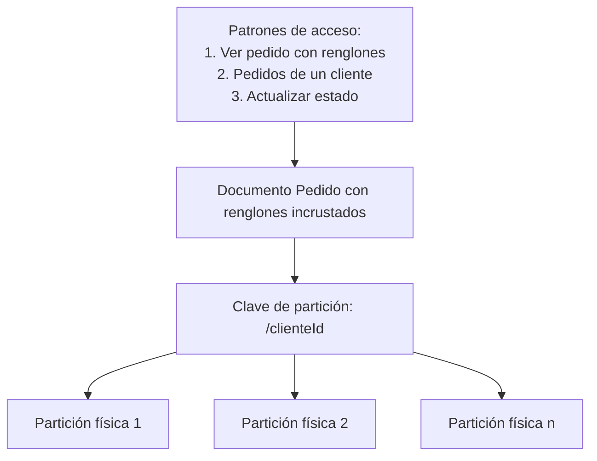

# Modelado en NoSQL

Parte de: [[06-SQL-Server/06 Otros datos/_Índice Otros datos|Otros datos]]

> [!info] Cómo avanzar
> `progreso`: **pendiente** → **viendo** (estudiando) → **visto** (contestaste la autoevaluación sin abrir las respuestas) → **dominado** (hiciste el laboratorio o lo aplicaste de verdad).

## Contenido

### Qué es
Modelar en una base **NoSQL documental** (Azure Cosmos DB, MongoDB, DynamoDB en su modo de documentos) parte de una idea opuesta a la relacional. En SQL Server normalizas primero (ver [[Normalización]]) y luego las consultas combinan tablas con joins. En una base documental **diseñas a partir de los patrones de acceso**: primero listas qué consultas y escrituras hará la app, y luego defines documentos que respondan cada una con **una sola lectura** a una sola partición, aunque eso implique **duplicar datos**. No hay joins entre colecciones (o son caros), así que lo que se lee junto se guarda junto.

### Cómo funciona

**Incrustar o referenciar**:

- **Incrusta** cuando los datos se leen siempre juntos, pertenecen a la entidad principal (relación de composición), el conjunto es **acotado** y cambia poco por separado: los renglones de un pedido, la dirección de envío vigente al momento de la compra, los datos de contacto de un usuario.
- **Referencia** (guarda solo el id) cuando el conjunto **crece sin límite** (los comentarios de un producto popular, los movimientos de una cuenta), cuando los datos cambian con frecuencia y se comparten entre muchos documentos (el precio actual del producto), o cuando se consultan de forma independiente. Un documento tiene límite de tamaño: 2 MB en Cosmos DB, 16 MB en MongoDB, 400 KB por elemento en DynamoDB.
- Patrón intermedio: **incrustar un resumen** (nombre y foto del autor) y referenciar el resto, aceptando actualizar las copias con un proceso asíncrono (por ejemplo, el *change feed* de Cosmos DB).

**La clave de partición** es la decisión más importante e **inmutable** del contenedor. Determina cómo se reparten los datos y la carga entre particiones físicas:

- Las consultas que incluyen la clave van a **una sola partición** (baratas y rápidas). Las que no, se reparten a **todas** (*fan-out*), cuestan más unidades de solicitud (RU en Cosmos DB) y escalan mal.
- Las transacciones (en Cosmos DB, *transactional batch* y procedimientos) solo abarcan documentos con **la misma clave lógica**.
- Una clave con poca cardinalidad o sesgada (`/pais` con casi todo en "MX", o la fecha del día) crea **particiones calientes**: una partición recibe todo el tráfico y se estrangula aunque el contenedor tenga capacidad total de sobra.
- Buenas candidatas: alta cardinalidad, reparto uniforme y presentes en la mayoría de las consultas (`/clienteId`, `/tenantId`, o una clave jerárquica `tenantId/usuarioId`).

### Ejemplo
Documento de pedido para Cosmos DB, particionado por cliente:
```json
{
  "id": "ped-2026-000123",
  "clienteId": "cli-42",
  "tipo": "pedido",
  "estado": "pagado",
  "creadoEn": "2026-11-09T18:20:00Z",
  "cliente": { "nombre": "Ana Méndez", "correo": "ana@ejemplo.mx" },
  "envio": { "calle": "Av. Juárez 10", "ciudad": "Puebla", "cp": "72000" },
  "renglones": [
    { "productoId": "prd-7", "nombre": "Filamento PLA", "cantidad": 2, "precioCentavos": 39900 },
    { "productoId": "prd-9", "nombre": "Boquilla 0.4", "cantidad": 1, "precioCentavos": 12900 }
  ],
  "totalCentavos": 92700
}
```
El nombre y el precio del producto se copian **tal como estaban al comprar**; eso es correcto para un pedido (es un hecho histórico). Leer "un pedido" es una lectura puntual por `id` + `clienteId`, la operación más barata.

```csharp
var respuesta = await contenedor.ReadItemAsync<PedidoDoc>(
    "ped-2026-000123", new PartitionKey("cli-42"));
```

### Cuándo usarlo y cuándo no
- **Sí**: patrones de acceso conocidos y estables, escala horizontal grande, esquemas variables, datos por tenant o por usuario, baja latencia global.
- **No** cuando necesitas consultas ad hoc, reportes con joins y agregaciones complejas, o transacciones entre muchas entidades: un relacional como SQL Server o [[PostgreSQL]] es más adecuado.
- Muchos sistemas combinan ambos: el núcleo transaccional en SQL Server y una proyección documental o una caché en [[Redis más allá de la caché (locks, colas y contadores)|Redis]].

### Errores comunes
1. **Traducir tablas a colecciones** una por una y luego "hacer joins" en la app: muchas lecturas y RU caras.
2. **Arreglos sin límite incrustados** que crecen hasta el tamaño máximo del documento.
3. **Clave de partición elegida sin mirar las consultas**: particiones calientes o *fan-out* constante. Cambiarla exige migrar a otro contenedor.
4. **Olvidar sincronizar las copias** de datos duplicados que sí deben actualizarse.
5. **Usar `id` aleatorio como clave de partición** cuando todas las consultas son por cliente: cada consulta recorre todas las particiones.

### Para profundizar
- [Modelado de datos en Azure Cosmos DB](https://learn.microsoft.com/azure/cosmos-db/nosql/modeling-data)
- [Particionamiento y escalado horizontal en Cosmos DB](https://learn.microsoft.com/azure/cosmos-db/partitioning-overview)
- [Patrones de modelado de MongoDB](https://www.mongodb.com/docs/manual/data-modeling/)

## Autoevaluación

Contesta primero en voz alta o en papel; luego despliega la respuesta.

> [!question]- ¿Cuál es la diferencia clave al modelar en una base documental frente a una relacional?
> En relacional modelas las **entidades** y normalizas; en documental modelas según los **patrones de acceso**: qué se lee junto se guarda junto (documentos con datos incrustados), aceptando duplicación.

> [!question]- ¿Cuándo incrustas y cuándo referencias?
> Incrusta lo que se lee siempre con el padre y tiene tamaño acotado (renglones de un pedido). Referencia lo que crece sin límite, se comparte entre muchos documentos o cambia por separado (el cliente de miles de pedidos). Cosmos DB limita cada elemento a 2 MB.

> [!question]- ¿Por qué es crítica la clave de partición en Cosmos DB o DynamoDB?
> Determina cómo se reparten los datos y la carga: debe tener muchos valores distintos, repartir bien las escrituras y estar en el filtro de las consultas frecuentes; las consultas entre particiones son más caras. Cambiarla después implica migrar los datos.

