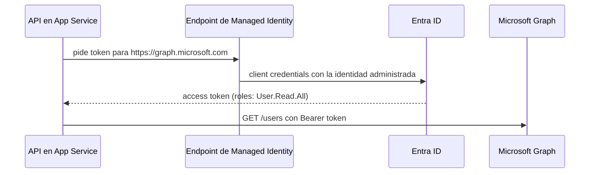

# Azure - Entra ID y registro de aplicaciones

Parte de: [[07-Azure/01 Fundamentos/_Índice Fundamentos|Fundamentos]]

> [!info] Cómo avanzar
> `progreso`: **pendiente** → **viendo** (estudiando) → **visto** (contestaste la autoevaluación sin abrir las respuestas) → **dominado** (hiciste el laboratorio o lo aplicaste de verdad).

## Contenido

### Qué es
**Microsoft Entra ID** (antes Azure Active Directory) es el servicio de **identidad** de Microsoft en la nube: guarda usuarios, grupos e identidades de aplicaciones, y emite tokens con [[OAuth 2.0]] y [[OpenID Connect]]. Todo tenant de Azure tiene un directorio de Entra ID; cuando inicias sesión en el portal o una app pide un token para llamar a una API, Entra ID es quien autentica y firma.

Para que una aplicación tuya pueda iniciar sesión de usuarios o pedir tokens, debe existir en Entra ID mediante un **registro de aplicación**.

### Cómo funciona
**Registro de aplicación vs aplicación empresarial**
- **Registro de aplicación (application object)**: la **definición global** de la app, en su tenant "hogar": id de cliente (*client id*), URIs de redirección, credenciales (secretos o certificados), permisos que solicita, scopes que expone, app roles.
- **Aplicación empresarial (service principal)**: la **instancia local** de esa app en un tenant concreto. Es a quien se le asignan permisos, roles de Azure ([[Azure - RBAC]]), consentimiento y qué usuarios pueden entrar. Una app multitenant tiene un registro y un service principal en cada tenant que la usa.

Analogía: el registro es la "clase"; el service principal es el "objeto" en cada tenant.

**Permisos delegados (scopes) vs app roles**
- **Scopes / permisos delegados** (claim `scp`): la app actúa **en nombre de un usuario** que inició sesión, y el permiso efectivo es la intersección entre lo que la app pide y lo que el usuario puede hacer. Ejemplo: `api://dionisio/Pedidos.Leer`.
- **App roles** (claim `roles`): roles que defines en tu API y asignas a **usuarios/grupos** (para autorización por rol) o a **aplicaciones** (permisos de aplicación, sin usuario). Ejemplo: `Pedidos.Sincronizar` asignado a un servicio.

**Flujo sin usuario (servicio a servicio)**: **client credentials**. La app se autentica con su propia identidad y recibe un token con permisos de **aplicación** (que requieren consentimiento de administrador). Credenciales posibles, de mejor a peor:
1. **[[Managed Identity]]** si el código corre en Azure: sin secretos que guardar ni rotar.
2. **Certificado** o federación de identidad de carga de trabajo (*workload identity federation*, por ejemplo desde Azure DevOps o GitHub).
3. **Client secret**: una contraseña con caducidad obligatoria.



### Ejemplo
API en App Service que lista usuarios en Graph sin usuario interactivo:

```csharp
// Paquetes: Azure.Identity, Microsoft.Graph
using Azure.Identity;
using Microsoft.Graph;

// En Azure usa la Managed Identity; en local usa tu sesión de az login / Visual Studio
var credencial = new DefaultAzureCredential();
var graph = new GraphServiceClient(credencial, ["https://graph.microsoft.com/.default"]);

var usuarios = await graph.Users.GetAsync(c => c.QueryParameters.Top = 10);
foreach (var u in usuarios?.Value ?? [])
    Console.WriteLine($"{u.DisplayName} <{u.UserPrincipalName}>");
```
El permiso de aplicación `User.Read.All` se asigna al service principal de la Managed Identity (con PowerShell o Graph, no desde la pantalla de registro de apps) y requiere consentimiento de administrador. Para validar tokens en tu propia API ASP.NET Core ver [[JWT y autenticación con Bearer]].

En tu proyecto Xolotl.Hecate tú mismo eres el emisor de tokens (RS256, PKCE); Entra ID es la alternativa administrada a ese papel.

### Cuándo usarlo y cuándo no
Usa Entra ID para apps internas de una organización, para identidades de servicio dentro de Azure y para llamar APIs de Microsoft. Para clientes externos (consumidores) Microsoft ofrece **Entra External ID**. Si necesitas control total del emisor y del formato de tokens, un servidor propio como Hecate tiene sentido, a costa de mantenerlo.

### Errores comunes
1. **Client secrets en el repositorio** o en `appsettings.json`: van en [[Key Vault]] o, mejor, se eliminan usando Managed Identity. Ver [[Secretos con User Secrets]] para desarrollo local.
2. **Secretos que caducan sin aviso**: tienen fecha de expiración obligatoria; la app cae el día que vence. Monitorea y rota, o usa certificados/MI.
3. **Pedir permisos de aplicación cuando bastan delegados**, o al revés, por no entender quién actúa.
4. **Confundir registro y service principal**: asignar roles "en el registro" no existe; se asignan al service principal.
5. **Validar mal el token**: no comprobar audiencia (`aud`) y emisor (`iss`).

### Para profundizar
- [¿Qué es Microsoft Entra ID?](https://learn.microsoft.com/es-mx/entra/fundamentals/whatis)
- [Objetos de aplicación y entidad de servicio](https://learn.microsoft.com/es-mx/entra/identity-platform/app-objects-and-service-principals)
- [Flujo de credenciales de cliente de OAuth 2.0](https://learn.microsoft.com/es-mx/entra/identity-platform/v2-oauth2-client-creds-grant-flow)
- [Agregar roles de aplicación](https://learn.microsoft.com/es-mx/entra/identity-platform/howto-add-app-roles-in-apps)

## Autoevaluación

Contesta primero en voz alta o en papel; luego despliega la respuesta.

> [!question]- ¿Qué es Microsoft Entra ID?
> El servicio de identidad de Microsoft (antes Azure Active Directory): usuarios, grupos, aplicaciones, inicio de sesión con OAuth 2.0 / OpenID Connect, MFA y acceso condicional.

> [!question]- ¿Qué diferencia hay entre un *registro de aplicación* y una *aplicación empresarial* (service principal)?
> El **registro** es la definición global de la app (client ID, redirect URIs, permisos que expone o pide). El **service principal** es la instancia de esa app **en un tenant**, a la que se asignan roles y consentimientos. Al registrar una app en tu tenant se crean ambos.

> [!question]- Una API en App Service debe llamar a Microsoft Graph sin usuario. ¿Qué flujo y credencial usarías?
> Flujo **client credentials** con permisos de **aplicación**. Como credencial, mejor una **Managed Identity** (sin secreto que rotar); si no se puede, certificado antes que *client secret*.

> [!question]- ¿Qué diferencia hay entre *scopes* (permisos delegados) y *app roles*?
> Los scopes (`api://mi-api/Pedidos.Read`) representan lo que una app puede hacer **en nombre del usuario**. Los app roles son roles que la API define y se asignan a usuarios, grupos o apps; llegan en el claim `roles`.

> [!question]- Error común con *client secrets*.
> Guardarlos en `appsettings.json` o Git, y olvidar que **caducan**: la app deja de autenticarse el día que vencen. Usa Key Vault o, mejor, Managed Identity / federación.

