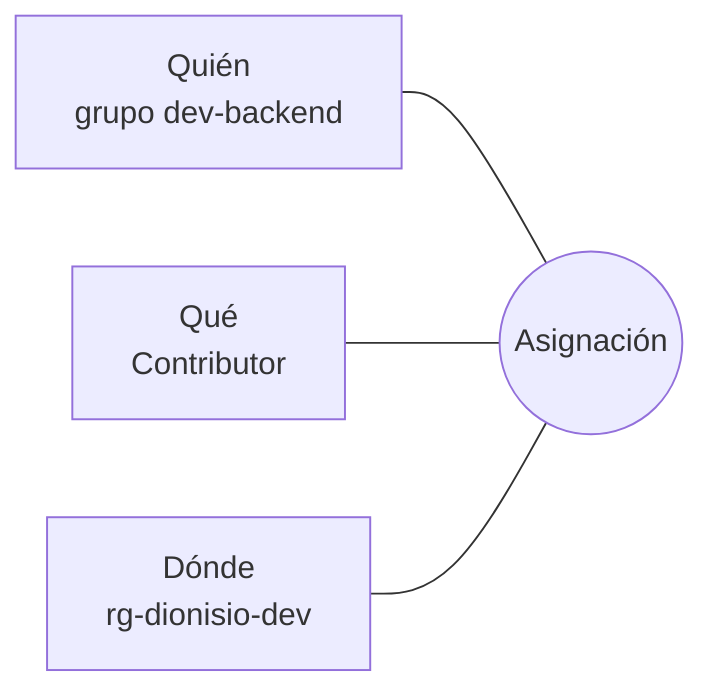

# Azure - RBAC

Parte de: [[07-Azure/01 Fundamentos/_Índice Fundamentos|Fundamentos]]

> [!info] Cómo avanzar
> `progreso`: **pendiente** → **viendo** (estudiando) → **visto** (contestaste la autoevaluación sin abrir las respuestas) → **dominado** (hiciste el laboratorio o lo aplicaste de verdad).

## Contenido

### Qué es
**Azure RBAC (control de acceso basado en roles)** es el sistema de autorización de Azure: decide **quién** puede hacer **qué** sobre **cuáles** recursos. Se basa en asignar roles (conjuntos de permisos) en lugar de dar permisos sueltos, y se evalúa en cada petición que pasa por [[Azure - Resource Manager|ARM]] y en el data plane de los servicios que lo soportan.

### Cómo funciona
Una **asignación de rol** siempre tiene tres piezas:

1. **Entidad de seguridad (security principal)**: quién. Un usuario, un **grupo**, un *service principal* (una app registrada) o una [[Managed Identity]].
2. **Definición de rol**: qué. Una lista de acciones permitidas (`Actions`, `DataActions`) y excluidas (`NotActions`). Ejemplo: *Key Vault Secrets User* permite leer secretos.
3. **Ámbito (scope)**: dónde. Grupo de administración, suscripción, grupo de recursos o un recurso concreto.



Reglas de evaluación:
- **Herencia hacia abajo**: un rol asignado en la suscripción aplica a todos sus grupos y recursos.
- **Es aditivo**: los permisos efectivos son la **suma** de todas tus asignaciones. Si tienes *Reader* en la suscripción y *Contributor* en `rg-lab`, en `rg-lab` puedes crear, modificar y borrar recursos (Contributor), y en el resto solo leer.
- No hay "deny" en las asignaciones normales; los *deny assignments* existen pero los crea Azure (por ejemplo, Blueprints o aplicaciones administradas), no tú directamente.
- Los cambios pueden tardar unos minutos en propagarse.

**Roles integrados fundamentales**
| Rol | Puede | No puede |
|---|---|---|
| **Owner** | Todo, incluido asignar roles a otros | — |
| **Contributor** | Crear, modificar y borrar recursos | Asignar roles, crear bloqueos ni asignar Azure Policy |
| **Reader** | Ver recursos y configuración | Cambiar nada |
| **User Access Administrator** | Solo administrar asignaciones de rol | Crear recursos |

Además hay cientos de roles **específicos de servicio**, muchos de data plane: *Storage Blob Data Reader/Contributor*, *Key Vault Secrets User*, *AcrPull*, *Azure Service Bus Data Sender*. Puedes crear **roles personalizados** si ninguno encaja.

### Ejemplo
La API de [[Itzamna.Dionisio]] en App Service necesita leer secretos de [[Key Vault]]. Lo correcto: habilitar su Managed Identity y darle **Key Vault Secrets User** solo sobre **ese** vault. **No** Contributor: Contributor es un rol de control plane que le permitiría borrar o reconfigurar el vault, y en un vault con modelo RBAC no le daría acceso a leer secretos (eso es data plane). Mínimo privilegio y el permiso correcto.

```bash
APP_PRINCIPAL=$(az webapp identity assign -g rg-dionisio-dev -n app-dionisio-dev --query principalId -o tsv)
KV_ID=$(az keyvault show -n kv-dionisio-dev --query id -o tsv)

az role assignment create --assignee-object-id $APP_PRINCIPAL --assignee-principal-type ServicePrincipal \
  --role "Key Vault Secrets User" --scope $KV_ID

#- Dar acceso al equipo a través de un grupo, no persona por persona
az role assignment create --assignee "<objectId-del-grupo-dev-backend>" \
  --role Contributor --scope $(az group show -n rg-dionisio-dev --query id -o tsv)

#- Ver qué tiene asignado un principal
az role assignment list --assignee $APP_PRINCIPAL --all -o table
```

### Cuándo usarlo y cuándo no
Siempre que puedas, autoriza con RBAC + identidades de Entra en lugar de claves compartidas (cadenas de conexión con clave, SAS de cuenta). Asigna roles a **grupos**: cuando alguien entra o sale del equipo solo cambias la membresía, las asignaciones quedan auditables y no acumulas cientos de asignaciones individuales (hay un límite por suscripción). Para accesos elevados temporales existe **Privileged Identity Management (PIM)**, que requiere licencia Entra ID P2.

### Errores comunes
1. **Dar Owner o Contributor "para que funcione"**: rompe mínimo privilegio; busca el rol específico.
2. **Confundir control plane con data plane**: Contributor en una cuenta de almacenamiento no equivale a *Storage Blob Data Contributor*.
3. **Asignar en la suscripción** lo que solo necesita un grupo de recursos o un recurso.
4. **Asignaciones a usuarios individuales** que nadie limpia cuando la persona se va.
5. **No esperar la propagación**: el primer intento falla con 403 y se "arregla" con más permisos innecesarios.

### Para profundizar
- [¿Qué es el control de acceso basado en roles de Azure?](https://learn.microsoft.com/es-mx/azure/role-based-access-control/overview)
- [Roles integrados de Azure](https://learn.microsoft.com/es-mx/azure/role-based-access-control/built-in-roles)
- [Procedimientos recomendados para Azure RBAC](https://learn.microsoft.com/es-mx/azure/role-based-access-control/best-practices)

## Autoevaluación

Contesta primero en voz alta o en papel; luego despliega la respuesta.

> [!question]- ¿Cuáles son las tres piezas de una asignación de rol?
> **Principal de seguridad** (usuario, grupo, service principal o managed identity) + **definición de rol** (qué acciones) + **ámbito** (grupo de administración, suscripción, grupo de recursos o recurso).

> [!question]- ¿Qué diferencia hay entre Owner, Contributor y Reader?
> **Owner**: todo, incluido asignar roles. **Contributor**: crear y administrar recursos, pero **no** asignar roles. **Reader**: solo ver. Para gestionar accesos sin más poderes existe *User Access Administrator*.

> [!question]- Un usuario tiene Reader en la suscripción y Contributor en un grupo de recursos. ¿Qué puede hacer en ese grupo?
> Contributor: los roles son **aditivos** y se heredan hacia abajo; el permiso efectivo es la unión. (Las *deny assignments* son la excepción y ganan.)

> [!question]- Tu app necesita leer secretos de Key Vault. ¿Le das Contributor sobre el vault?
> No. Aplica **mínimo privilegio**: el rol de data plane **Key Vault Secrets User** en el ámbito del vault (o del secreto). Contributor administra el recurso pero no da lectura de secretos con el modelo RBAC.

> [!question]- ¿Por qué asignar roles a grupos en vez de a usuarios individuales?
> Es más fácil de mantener y auditar: altas y bajas se hacen en el grupo de Entra ID, no en decenas de asignaciones sueltas.

## Práctica

- [[Lab 4 - Key Vault y Managed Identity]]

