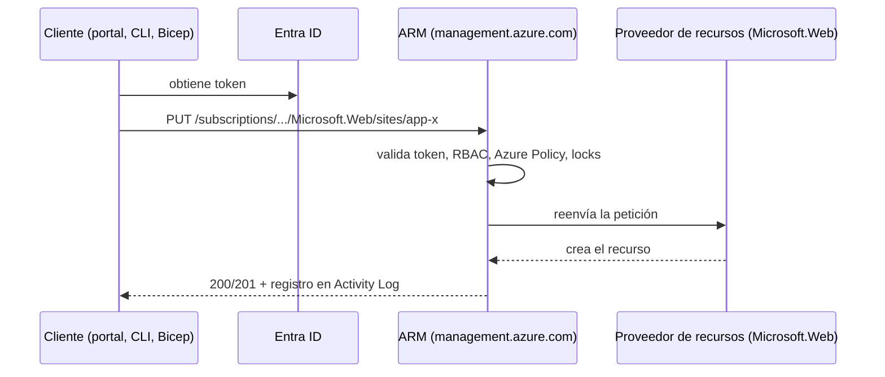

# Azure - Resource Manager

Parte de: [[07-Azure/01 Fundamentos/_Índice Fundamentos|Fundamentos]]

> [!info] Cómo avanzar
> `progreso`: **pendiente** → **viendo** (estudiando) → **visto** (contestaste la autoevaluación sin abrir las respuestas) → **dominado** (hiciste el laboratorio o lo aplicaste de verdad).

## Contenido

### Qué es
**Azure Resource Manager (ARM)** es la capa de administración de Azure: el servicio por el que pasa **toda** petición para crear, leer, modificar o borrar recursos, venga del portal, de la [[Azure CLI]], de PowerShell, de un SDK o de una plantilla [[Bicep]]/[[ARM templates|ARM]]. Como todo pasa por el mismo punto, ARM aplica de forma uniforme autenticación, permisos ([[Azure - RBAC]]), políticas, bloqueos y etiquetas.

### Cómo funciona

Piezas clave:

- **Proveedor de recursos (resource provider)**: el servicio que sabe crear un tipo de recurso. Cada uno tiene un espacio de nombres: `Microsoft.Web` (App Service), `Microsoft.Sql`, `Microsoft.App` (Container Apps), `Microsoft.KeyVault`. Un tipo completo se escribe `Microsoft.Web/sites`.
- **Registro del proveedor**: la suscripción debe tener **registrado** el proveedor para poder crear sus recursos. Muchos se registran solos la primera vez desde el portal, pero en suscripciones nuevas o desde scripts puedes recibir un error del tipo `MissingSubscriptionRegistration`. Se arregla registrándolo.
- **Id de recurso**: cada recurso tiene una ruta única `/subscriptions/{sub}/resourceGroups/{rg}/providers/{proveedor}/{tipo}/{nombre}`. Es lo que usas como *scope* de permisos o para referenciarlo en scripts.
- **Activity Log**: ARM registra cada operación de escritura (quién creó o borró qué y cuándo).
- **Bloqueos (locks)**: se aplican en suscripción, grupo o recurso y se heredan.
  - `CanNotDelete`: se puede leer y modificar, pero no borrar.
  - `ReadOnly`: solo lectura; bloquea también modificaciones. Ojo: algunas operaciones que parecen lecturas son POST en ARM (por ejemplo, listar las claves de una cuenta de almacenamiento), así que `ReadOnly` puede romper cosas inesperadas.
  - Los bloqueos aplican **incluso a Owner**: hay que quitar el bloqueo antes de borrar, lo que evita accidentes.

### Control plane vs data plane
- **Control plane (plano de administración)**: operaciones sobre el recurso en sí, vía `management.azure.com`: crear la cuenta de almacenamiento, cambiar el SKU, configurar el firewall. Lo controla RBAC de administración y los locks.
- **Data plane (plano de datos)**: operaciones sobre lo que contiene el recurso, en su propio endpoint: subir un blob a `https://cuenta.blob.core.windows.net`, leer un secreto de Key Vault, ejecutar una consulta en Azure SQL. Tiene sus propios roles (por ejemplo *Storage Blob Data Reader*, *Key Vault Secrets User*) o mecanismos (usuarios de SQL).

Ser Contributor de una cuenta de almacenamiento (control plane) no te convierte automáticamente en lector de sus blobs vía Entra ID (data plane). Esta separación explica muchos "tengo permisos pero me da 403".

### Ejemplo
```bash
#- Ver si el proveedor de Container Apps está registrado y registrarlo
az provider show -n Microsoft.App --query registrationState -o tsv
az provider register -n Microsoft.App --wait

#- Proteger producción contra borrado accidental
az lock create -n no-borrar -g rg-dionisio-prod --lock-type CanNotDelete \
  --notes "Quitar solo con cambio aprobado"

#- Ver quién borró algo en las últimas 24 horas
az monitor activity-log list -g rg-dionisio-dev --offset 1d \
  --query "[?contains(operationName.value,'delete')].{quien:caller, que:resourceId}" -o table
```

### Cuándo usarlo y cuándo no
ARM no se "usa" opcionalmente: siempre está ahí. Lo que decides es **cómo hablarle**: portal para explorar, CLI para tareas puntuales e IaC para lo repetible (ver [[Azure Portal vs CLI vs IaC]]). Usa locks `CanNotDelete` en recursos de producción con datos (bases, almacenamiento, Key Vault); evita `ReadOnly` salvo que sepas exactamente qué operaciones bloquea.

### Errores comunes
1. **Proveedor no registrado** en scripts o pipelines: registra los proveedores necesarios como paso de preparación.
2. **Confundir permisos de control y de datos**: asigna el rol de data plane específico en lugar de subir a Owner.
3. **Lock `ReadOnly` que rompe despliegues**: pipelines que listan claves o reinician apps fallan. Prefiere `CanNotDelete`.
4. **Olvidar el lock al limpiar**: `az group delete` falla con un recurso bloqueado; revisa `az lock list -g <rg>`.

### Para profundizar
- [¿Qué es Azure Resource Manager?](https://learn.microsoft.com/es-mx/azure/azure-resource-manager/management/overview)
- [Proveedores y tipos de recursos](https://learn.microsoft.com/es-mx/azure/azure-resource-manager/management/resource-providers-and-types)
- [Bloquear recursos para evitar cambios inesperados](https://learn.microsoft.com/es-mx/azure/azure-resource-manager/management/lock-resources)
- [Plano de control y plano de datos](https://learn.microsoft.com/es-mx/azure/azure-resource-manager/management/control-plane-and-data-plane)

## Autoevaluación

Contesta primero en voz alta o en papel; luego despliega la respuesta.

> [!question]- ¿Qué es Azure Resource Manager (ARM)?
> Es la **capa de administración** (control plane) de Azure: toda petición del portal, CLI, PowerShell, SDK o plantillas pasa por la misma API de ARM, que autentica, aplica RBAC y Azure Policy y luego llama al **proveedor de recursos** (`Microsoft.Web`, `Microsoft.Sql`…).

> [!question]- ¿Qué es un proveedor de recursos y qué pasa si no está registrado?
> Es el servicio que gestiona un tipo de recurso (p. ej. `Microsoft.ContainerRegistry`). Si no está registrado en la suscripción, crear ese recurso falla con un error de registro; se arregla con `az provider register --namespace Microsoft.ContainerRegistry`.

> [!question]- ¿Para qué sirven los bloqueos (locks) `CanNotDelete` y `ReadOnly`?
> Evitan borrados o cambios accidentales aunque tengas permisos. `CanNotDelete` permite modificar pero no borrar; `ReadOnly` impide también modificar (y puede romper operaciones que hacen POST, como listar llaves de una cuenta de almacenamiento).

> [!question]- ¿Qué diferencia hay entre control plane y data plane?
> Control plane = administrar el recurso (crearlo, cambiar su SKU) vía ARM en `management.azure.com`. Data plane = usar su contenido (leer un blob, consultar la base) en el endpoint del servicio. Los permisos son distintos: ser *Contributor* de una cuenta de almacenamiento no te da por sí solo lectura de blobs con Entra ID.

