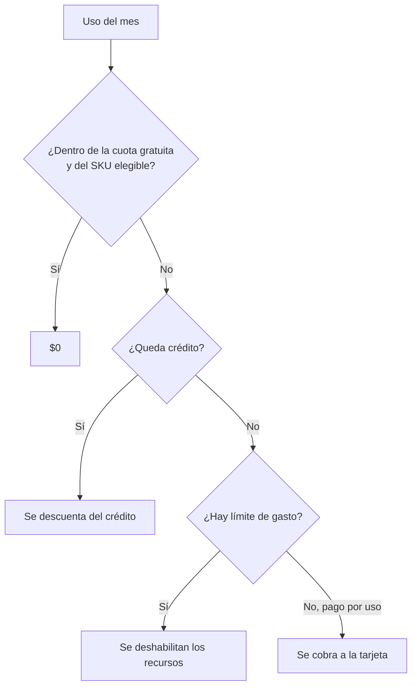

# Azure - capas gratuitas

Parte de: [[07-Azure/01 Fundamentos/_Índice Fundamentos|Fundamentos]]

> [!info] Cómo avanzar
> `progreso`: **pendiente** → **viendo** (estudiando) → **visto** (contestaste la autoevaluación sin abrir las respuestas) → **dominado** (hiciste el laboratorio o lo aplicaste de verdad).

## Contenido

### Qué es
"Gratis" en Azure no es una sola cosa. Hay varias formas de no pagar (o pagar poco), cada una con reglas distintas, y confundirlas es la causa número uno de cobros inesperados. Esta nota da el mapa general; el detalle de cada oferta está en la sección [[_Índice Dónde probar Azure sin pagar|Dónde probar Azure sin pagar]].

### Cómo funciona: los tipos de "gratis"
Verificado en la página oficial de servicios gratuitos de Azure (noviembre de 2026):

| Tipo | Qué es | Dura | Nota |
|---|---|---|---|
| **Crédito promocional** | Saldo en dólares para gastar en casi cualquier servicio | Cuenta gratuita: USD 200 en 30 días | [[Cuenta gratuita de Azure (crédito de 30 días, servicios gratuitos y límite de gasto)]] |
| **Gratis 12 meses** | Cantidades mensuales de ciertos servicios para clientes nuevos | 12 meses | VMs B1s/B2pts v2/B2ats v2 (750 h), PostgreSQL y MySQL B1MS, ACR Standard, etc. Ver [[Servicios de Azure gratuitos durante 12 meses]] |
| **Siempre gratis** | Cuota mensual permanente de ciertos servicios | Indefinido (mientras Microsoft la mantenga) | Functions 1 millón de solicitudes, App Service 10 apps, Static Web Apps, Container Apps, Azure SQL serverless 100,000 vCore-segundos. Ver [[Servicios de Azure siempre gratuitos]] |
| **Nivel gratuito de un servicio (SKU Free)** | Un plan/tier llamado Free dentro del servicio | Mientras lo uses | App Service F1, Static Web Apps Free, AKS tier Free (solo la administración del clúster) |
| **Créditos de programas** | Saldo mensual o anual por ser estudiante o suscriptor de Visual Studio | Según programa | [[Azure for Students]], [[Créditos de Azure para suscriptores de Visual Studio]] |

Diferencias clave:
- El **crédito** se agota y caduca; mientras dura, puede pagar servicios que normalmente cuestan.
- La **cuota gratuita** (12 meses o siempre) se mide **por mes**: lo que excedas se cobra (o se descuenta del crédito si aún lo tienes).
- El **tier Free** de un servicio es una configuración del recurso: si lo cambias de nivel, deja de ser gratis.

### Ejemplo
Montas [[Itzamna.Dionisio]] en un plan F1 para practicar. Funciona. Luego quieres probar *deployment slots*, que el F1 no soporta, y escalas el plan a S1 "un ratito". El plan S1 cobra **por hora mientras exista en ese nivel**, aunque no tenga tráfico. Si olvidas regresarlo a F1 (o borrarlo), pagas todo el mes. Lo mismo pasa al cambiar una VM gratuita B1s por una B2s: la cuota de 750 horas aplica **solo** a los tamaños elegibles.

### Cuándo usarlo y cuándo no
- **Crédito**: para probar servicios caros por poco tiempo (AKS, App Gateway, SQL de mayor nivel).
- **Siempre gratis / tier Free**: para proyectos personales que quieres tener publicados indefinidamente (ver [[Crédito promocional vs proyectos con costo cero permanente]]).
- No diseñes producción real alrededor de cuotas gratuitas: no tienen SLA fuerte y pueden cambiar.

### Errores comunes
1. **"El servicio X es gratis, así que todo lo que crea también"**: una VM gratuita trae disco administrado, IP pública y quizá tráfico de salida; una Function App necesita cuenta de almacenamiento; Container Apps puede crear un Log Analytics que cobra por GB ingerido. Revisa **todo** lo que aparece en el grupo de recursos.
2. **Escalar "solo para probar"** y no regresar el nivel.
3. **Usar un tamaño o región no elegible** para la cuota de 12 meses.
4. **Suponer que las condiciones no cambian**: montos, servicios y cantidades se actualizan; revisa la página oficial antes de cada proyecto.

### Para profundizar
- [Servicios gratuitos de Azure (página oficial)](https://azure.microsoft.com/pricing/free-services/)
- [Preguntas frecuentes de la cuenta gratuita](https://azure.microsoft.com/free/free-account-faq/)
- [Límite de gasto de Azure](https://learn.microsoft.com/es-mx/azure/cost-management-billing/manage/spending-limit)

## Autoevaluación

Contesta primero en voz alta o en papel; luego despliega la respuesta.

> [!question]- ¿Qué tipos de «gratis» existen en Azure?
> 1) Servicios **siempre gratuitos** hasta cierta cantidad mensual; 2) servicios **gratis por 12 meses** con la cuenta gratuita; 3) **crédito** temporal de la cuenta gratuita, Azure for Students o Visual Studio; 4) **niveles gratuitos** propios de un servicio (p. ej. plan F1 de App Service, plan Free de Static Web Apps). Cantidades y condiciones cambian (verificar en la página oficial).

> [!question]- Usas el plan gratuito de un servicio y lo escalas a otro nivel «solo para probar». ¿Qué riesgo hay?
> Ese nuevo nivel ya cobra. Si estás con crédito, lo consume; si ya pasaste a pago por uso, se carga a tu tarjeta. Siempre revisa el SKU antes de escalar y regresa o borra al terminar.

> [!question]- Error común: «el servicio X es gratis, así que todo lo que crea también».
> Muchos servicios gratuitos dependen de otros que no lo son: IP públicas, discos, egreso de datos, logs en Log Analytics, Application Insights por encima de la cuota. Revisa todo el grupo de recursos en Cost Management.

