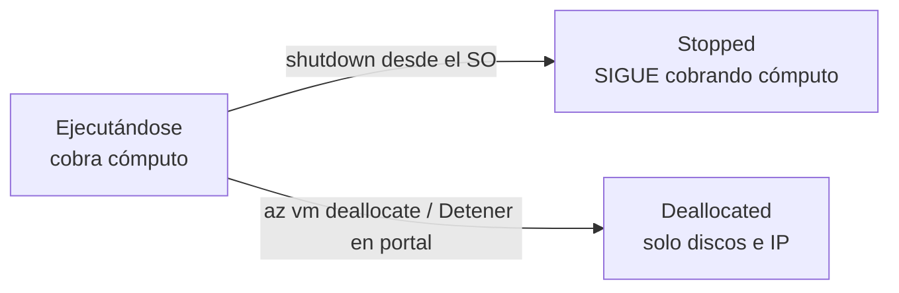

# Azure - costos y Cost Management

Parte de: [[07-Azure/01 Fundamentos/_Índice Fundamentos|Fundamentos]]

> [!info] Cómo avanzar
> `progreso`: **pendiente** → **viendo** (estudiando) → **visto** (contestaste la autoevaluación sin abrir las respuestas) → **dominado** (hiciste el laboratorio o lo aplicaste de verdad).

## Contenido

### Qué es
En Azure pagas por **lo que tienes asignado y por lo que consumes**: horas de cómputo, GB almacenados, transacciones, tráfico de salida. **Microsoft Cost Management** es la herramienta (sin costo adicional) para ver, analizar y controlar ese gasto: análisis de costos, presupuestos, alertas, exportaciones y recomendaciones de ahorro (vía Azure Advisor).

### Cómo funciona
**Modelos de cobro más comunes**
- **Por tiempo asignado**: VMs, planes de App Service, bases provisionadas. Cobran mientras existan y estén asignados, uses o no la CPU.
- **Por consumo**: Functions en planes de consumo, almacenamiento por GB, Container Apps por vCPU-segundo.
- **Por salida de datos** (egress): el tráfico que sale de Azure a Internet tiene costo después de una cuota.

**Lo que ofrece Cost Management**
- **Análisis de costos**: gráficas por servicio, grupo de recursos, región o [[Azure - etiquetas (tags)|etiqueta]], y pronóstico del mes.
- **Presupuestos (budgets)**: un monto por periodo con umbrales (por ejemplo 50%, 80%, 100%) sobre costo **real** o **pronosticado**.
- **Alertas**: correos o *action groups* (que pueden disparar un webhook, una Function o un runbook) cuando se cruza un umbral; también alertas de anomalías.
- **Exportaciones** programadas a una cuenta de almacenamiento para analizar en Excel o Power BI.
- **Recomendaciones** de Advisor: recursos inactivos, tamaños sobredimensionados, candidatos a reservación.

**Lo que NO hace un presupuesto**: no detiene ni borra nada. Solo avisa. Si quieres que algo se apague, tú automatizas la acción con un action group (ver [[Cómo evitar cobros inesperados en la nube (presupuestos y alertas)]]). Además, los datos de costo no son en tiempo real: llegan con horas de retraso, así que una alerta puede llegar tarde.

**Apagar una VM desde el sistema operativo** (Windows "Apagar" o `shutdown` en Linux) deja la VM en estado **Detenida (Stopped)** pero **asignada**: el hardware sigue reservado y **sigue cobrando cómputo**. Solo deja de cobrar cómputo cuando está **Desasignada (Stopped (deallocated))**, con el botón *Detener* del portal o `az vm deallocate`. Discos e IP públicas estáticas siguen cobrando en ambos casos.



### Estimar antes y ahorrar después
- **Antes de crear**: la [calculadora de precios](https://azure.microsoft.com/pricing/calculator/) estima el costo mensual por región, tamaño y horas. Para comparar contra tu servidor actual existe la calculadora de TCO.
- **Reservaciones**: compromiso de 1 o 3 años por un recurso específico (tamaño de VM, capacidad de SQL, etc.) a cambio de descuento. Convienen para cargas **estables 24/7** que sabes que seguirán ahí.
- **Savings plans for compute**: compromiso de gasto por hora durante 1 o 3 años, más flexible (aplica a varias familias de cómputo y regiones).
- Para cargas variables o de horario laboral conviene más **apagar o escalar a cero** que reservar.

### Ejemplo
```bash
#- Presupuesto mensual de 15 unidades de la moneda de facturación para el grupo de laboratorio
az consumption budget create --budget-name presupuesto-lab --amount 15 \
  --category cost --time-grain monthly \
  --start-date 2026-11-01 --end-date 2027-10-31 \
  --resource-group rg-lab
```
(La opción más cómoda para configurar umbrales y correos es el portal: *Cost Management > Presupuestos*.)

Rutina semanal sugerida: abrir *Análisis de costos* agrupado por grupo de recursos, revisar el pronóstico del mes y atender las recomendaciones de Advisor.

### Cuándo usarlo y cuándo no
Úsalo desde el **primer día** en cualquier suscripción con tarjeta. Reservaciones y savings plans solo cuando tengas historial de uso estable; comprarlos para un proyecto que aún cambia es dinero comprometido sin uso.

### Errores comunes
1. **Creer que el presupuesto es un tope**: es una alarma, no un freno.
2. **Apagar VMs desde el SO** y seguir pagando: desasigna.
3. **Olvidar recursos "satélite"**: discos huérfanos, IPs públicas, snapshots, gateways y Log Analytics con mucha ingesta.
4. **Revisar costos solo al llegar la factura**: configura alertas por pronóstico.
5. **Reservar sin medir**: revisa al menos un mes de uso real antes.

### Para profundizar
- [¿Qué es Microsoft Cost Management?](https://learn.microsoft.com/es-mx/azure/cost-management-billing/costs/overview-cost-management)
- [Tutorial: Creación y administración de presupuestos](https://learn.microsoft.com/es-mx/azure/cost-management-billing/costs/tutorial-acm-create-budgets)
- [Calculadora de precios de Azure](https://azure.microsoft.com/pricing/calculator/)
- [¿Qué son las reservas de Azure?](https://learn.microsoft.com/es-mx/azure/cost-management-billing/reservations/save-compute-costs-reservations)

## Autoevaluación

Contesta primero en voz alta o en papel; luego despliega la respuesta.

> [!question]- ¿Qué ofrece Cost Management?
> **Análisis de costos** (por suscripción, grupo, recurso, servicio o etiqueta), **presupuestos con alertas**, exportaciones y recomendaciones de ahorro (vía Azure Advisor).

> [!question]- ¿Un presupuesto (budget) detiene los recursos cuando se alcanza?
> No. Un presupuesto solo **avisa** (correo o *action group*). Para detener algo tendrías que automatizarlo tú (p. ej. el action group llama a un runbook o Function). Ver [[Cómo evitar cobros inesperados en la nube (presupuestos y alertas)]].

> [!question]- Paras una VM desde el sistema operativo. ¿Deja de cobrar?
> No del todo: si solo se apaga desde el SO queda *Stopped* y sigue cobrando cómputo. Debe quedar **Stopped (deallocated)** (`az vm deallocate`). Aun así, los discos y las IP públicas estáticas siguen cobrando.

> [!question]- ¿Qué herramienta usarías para estimar el costo **antes** de crear algo?
> La **calculadora de precios de Azure** (y para migraciones, la calculadora de TCO). Cost Management muestra lo que **ya** se gastó o se pronostica (verificar en la página oficial).

> [!question]- ¿Cuándo convienen reservaciones o *savings plans*?
> Cuando una carga es **estable y de largo plazo** (VMs, SQL corriendo 24/7). A cambio de compromiso (1 o 3 años) bajan el precio. Para labs o cargas intermitentes no convienen (verificar en la página oficial).

