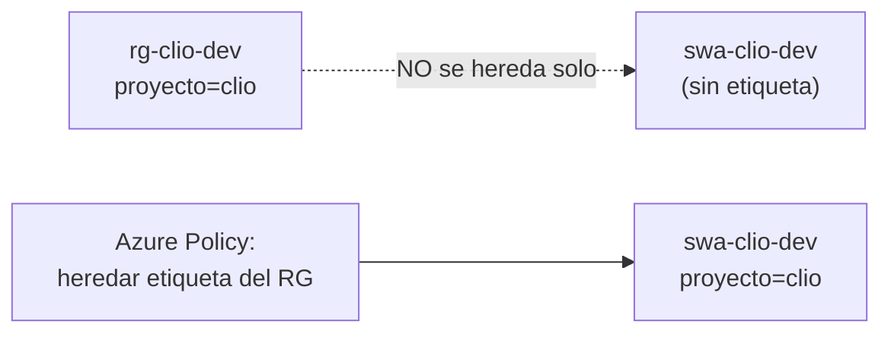

# Azure - etiquetas (tags)

Parte de: [[07-Azure/01 Fundamentos/_Índice Fundamentos|Fundamentos]]

> [!info] Cómo avanzar
> `progreso`: **pendiente** → **viendo** (estudiando) → **visto** (contestaste la autoevaluación sin abrir las respuestas) → **dominado** (hiciste el laboratorio o lo aplicaste de verdad).

## Contenido

### Qué es
Una **etiqueta (tag)** es un par **nombre=valor** de metadatos que pegas a un recurso, grupo de recursos o suscripción. No cambia cómo funciona el recurso; sirve para **organizar, filtrar, reportar costos y automatizar**. Ejemplos: `proyecto=dionisio`, `ambiente=dev`, `dueño=equipo-backend`, `centroCosto=ti-01`, `expira=2026-12-31`.

### Cómo funciona
- Se guardan en ARM junto con el recurso (ver [[Azure - Resource Manager]]); cualquier herramienta puede leerlas y filtrarlas.
- Hay un límite de etiquetas por recurso (Microsoft Learn indica 50 por recurso o grupo de recursos) y restricciones de longitud y caracteres; algunos tipos de recurso no admiten etiquetas.
- Los **nombres** de etiqueta no distinguen mayúsculas y minúsculas para las operaciones, pero los **valores** sí; `Ambiente=Dev` y `ambiente=dev` acaban siendo valores distintos en reportes. Define una convención y respétala.
- **No se heredan automáticamente.** Poner `proyecto=clio` en el grupo de recursos **no** etiqueta los recursos que contiene. Para lograr herencia se usa **Azure Policy** con definiciones integradas como "Inherit a tag from the resource group if missing" (agrega la etiqueta al crear o actualizar el recurso; para los existentes hay que lanzar una tarea de corrección).
- En **Cost Management** puedes agrupar y filtrar costos por etiqueta. Las etiquetas aplican a los datos de costo a partir de que existen; no reescriben el pasado. Hay una opción de "herencia de etiquetas" en Cost Management que copia las del grupo y la suscripción a los registros de uso (solo para reportes, no al recurso).



### Ejemplo
Convención mínima para tus proyectos personales:

| Etiqueta | Valores | Uso |
|---|---|---|
| `proyecto` | `dionisio`, `clio`, `hecate` | Costo por proyecto |
| `ambiente` | `lab`, `dev`, `prod` | Filtrar qué se puede borrar |
| `dueño` | tu alias | Saber a quién preguntar |
| `expira` | fecha ISO | Script de limpieza de laboratorios |

```bash
#- Crear el grupo ya etiquetado
az group create -n rg-clio-dev -l mexicocentral --tags proyecto=clio ambiente=dev expira=2026-12-31

#- Etiquetar un recurso existente SIN borrar sus otras etiquetas (merge)
az tag update --resource-id $(az webapp show -g rg-clio-dev -n app-clio-dev --query id -o tsv) \
  --operation Merge --tags proyecto=clio

#- Listar grupos de laboratorio vencidos para limpiarlos
az group list --query "[?tags.ambiente=='lab' && tags.expira<'2026-11-09'].name" -o tsv
```
En [[Bicep]] lo usual es definir un objeto `tags` común y pasarlo a cada recurso, lo que resuelve la falta de herencia desde el código.

### Cuándo usarlo y cuándo no
Úsalas siempre que tengas más de un proyecto o ambiente en la misma suscripción: son la forma barata de saber quién gasta qué. No las uses para **control de acceso** (RBAC se asigna por scope, no por etiqueta) ni como base de datos de configuración.

### Errores comunes
1. **Guardar secretos o datos personales** en etiquetas: cualquiera con permiso de lectura (Reader) las ve, aparecen en exportaciones de costos y en el Activity Log. Nunca contraseñas, cadenas de conexión ni tokens.
2. **Suponer herencia**: etiquetas solo en el grupo y reportes de costo vacíos por recurso. Usa Policy o IaC.
3. **Reemplazar en lugar de combinar**: `az resource tag --tags x=y` sustituye todas las etiquetas; usa `az tag update --operation Merge`.
4. **Valores inconsistentes** (`Prod`, `prod`, `produccion`): fija valores permitidos con Azure Policy.

### Para profundizar
- [Usar etiquetas para organizar recursos de Azure](https://learn.microsoft.com/es-mx/azure/azure-resource-manager/management/tag-resources)
- [Asignar definiciones de directivas para el cumplimiento de etiquetas](https://learn.microsoft.com/es-mx/azure/azure-resource-manager/management/tag-policies)
- [Estrategia de etiquetado (Cloud Adoption Framework)](https://learn.microsoft.com/es-mx/azure/cloud-adoption-framework/ready/azure-best-practices/resource-tagging)

## Autoevaluación

Contesta primero en voz alta o en papel; luego despliega la respuesta.

> [!question]- ¿Qué son las etiquetas y para qué se usan?
> Pares nombre-valor (`ambiente=dev`, `proyecto=itzamna`, `dueño=ana`) en recursos, grupos y suscripciones. Sirven para **filtrar costos**, automatizar (p. ej. apagar todo lo que tenga `apagar=noche`) y saber de quién es cada cosa.

> [!question]- Pones `proyecto=clio` en el grupo de recursos. ¿Los recursos dentro la heredan?
> No, por defecto **no se heredan**. Hay que ponerlas en cada recurso o usar **Azure Policy** (p. ej. la política integrada que hereda una etiqueta del grupo de recursos).

> [!question]- Error común con etiquetas: ¿qué NO debes guardar en ellas?
> Secretos o datos sensibles: las etiquetas las puede leer cualquiera con acceso de lectura y aparecen en reportes de costos.

## Práctica

- [[Lab 1 - Crear y borrar recursos con Azure CLI en el sandbox]]

