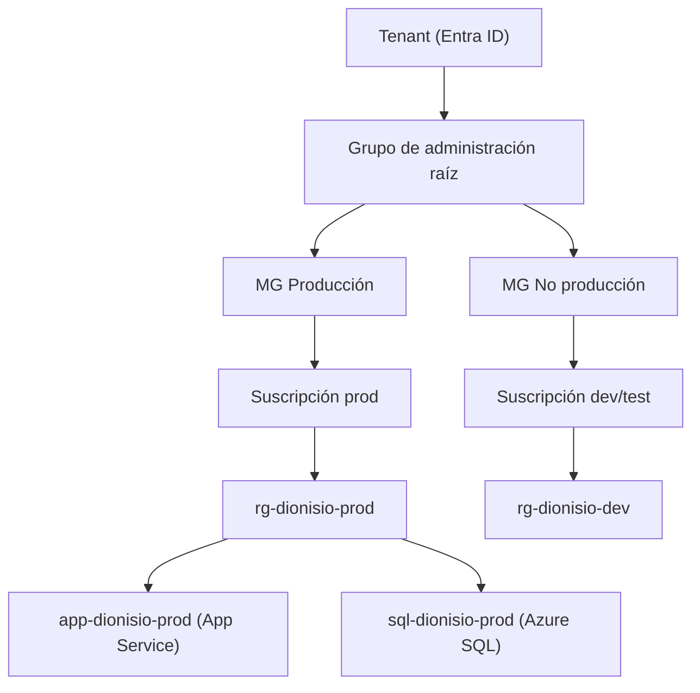

# Azure - suscripciones, grupos de recursos y regiones

Parte de: [[07-Azure/01 Fundamentos/_Índice Fundamentos|Fundamentos]]

> [!info] Cómo avanzar
> `progreso`: **pendiente** → **viendo** (estudiando) → **visto** (contestaste la autoevaluación sin abrir las respuestas) → **dominado** (hiciste el laboratorio o lo aplicaste de verdad).

## Contenido

### Qué es
Azure organiza todo lo que creas en una jerarquía de contenedores. Entenderla es lo primero porque de ella dependen **quién paga**, **quién tiene permisos**, **qué políticas aplican** y **dónde viven físicamente** tus datos.

- **Tenant (inquilino)**: tu directorio de [[Azure - Entra ID y registro de aplicaciones|Microsoft Entra ID]]; contiene usuarios, grupos e identidades de aplicaciones. Es la raíz de la confianza.
- **Grupos de administración**: carpetas opcionales para agrupar suscripciones y aplicar permisos y políticas a muchas a la vez (por ejemplo "Producción" y "No producción").
- **Suscripción**: unidad de **facturación**, de **cuotas** (límites de vCPU, número de recursos) y frontera de acceso. Cada suscripción confía en un solo tenant.
- **Grupo de recursos (resource group)**: contenedor lógico de recursos que comparten ciclo de vida.
- **Recurso**: la cosa concreta: una Web App, una base de datos, una cuenta de almacenamiento.
- **Región**: el conjunto de centros de datos donde se ejecuta el recurso (East US, Mexico Central, etc.). Algunas regiones tienen **zonas de disponibilidad** (centros de datos separados dentro de la región).

### Cómo funciona

Los permisos ([[Azure - RBAC]]) y las políticas (Azure Policy) se **heredan hacia abajo**: lo que asignes en un grupo de administración aplica a sus suscripciones, grupos de recursos y recursos.

La suscripción hace más que agrupar: define a qué cuenta de facturación va el cobro, qué oferta tiene (gratuita, Visual Studio, pago por uso), qué cuotas tienes por región y qué límites de gasto aplican. Por eso es común separar prod y dev en suscripciones distintas: así un experimento no agota la cuota de producción y los costos se ven por separado.

Un detalle que confunde: el grupo de recursos **también tiene región**, pero esa región solo indica dónde se guardan sus **metadatos** (la descripción de qué recursos contiene). Los recursos dentro pueden estar en **otras regiones**. Un grupo creado en *East US* puede contener una base de datos en *Mexico Central*. Lo que sí debes cuidar es que, si la región del grupo sufre una interrupción, las operaciones de administración sobre ese grupo pueden verse afectadas; por eso conviene que coincida con la región principal de la carga.

### Ejemplo
Para [[Itzamna.Dionisio]] (API .NET con Dapper) una organización razonable sería:

| Grupo de recursos | Contenido | Por qué juntos |
|---|---|---|
| `rg-dionisio-dev` | App Service, Azure SQL, Key Vault de dev | Se crean y borran juntos |
| `rg-dionisio-prod` | Lo mismo en prod | Permisos más estrictos, candado contra borrado |
| `rg-compartido-prod` | Log Analytics, ACR | Lo usan varios proyectos y vive más tiempo |

```bash
#- Crear un grupo en Mexico Central y una cuenta de almacenamiento en otra región
az group create -n rg-dionisio-dev -l mexicocentral
az storage account create -n stdionisiodev01 -g rg-dionisio-dev -l eastus --sku Standard_LRS
```

### Cuándo usarlo y cuándo no
Criterio principal para agrupar: **ciclo de vida compartido**. Si las cosas se crean, despliegan y borran juntas, van en el mismo grupo. Criterios secundarios: mismo ambiente, mismo dueño, mismos permisos.

- Usa **suscripciones separadas** para prod y no-prod, o cuando necesitas facturación o cuotas separadas.
- Usa **grupos de administración** cuando ya tienes varias suscripciones; con una sola no aportan mucho.
- Elige la **región** por latencia a tus usuarios, disponibilidad del servicio (no todos están en todas las regiones), precio (varía entre regiones) y requisitos de residencia de datos.

### Errores comunes
1. **Todo en un solo grupo "para no complicarse"**: no puedes borrar un laboratorio sin arriesgar lo demás, los permisos quedan demasiado amplios y Cost Management no te dice cuánto cuesta cada proyecto.
2. **Mezclar dev y prod en la misma suscripción**: un desarrollador con Contributor en la suscripción puede tocar producción.
3. **Elegir región al azar**: luego descubres que el servicio o el tamaño que necesitas no existe ahí, o que pagas más.
4. **Creer que el grupo obliga la región de los recursos**: no la obliga; usa Azure Policy ("Allowed locations") si quieres restringirla.
5. **Nombres sin convención**: usa prefijos por tipo (`rg-`, `app-`, `sql-`, `kv-`) y sufijos por ambiente.

### Para profundizar
- [Organizar recursos de Azure (Cloud Adoption Framework)](https://learn.microsoft.com/es-mx/azure/cloud-adoption-framework/ready/azure-setup-guide/organize-resources)
- [¿Qué son los grupos de administración?](https://learn.microsoft.com/es-mx/azure/governance/management-groups/overview)
- [Abreviaturas recomendadas para recursos](https://learn.microsoft.com/es-mx/azure/cloud-adoption-framework/ready/azure-best-practices/resource-abbreviations)

## Autoevaluación

Contesta primero en voz alta o en papel; luego despliega la respuesta.

> [!question]- ¿Cómo se relacionan tenant, grupo de administración, suscripción, grupo de recursos y recurso?
> Es una jerarquía: el **tenant** de Entra ID contiene **grupos de administración**, que contienen **suscripciones**; cada suscripción contiene **grupos de recursos**, y cada recurso vive en exactamente un grupo de recursos. Permisos (RBAC) y políticas se heredan hacia abajo.

> [!question]- ¿Para qué sirve una suscripción además de agrupar recursos?
> Es la **unidad de facturación** y un **límite de cuotas y de acceso**. Por eso es común separar suscripciones por ambiente (dev/prod) o por equipo.

> [!question]- Tu grupo de recursos está en *East US* y quieres crear una base de datos en *Mexico Central*. ¿Se puede?
> Sí. La región del grupo de recursos solo indica dónde se guardan sus **metadatos**; cada recurso puede estar en otra región. Aun así, conviene mantener juntos los recursos que se comunican mucho para bajar latencia y costo de transferencia.

> [!question]- ¿Qué criterio usarías para decidir qué va en un mismo grupo de recursos?
> El **ciclo de vida**: lo que se crea, despliega y borra junto (p. ej. la API, su plan de App Service y su base de una app) va en el mismo grupo. Así `az group delete` limpia todo de una vez.

> [!question]- Error común: crear todo en un solo grupo de recursos «para no complicarse». ¿Qué problema trae?
> No puedes borrar ni dar permisos por proyecto sin afectar a los demás, y el análisis de costos por grupo deja de servir. Un grupo por proyecto/ambiente es más fácil de limpiar y de auditar.

## Práctica

- [[Lab 1 - Crear y borrar recursos con Azure CLI en el sandbox]]

