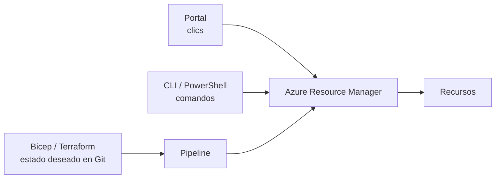

# Azure Portal vs CLI vs IaC

Parte de: [[07-Azure/01 Fundamentos/_Índice Fundamentos|Fundamentos]]

> [!info] Cómo avanzar
> `progreso`: **pendiente** → **viendo** (estudiando) → **visto** (contestaste la autoevaluación sin abrir las respuestas) → **dominado** (hiciste el laboratorio o lo aplicaste de verdad).

## Contenido

### Qué es
Hay tres formas principales de crear y cambiar recursos en Azure, y todas terminan hablando con [[Azure - Resource Manager|ARM]]:

- **Portal** (`portal.azure.com`): interfaz gráfica. Excelente para descubrir opciones, ver el estado y diagnosticar.
- **CLI / PowerShell** ([[Azure CLI]], [[PowerShell para Azure]]): comandos **imperativos** ("crea esto, cambia aquello"). Buenos para tareas puntuales y scripts.
- **Infraestructura como código (IaC)** ([[Bicep]], [[ARM templates]], [[Terraform]]): archivos **declarativos** que describen el estado deseado ("debe existir esto con esta configuración"); la herramienta calcula qué crear, cambiar o dejar igual.

### Cómo funciona


| Criterio | Portal | CLI | IaC |
|---|---|---|---|
| Curva de aprendizaje | Baja | Media | Media-alta |
| Repetible | No | Sí, si guardas el script | Sí, por diseño |
| Idempotente | No | Depende del comando | Sí |
| Revisión en PR | No | Parcial | Sí |
| Detecta diferencias (*drift*) | No | No | Sí (`what-if`, `plan`) |
| Ideal para | Explorar, diagnosticar | Operación, limpieza, consultas | Ambientes dev/test/prod |

**Qué pasa si producción se configura a mano en el portal**: nadie sabe con certeza cómo está configurada; recrearla tras un desastre depende de la memoria de alguien; dev y prod se van diferenciando (*configuration drift*); no hay historial de quién cambió qué más allá del Activity Log; y no puedes revisar el cambio antes de aplicarlo. Los "arreglos rápidos" en el portal se pierden o se sobrescriben en el siguiente despliegue de IaC.

### Ejemplo: del portal al código
Configuraste una Web App en el portal probando opciones y ahora quieres pasarla a código:

1. **Exporta la plantilla**: en el grupo de recursos o en el recurso, *Automatización > Exportar plantilla*; o con CLI:
```bash
az group export -n rg-clio-dev > rg-clio-dev.json
az bicep decompile --file rg-clio-dev.json   # genera rg-clio-dev.bicep
```
2. **Limpia el resultado**: la exportación trae valores fijos, propiedades por defecto y a veces recursos que no quieres. Convierte nombres y SKUs en parámetros.
3. **Valida contra lo existente** con `what-if`; si no muestra cambios, tu código describe la realidad:
```bash
az deployment group what-if -g rg-clio-dev -f main.bicep -p ambiente=dev
```
4. **Sube a Git y despliega desde [[Azure Pipelines]]**; a partir de ahí, los cambios se hacen en el código, no en el portal.

Otra ayuda: muchas pantallas de creación del portal tienen *Descargar una plantilla para automatización* antes de crear.

### Cuándo usarlo y cuándo no
- **Portal**: aprender un servicio, ver métricas y logs, diagnosticar, emergencias (y luego reflejar el cambio en el código).
- **CLI**: laboratorios, consultas, limpieza, tareas operativas puntuales, pasos de pipeline que no son infraestructura (por ejemplo, un *swap* de slots).
- **IaC**: todo lo que deba existir en más de un ambiente o sobrevivir más de unas semanas. Para tus proyectos (Dionisio, Clio, Hermes) la regla práctica: laboratorio con CLI, ambientes reales con Bicep.

### Errores comunes
1. **"Lo hago en el portal y luego lo paso a código"** y nunca pasa.
2. **Mezclar IaC con cambios manuales**: el siguiente despliegue revierte el cambio manual (o lo deja como drift silencioso).
3. **Usar la plantilla exportada tal cual**: es verbosa y frágil; refactorízala.
4. **Scripts de CLI como "IaC"**: crean bien la primera vez pero fallan o duplican al reejecutar.

### Para profundizar
- [¿Qué es la infraestructura como código? (Azure DevOps)](https://learn.microsoft.com/es-mx/devops/deliver/what-is-infrastructure-as-code)
- [Exportar plantillas en el portal](https://learn.microsoft.com/es-mx/azure/azure-resource-manager/templates/export-template-portal)
- [Operación what-if de Bicep](https://learn.microsoft.com/es-mx/azure/azure-resource-manager/bicep/deploy-what-if)

## Autoevaluación

Contesta primero en voz alta o en papel; luego despliega la respuesta.

> [!question]- ¿Cuándo usarías el portal, la CLI y la IaC?
> **Portal**: explorar, aprender y diagnosticar. **CLI/PowerShell**: tareas repetibles cortas y scripts. **IaC** (Bicep, Terraform): ambientes que deben ser reproducibles, revisables en PR y desplegados por pipeline.

> [!question]- ¿Qué problema aparece si producción se configura a mano en el portal?
> **Drift** y falta de historial: nadie sabe qué cambió ni puede recrear el ambiente igual. La IaC versionada lo resuelve y permite `what-if` antes de aplicar.

> [!question]- Truco: en el portal configuraste un recurso y quieres pasarlo a código. ¿Qué haces?
> Usa *Export template* del recurso o grupo (ARM) y descompílalo a Bicep con `az bicep decompile`, o `az bicep export`/insertar recurso desde VS Code. El resultado necesita limpieza: trae valores fijos y propiedades de solo lectura.

## Práctica

- [[Lab 6 - Bicep básico]]

