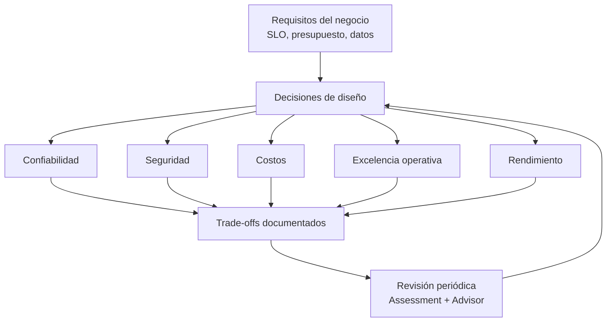

# Azure Well-Architected Framework

Parte de: [[07-Azure/01 Fundamentos/_Índice Fundamentos|Fundamentos]]

> [!info] Cómo avanzar
> `progreso`: **pendiente** → **viendo** (estudiando) → **visto** (contestaste la autoevaluación sin abrir las respuestas) → **dominado** (hiciste el laboratorio o lo aplicaste de verdad).

## Contenido

### Qué es
El **Azure Well-Architected Framework (WAF)** es la guía de Microsoft para diseñar y operar cargas de trabajo en Azure con calidad. Se organiza en **cinco pilares**, cada uno con principios de diseño, listas de comprobación (*checklists*), recomendaciones y los *trade-offs* frente a los demás pilares. No es una norma que se "cumple" una vez: es un marco para tomar decisiones conscientes y revisarlas periódicamente.

Los cinco pilares (cada uno tiene su nota):
- [[Well-Architected - Confiabilidad]]: que la carga resista fallas y se recupere.
- [[Well-Architected - Seguridad]]: confidencialidad, integridad y disponibilidad frente a ataques.
- [[Well-Architected - Optimización de costos]]: obtener el valor necesario sin gastar de más.
- [[Well-Architected - Excelencia operativa]]: desplegar, observar y operar con procesos confiables.
- [[Well-Architected - Eficiencia del rendimiento]]: atender la demanda con los recursos justos y escalar.

### Cómo funciona
El framework parte de la **carga de trabajo** (workload): el conjunto de componentes que entregan una capacidad de negocio, por ejemplo "la API de pedidos de Dionisio con su base y su front". Para cada carga se definen requisitos (SLO, presupuesto, sensibilidad de datos) y se revisa cada pilar.



**Trade-offs**: mejorar un pilar casi siempre cuesta en otro. Ejemplos:
- Desplegar en **dos regiones** mejora la confiabilidad pero **duplica costos** y complica la operación.
- **Private Endpoints** y redes cerradas mejoran la seguridad pero añaden costo, complejidad y puntos de falla de DNS.
- **Escalar a cero** (Functions de consumo, Container Apps) ahorra dinero pero introduce *cold start*, que empeora el rendimiento percibido.
- Más **logs y trazas** mejoran la operación pero cuestan por GB ingerido en Log Analytics.

La idea no es maximizar todo, sino elegir conscientemente y dejarlo escrito (por ejemplo en un ADR).

### Herramientas para evaluar
- **Azure Well-Architected Review**: cuestionario en Microsoft Learn que evalúa una carga pilar por pilar y genera recomendaciones; puedes guardar resultados y repetirlo para medir avance.
- **Azure Advisor**: recomendaciones automáticas sobre tus recursos reales, agrupadas en confiabilidad, seguridad, rendimiento, costo y excelencia operativa, con un puntaje.
- **Guías de servicio** del WAF (por ejemplo para App Service, Azure SQL, AKS): qué configurar en cada servicio según cada pilar.
- **Centro de arquitectura de Azure**: arquitecturas de referencia ya alineadas con el framework.
- **Microsoft Defender for Cloud** (seguridad) y **Cost Management** (costos) como fuentes de datos.

### Ejemplo
Revisión rápida de [[Itzamna.Dionisio]] (API .NET en App Service + Azure SQL):

| Pilar | Pregunta | Decisión |
|---|---|---|
| Confiabilidad | ¿Qué pasa si cae una instancia? | 2 instancias en S1+, health check en `/health` |
| Seguridad | ¿Dónde están los secretos? | Key Vault + Managed Identity, sin cadenas en el repo |
| Costos | ¿Cuánto cuesta dev fuera de horario? | Dev en plan B1 o F1, SQL serverless con autopausa |
| Operación | ¿Cómo se despliega? | Pipeline YAML, Bicep, slots con swap |
| Rendimiento | ¿Meta de latencia? | p95 < 300 ms medido en Application Insights |

### Relación con AZ-305
El examen [[AZ-305 Azure Solutions Architect Expert]] evalúa diseñar soluciones de identidad, datos, continuidad de negocio e infraestructura, y sus casos de estudio piden justamente elegir entre opciones según requisitos y trade-offs. El WAF da el vocabulario y los criterios: si entiendes los pilares, muchas preguntas se reducen a "qué requisito domina y qué sacrifico".

### Cuándo usarlo y cuándo no
Úsalo al diseñar una carga nueva, antes de pasar a producción y periódicamente (por ejemplo cada trimestre). Para un laboratorio de una tarde basta con aplicar las ideas básicas (borrar al terminar, sin secretos en código); no hace falta un assessment formal.

### Errores comunes
1. **Tratarlo como checklist para "pasar"** sin entender los trade-offs.
2. **Optimizar un solo pilar** (por ejemplo, solo costos) y descubrir el impacto en confiabilidad en un incidente.
3. **Evaluar una vez y olvidarlo**: las cargas cambian; repite la revisión.
4. **Diseñar sin requisitos**: sin SLO ni presupuesto no hay forma de decidir.

### Para profundizar
- [Azure Well-Architected Framework](https://learn.microsoft.com/es-mx/azure/well-architected/)
- [Pilares del Well-Architected Framework](https://learn.microsoft.com/es-mx/azure/well-architected/pillars)
- [Azure Well-Architected Review (assessment)](https://learn.microsoft.com/es-mx/assessments/azure-architecture-review/)
- [Introducción a Azure Advisor](https://learn.microsoft.com/es-mx/azure/advisor/advisor-overview)

## Subtemas

- [[Well-Architected - Confiabilidad]]
- [[Well-Architected - Seguridad]]
- [[Well-Architected - Optimización de costos]]
- [[Well-Architected - Excelencia operativa]]
- [[Well-Architected - Eficiencia del rendimiento]]

## Autoevaluación

Contesta primero en voz alta o en papel; luego despliega la respuesta.

> [!question]- ¿Qué es el Well-Architected Framework y cuáles son sus pilares?
> Un conjunto de principios y guías de Microsoft para diseñar cargas en Azure. Pilares: **Confiabilidad, Seguridad, Optimización de costos, Excelencia operativa y Eficiencia del rendimiento**.

> [!question]- ¿Por qué se habla de *trade-offs* entre pilares? Da un ejemplo.
> Mejorar un pilar suele costar en otro: desplegar en dos regiones sube la confiabilidad pero también el costo y la complejidad operativa. La decisión depende de los requisitos (SLO, RTO/RPO, presupuesto).

> [!question]- ¿Qué herramientas te ayudan a evaluar una carga contra el framework?
> La **Well-Architected Review** (evaluación en Microsoft Learn) y **Azure Advisor**, cuyas recomendaciones se agrupan por pilar.

> [!question]- ¿Cómo se relaciona con AZ-305?
> El examen de arquitectura plantea casos donde debes elegir servicios justificando confiabilidad, seguridad y costo; pensar por pilares ayuda a descartar opciones. Ver [[AZ-305 Azure Solutions Architect Expert]].

## Progreso de los subtemas

```base
filters:
  and:
    - file.inFolder("07-Azure/01 Fundamentos/Azure Well-Architected Framework")
    - file.name != "Azure Well-Architected Framework"
views:
  - type: table
    name: Progreso
    order:
      - file.name
      - progreso
      - nivel
```
