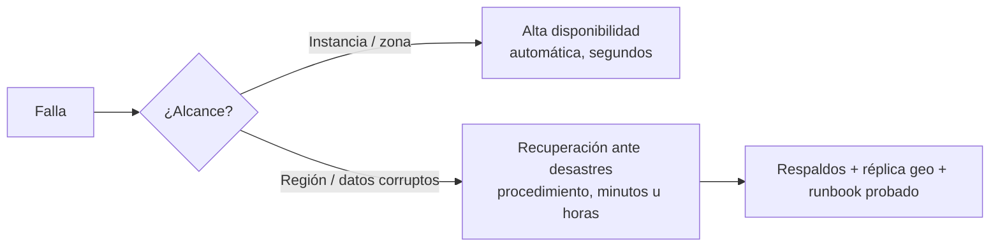

# Well-Architected - Confiabilidad

Parte de: [[Azure Well-Architected Framework]]

> [!info] Cómo avanzar
> `progreso`: **pendiente** → **viendo** (estudiando) → **visto** (contestaste la autoevaluación sin abrir las respuestas) → **dominado** (hiciste el laboratorio o lo aplicaste de verdad).

## Contenido

### Qué es
El pilar de **confiabilidad** busca que la carga de trabajo **siga cumpliendo su función** cuando algo falla (una instancia, una zona, una dependencia, un despliegue malo) y que **se recupere** a un estado conocido dentro de tiempos acordados. Parte de una premisa realista: en la nube las fallas son normales y hay que diseñar para ellas, no esperar que no ocurran. Es parte del [[Azure Well-Architected Framework]].

### Cómo funciona
**1. Definir objetivos**
- **SLO** (objetivo de nivel de servicio): por ejemplo, 99.9% de peticiones exitosas al mes (unos 43 minutos de indisponibilidad permitida).
- **RTO** (*Recovery Time Objective*): cuánto puede tardar la recuperación tras un desastre.
- **RPO** (*Recovery Point Objective*): cuántos datos puedes perder, medido en tiempo (por ejemplo, 5 minutos).
- Identificar **flujos críticos** (cobrar, iniciar sesión) frente a secundarios (reportes).

**2. Alta disponibilidad (HA) vs recuperación ante desastres (DR)**
- **HA**: mantener el servicio **funcionando** ante fallas locales y frecuentes, de forma automática y sin perder datos. Ejemplos: varias instancias detrás de un balanceador, **zonas de disponibilidad**, Azure SQL con redundancia de zona, reintentos con backoff.
- **DR**: **recuperarse** de eventos grandes y raros (pérdida de una región, borrado masivo, ransomware). Suele implicar otra región, réplicas geográficas, respaldos y un procedimiento (*runbook*) probado. Puede haber interrupción y pérdida de datos dentro del RTO/RPO.

**3. Patrones de diseño**
- **Redundancia** en cada capa (sin punto único de falla).
- **Reintentos con backoff** y **circuit breaker** para dependencias ([[Resiliencia con Polly]]).
- **Desacoplar con colas** ([[Service Bus]]): si el consumidor cae, los mensajes esperan.
- **Health checks** ([[Health checks]]) para que el balanceador saque instancias enfermas.
- **Degradación elegante**: si falla el servicio de recomendaciones, la página carga sin ellas.
- **Despliegues seguros**: slots, canary, rollback rápido; muchos incidentes los causa un cambio propio.

**4. Probar**: pruebas de carga, ejercicios de DR, y fallas inyectadas (Azure Chaos Studio).

### Ejemplo
Para la API de [[Itzamna.Dionisio]] con un SLO de 99.9%:
- App Service con 2+ instancias y redundancia de zona (si el plan y la región lo permiten), health check en `/health`.
- Azure SQL con redundancia de zona y respaldos automáticos con restauración a un punto en el tiempo (cubre el RPO de errores humanos).
- Llamadas a servicios externos con Polly (timeout + reintento + circuit breaker).
- Envío de correos por cola, no en la petición HTTP.
- DR: replicación geográfica o restauración geo de SQL y la infraestructura en [[Bicep]] para recrear la app en otra región; runbook probado dos veces al año.

### Cuándo usarlo y cuándo no
Ajusta el nivel de confiabilidad a lo que el negocio necesita: un portafolio personal no necesita multirregión; un sistema de cobro sí podría. Cada "nueve" adicional de disponibilidad cuesta mucho más (ver trade-offs en [[Well-Architected - Optimización de costos]]).

### Errores comunes
1. **"Tenemos respaldos, así que somos confiables"**: un respaldo no da disponibilidad (restaurar tarda), puede no cumplir el RPO, y si nunca probaste restaurarlo no sabes si funciona. Además, no protege contra fallas de la aplicación ni de dependencias.
2. **Calcular el SLA compuesto mal**: dependencias en serie multiplican su disponibilidad: 99.95% × 99.99% da menos que cualquiera de las dos.
3. **Redundancia solo en cómputo** y base de datos en una sola zona.
4. **Reintentos sin límite** que amplifican una caída (tormenta de reintentos).
5. **Runbook de DR que nadie ha ejecutado**.

### Para profundizar
- [Pilar de confiabilidad](https://learn.microsoft.com/es-mx/azure/well-architected/reliability/)
- [Lista de comprobación de revisión de diseño de confiabilidad](https://learn.microsoft.com/es-mx/azure/well-architected/reliability/checklist)
- [Zonas de disponibilidad de Azure](https://learn.microsoft.com/es-mx/azure/reliability/availability-zones-overview)

## Autoevaluación

Contesta primero en voz alta o en papel; luego despliega la respuesta.

> [!question]- ¿Qué busca el pilar de confiabilidad?
> Que la carga **siga funcionando** y se recupere ante fallas: redundancia (zonas, regiones), reintentos, health checks, respaldos probados y objetivos claros (SLO, RTO, RPO).

> [!question]- ¿Qué diferencia hay entre alta disponibilidad y recuperación ante desastres?
> Alta disponibilidad: tolerar fallas **locales** sin caerse (zonas de disponibilidad, varias instancias). DR: **recuperarse** de una pérdida mayor (región completa, borrado de datos) dentro de un RTO/RPO. Ver [[Recuperación ante desastres (RPO y RTO)]].

> [!question]- Error común: «tenemos respaldos, así que somos confiables».
> Un respaldo que nunca se restauró no está probado. Hay que ensayar la restauración y medir cuánto tarda.

