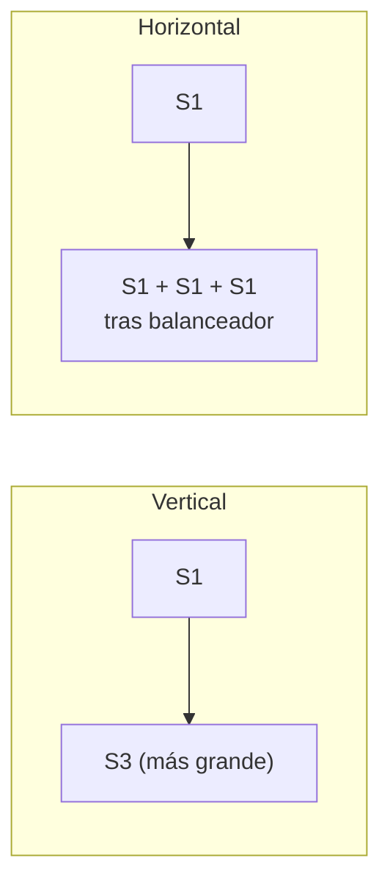

# Well-Architected - Eficiencia del rendimiento

Parte de: [[Azure Well-Architected Framework]]

> [!info] Cómo avanzar
> `progreso`: **pendiente** → **viendo** (estudiando) → **visto** (contestaste la autoevaluación sin abrir las respuestas) → **dominado** (hiciste el laboratorio o lo aplicaste de verdad).

## Contenido

### Qué es
El pilar de **eficiencia del rendimiento** busca que la carga de trabajo **atienda la demanda** (actual y futura) con tiempos de respuesta aceptables, **usando los recursos justos**: ni subdimensionada (lenta, errores bajo carga) ni sobredimensionada (cara). Incluye diseñar para escalar, medir y ajustar continuamente. Es parte del [[Azure Well-Architected Framework]].

### Cómo funciona
**1. Definir objetivos medibles**: por ejemplo "p95 de latencia < 300 ms y p99 < 1 s con 200 peticiones por segundo", "el reporte mensual se genera en menos de 2 minutos". Se usan percentiles porque el promedio esconde a los usuarios que esperan mucho.

**2. Escalar: vertical vs horizontal**
- **Vertical (scale up)**: una máquina más grande (más CPU/RAM). Simple, pero tiene techo, suele requerir reinicio y sigue siendo un punto único de falla.
- **Horizontal (scale out)**: más instancias del mismo tamaño detrás de un balanceador. La nube lo **favorece** porque se puede automatizar (autoescalado por métricas o por horario), crece casi sin techo, aporta redundancia y permite pagar solo por las instancias que necesitas en cada momento. Requiere que la aplicación sea **stateless** (sesión y caché fuera de la instancia, por ejemplo en Redis o en la base).



**3. Optimizar el diseño**
- **Caché** en varios niveles: CDN para estáticos, [[Output caching]] o Redis para respuestas, caché en memoria para datos casi inmutables.
- **Trabajo asíncrono**: lo pesado va a una cola y lo procesa un worker ([[Service Bus]], Functions).
- **Datos**: índices y consultas eficientes (en tus procedimientos de SQL Server), particionado, réplicas de lectura.
- **Cercanía**: región cercana a los usuarios, CDN o [[Front Door]].
- **Conexiones**: reutilizar `HttpClient` (vía `IHttpClientFactory`) y pools de conexión.

**4. Medir y probar**
- **Pruebas de carga** (Azure Load Testing, k6, JMeter) antes de producción y tras cambios grandes.
- **Monitoreo en producción** con [[Application Insights]]: percentiles de latencia por endpoint, dependencias lentas, uso de CPU/memoria.

**¿Cómo sabes si cumpliste un objetivo?** Midiendo la métrica que definiste (por ejemplo, p95 de duración de peticiones) en condiciones representativas, ya sea con una prueba de carga que simule la demanda esperada o con datos reales de producción durante un periodo, y comparándola con el umbral. Sin un objetivo numérico previo no hay forma de decir que cumpliste.

### Ejemplo
Consulta en Log Analytics (KQL) para revisar el p95 por endpoint de la API de [[Itzamna.Dionisio]] en la última hora:
```kusto
requests
| where timestamp > ago(1h)
| summarize p95 = percentile(duration, 95), peticiones = count() by name
| order by p95 desc
```
Si `GET /api/pedidos` tiene p95 de 1.2 s contra una meta de 300 ms, revisas la dependencia SQL en el mapa de aplicación; si el procedimiento tarda, optimizas el índice antes de escalar (escalar una consulta lenta solo multiplica el costo).

### Cuándo usarlo y cuándo no
Siempre define objetivos, aunque sean simples. No optimices prematuramente sin datos: mide primero, encuentra el cuello de botella, corrígelo, vuelve a medir. Escalar vertical sigue siendo válido para cargas difíciles de paralelizar o como solución rápida temporal.

### Errores comunes
1. **Medir promedios** en vez de percentiles.
2. **Escalar para tapar código ineficiente** (consultas N+1, falta de índices).
3. **Aplicación con estado en memoria** que se rompe al tener varias instancias.
4. **Probar carga contra dev** con datos y tamaños que no se parecen a prod.
5. **Autoescalado sin límites máximos**: una avalancha o un bucle te escala (y cobra) sin control.

### Para profundizar
- [Pilar de eficiencia del rendimiento](https://learn.microsoft.com/es-mx/azure/well-architected/performance-efficiency/)
- [Lista de comprobación de eficiencia del rendimiento](https://learn.microsoft.com/es-mx/azure/well-architected/performance-efficiency/checklist)
- [¿Qué es Azure Load Testing?](https://learn.microsoft.com/es-mx/azure/load-testing/overview-what-is-azure-load-testing)

## Autoevaluación

Contesta primero en voz alta o en papel; luego despliega la respuesta.

> [!question]- ¿Qué busca este pilar?
> Que la carga cumpla sus objetivos de rendimiento al crecer la demanda: escalado horizontal, caché, CDN, particionado de datos y pruebas de carga.

> [!question]- ¿Escalar vertical u horizontal? ¿Cuál favorece la nube y por qué?
> Horizontal (más instancias): no tiene un techo tan bajo, permite redundancia y escalar automáticamente. Requiere que la app sea *stateless* (sesión en Redis o en el cliente).

> [!question]- ¿Cómo sabes si cumpliste un objetivo de rendimiento?
> Midiendo: define metas (p. ej. p95 < 500 ms) y verifícalas con pruebas de carga y telemetría. Ver [[Pruebas de carga (k6 y NBomber)]].

