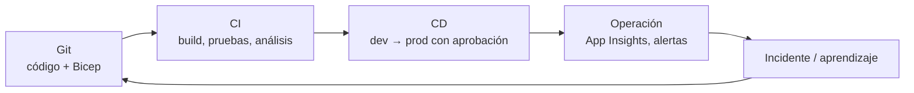

# Well-Architected - Excelencia operativa

Parte de: [[Azure Well-Architected Framework]]

> [!info] Cómo avanzar
> `progreso`: **pendiente** → **viendo** (estudiando) → **visto** (contestaste la autoevaluación sin abrir las respuestas) → **dominado** (hiciste el laboratorio o lo aplicaste de verdad).

## Contenido

### Qué es
El pilar de **excelencia operativa** trata de **cómo construyes, despliegas y operas** la carga de trabajo: procesos y prácticas que permiten entregar cambios con frecuencia y con poco riesgo, saber en todo momento cómo está el sistema y responder bien a los incidentes. Es la parte "DevOps" del [[Azure Well-Architected Framework]].

### Cómo funciona: áreas principales
- **Cultura y estándares**: responsabilidades claras, convenciones de nombres, documentación viva (ADR, runbooks), revisión de código.
- **Infraestructura como código**: todos los ambientes descritos en [[Bicep]] o [[Terraform]], versionados en Git.
- **CI/CD**: pipelines que compilan, prueban, escanean y despliegan siempre igual ([[Azure Pipelines]]), con aprobaciones para producción.
- **Prácticas de despliegue seguro**: slots, canary, [[Feature flags]], rollback rápido.
- **Observabilidad**: logs, métricas y trazas centralizadas ([[Application Insights]], [[Log Analytics]], [[OpenTelemetry]]), dashboards útiles.
- **Alertas accionables** y gestión de incidentes: quién responde, cómo se escala, revisión posterior sin culpables (*postmortem*).
- **Automatización** de tareas repetitivas (limpieza, rotación, escalado).

**¿Qué tiene que ver la IaC con este pilar?** Mucho: hace que los ambientes sean **reproducibles** (dev y prod iguales salvo parámetros), que los cambios de infraestructura pasen por **pull request** y revisión, que puedas ver diferencias antes de aplicar (`what-if`/`plan`), que recrear un ambiente tras un desastre sea ejecutar un pipeline, y que el historial de Git sea la auditoría. Sin IaC, la operación depende de lo que alguien recuerda haber hecho en el portal (ver [[Azure Portal vs CLI vs IaC]]).

### Ejemplo
Flujo operativo para [[Itzamna.Dionisio]]:
1. PR en Azure Repos con código y cambios de Bicep; el pipeline de validación compila, corre pruebas y `az deployment group what-if`.
2. Merge a `main` → despliega a dev automáticamente; a prod con aprobación en un *environment*.
3. En prod despliega al slot `staging`, prueba de humo contra `/health`, luego *swap*.
4. Alertas en Azure Monitor:
   - Tasa de errores 5xx > 2% durante 5 minutos → notificación al responsable de guardia.
   - p95 de latencia > 1 s durante 10 minutos.
   - Cada alerta enlaza a un runbook corto: qué revisar y cómo hacer rollback (swap de regreso).
5. Tras un incidente, postmortem breve: causa, qué detectó la falla, qué cambio evita que se repita.

### Cuándo usarlo y cuándo no
Escala la formalidad al tamaño: en un proyecto personal basta un pipeline YAML, Bicep y dos o tres alertas bien pensadas. En equipos grandes se suman procesos de cambio, guardias y SLOs formales. No conviertas la operación en burocracia: el objetivo es entregar más seguido con menos sustos.

### Errores comunes
1. **Alertas que nadie atiende**: demasiadas, mal calibradas o sin responsable. El equipo se acostumbra a ignorarlas (fatiga de alertas) y la importante pasa desapercibida. Cada alerta debe ser **accionable**, tener dueño y un runbook; si nunca requiere acción, se ajusta o se elimina.
2. **Cambios manuales en producción** que no quedan en el código.
3. **Desplegar sin prueba de humo ni rollback** definido.
4. **Logs sin correlación**: imposible seguir una petición entre servicios; usa trazas distribuidas.
5. **Runbooks desactualizados** o que solo viven en la cabeza de alguien.

### Para profundizar
- [Pilar de excelencia operativa](https://learn.microsoft.com/es-mx/azure/well-architected/operational-excellence/)
- [Lista de comprobación de excelencia operativa](https://learn.microsoft.com/es-mx/azure/well-architected/operational-excellence/checklist)
- [Prácticas de implementación segura](https://learn.microsoft.com/es-mx/azure/well-architected/operational-excellence/safe-deployments)

## Autoevaluación

Contesta primero en voz alta o en papel; luego despliega la respuesta.

> [!question]- ¿De qué trata la excelencia operativa?
> De operar la carga de forma predecible: IaC, CI/CD, despliegues seguros (slots, canary), observabilidad, runbooks y mejora continua con postmortems.

> [!question]- ¿Qué tiene que ver la IaC con este pilar?
> Hace los ambientes **reproducibles** y los cambios **revisables**; reduce errores manuales y permite recrear un ambiente tras un desastre.

> [!question]- Error común: alertas que nadie atiende.
> Genera fatiga y se ignoran las importantes. Cada alerta debe ser accionable y tener un runbook. Ver [[Runbooks]].

