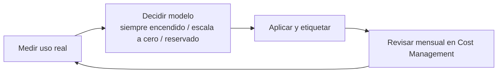

# Well-Architected - Optimización de costos

Parte de: [[Azure Well-Architected Framework]]

> [!info] Cómo avanzar
> `progreso`: **pendiente** → **viendo** (estudiando) → **visto** (contestaste la autoevaluación sin abrir las respuestas) → **dominado** (hiciste el laboratorio o lo aplicaste de verdad).

## Contenido

### Qué es
El pilar de **optimización de costos** busca que la carga de trabajo entregue el valor que el negocio necesita **al menor costo razonable**, sin sacrificar los requisitos de confiabilidad, seguridad y rendimiento acordados. No es "gastar lo mínimo": es gastar **a propósito**, sabiendo qué pagas y por qué. Es parte del [[Azure Well-Architected Framework]].

### Cómo funciona: prácticas típicas
- **Visibilidad**: costos por carga, ambiente y equipo con [[Azure - etiquetas (tags)|etiquetas]] y [[Azure - costos y Cost Management|Cost Management]]; presupuestos y alertas.
- **Dimensionar correctamente** (*rightsizing*): elegir tamaño y nivel según métricas reales, no por intuición; Advisor señala recursos sobredimensionados o inactivos.
- **Pagar por uso real**: servicios que escalan a cero (Functions, Container Apps, SQL serverless) para cargas intermitentes.
- **Apagar lo que no se usa**: ambientes de dev/test fuera de horario, laboratorios borrados al terminar.
- **Compromisos para lo estable**: reservaciones o savings plans para cargas 24/7 predecibles.
- **Modelos de precio y licencias**: Azure Hybrid Benefit si ya tienes licencias de Windows/SQL Server; precios dev/test.
- **Diseño consciente del costo**: tráfico de salida, retención de logs, niveles de almacenamiento (hot/cool/archive), réplicas que realmente necesitas.
- **Revisión continua**: los costos se revisan como cualquier otra métrica (FinOps).

### Ejemplo: API con tráfico solo en horario laboral
La API interna de [[Itzamna.Dionisio]] recibe tráfico de 8:00 a 19:00, lunes a viernes. Opciones a evaluar:

| Opción | Cómo ahorra | Contra |
|---|---|---|
| **Autoescalado programado** en App Service (Standard o superior) | 2 instancias en horario, 1 fuera | El mínimo sigue siendo 1 instancia 24/7 |
| **Container Apps** con mínimo de réplicas en 0 | No paga cómputo sin tráfico | Cold start en la primera petición |
| **Functions Flex Consumption** | Paga por ejecución | Reescribir como funciones |
| **Azure SQL serverless** con autopausa | La base se pausa sin uso | Primera conexión tras la pausa es lenta |
| **Reservación** | Descuento por compromiso | Mala idea si la carga es intermitente |

Cálculo de referencia: 11 horas × 5 días son 55 horas de uso a la semana de 168 posibles, alrededor de un tercio del tiempo; un servicio que escala a cero puede pagar del orden de esa fracción frente a uno siempre encendido (los precios exactos se calculan en la [calculadora de precios](https://azure.microsoft.com/pricing/calculator/)).

### Cuándo usarlo y cuándo no
Siempre, pero con datos. Optimiza primero lo que más pesa en la factura (análisis de costos agrupado por servicio). No sacrifiques requisitos explícitos: si el SLO exige zona redundante, quitarla para ahorrar es incumplir.

### Errores comunes
1. **Quitar redundancia sin medir el impacto**: bajar a una instancia o a una sola zona ahorra, pero si el SLO exigía alta disponibilidad, el primer incidente puede costar más que lo ahorrado (en dinero, clientes o reputación). Evalúa el trade-off con [[Well-Architected - Confiabilidad]] y documenta la decisión.
2. **Reservar sin historial** de uso estable.
3. **Ignorar costos "invisibles"**: ingesta de logs, egress, discos huérfanos, IPs públicas.
4. **Optimizar una vez**: los precios y el uso cambian.
5. **Ambientes de dev con configuración de prod** (mismos SKUs y réplicas).

### Para profundizar
- [Pilar de optimización de costos](https://learn.microsoft.com/es-mx/azure/well-architected/cost-optimization/)
- [Lista de comprobación de optimización de costos](https://learn.microsoft.com/es-mx/azure/well-architected/cost-optimization/checklist)
- [Calculadora de precios de Azure](https://azure.microsoft.com/pricing/calculator/)

## Autoevaluación

Contesta primero en voz alta o en papel; luego despliega la respuesta.

> [!question]- ¿Qué prácticas típicas incluye este pilar?
> Elegir el tamaño correcto (*right-sizing*), escalar con la demanda, apagar lo que no se usa, servicios serverless para cargas intermitentes, reservaciones para cargas estables, presupuestos y etiquetas de costo.

> [!question]- Tu API recibe tráfico solo en horario laboral. ¿Qué opciones de costo considerarías?
> Escalado automático a la baja fuera de horario, planes que escalan a cero (Functions, Container Apps) o base serverless (Azure SQL serverless con auto-pausa), en vez de capacidad fija 24/7.

> [!question]- Error común: optimizar costos quitando redundancia sin medir el impacto.
> Puedes romper el SLO. La optimización debe respetar los requisitos de confiabilidad acordados; se decide con números, no por intuición.

