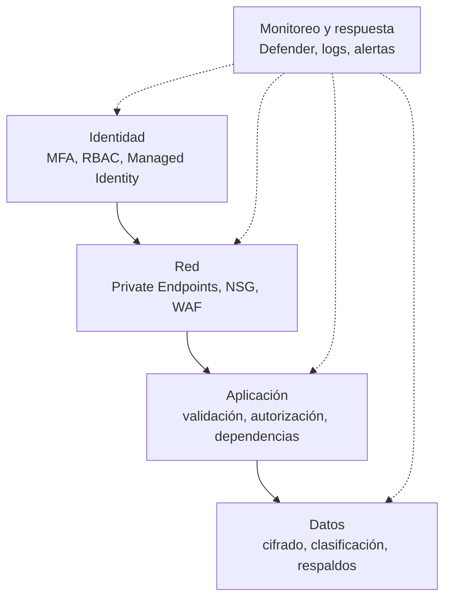

# Well-Architected - Seguridad

Parte de: [[Azure Well-Architected Framework]]

> [!info] Cómo avanzar
> `progreso`: **pendiente** → **viendo** (estudiando) → **visto** (contestaste la autoevaluación sin abrir las respuestas) → **dominado** (hiciste el laboratorio o lo aplicaste de verdad).

## Contenido

### Qué es
El pilar de **seguridad** busca proteger la **confidencialidad, integridad y disponibilidad** de la carga de trabajo y sus datos frente a amenazas, sean externas o internas. En la nube aplica el **modelo de responsabilidad compartida**: Microsoft protege la infraestructura física y la plataforma; tú eres responsable de identidades, configuración, datos y código. Cuanto más PaaS uses, menos te toca. Es parte del [[Azure Well-Architected Framework]].

### Cómo funciona: ideas clave
- **Zero Trust**: verificar explícitamente cada acceso, usar el **mínimo privilegio** y **asumir brecha**.
- **La identidad es el perímetro principal**: autenticación fuerte (MFA), [[Azure - RBAC]] con roles específicos, identidades sin secretos para servicios.
- **Defensa en profundidad**: varias capas (identidad, red, aplicación, datos) para que fallar una no lo exponga todo.
- **Proteger los datos**: cifrado en tránsito (TLS) y en reposo (por defecto en Azure, con opción de claves propias), clasificación de datos sensibles.
- **Secretos fuera del código**: [[Key Vault]], rotación, y mejor aún, eliminar secretos con [[Managed Identity]].
- **Superficie de ataque mínima**: cerrar acceso público innecesario, [[Private Endpoints]], WAF en [[Front Door]] o [[Application Gateway]].
- **Detección y respuesta**: logs centralizados, Microsoft Defender for Cloud, alertas y un plan de respuesta a incidentes.
- **Cadena de suministro**: dependencias escaneadas, imágenes de contenedor firmadas o de registros confiables, pipelines con permisos mínimos.

**¿Por qué Managed Identity es la recomendación típica?** Porque elimina el problema de raíz: no hay contraseña ni cadena de conexión que se filtre en el repo, en logs o en un archivo de configuración; Azure emite y rota las credenciales; y el acceso se controla con RBAC, auditable y revocable. Un secreto que no existe no se puede robar.

**"Asumir brecha"** significa diseñar como si un atacante **ya estuviera dentro** de algún componente: segmentar redes y permisos para limitar el radio de daño (*blast radius*), cifrar también el tráfico interno, registrar y alertar sobre comportamientos anómalos, tener respaldos inmutables y practicar la respuesta. La pregunta de diseño cambia de "¿cómo evito que entren?" a "si entran por aquí, ¿qué más pueden alcanzar y cómo me entero?".

### Ejemplo
Aplicado a [[Itzamna.Dionisio]] y Xolotl.Hecate:
- La API lee la cadena de Azure SQL **sin contraseña**: autenticación de Entra con Managed Identity (`Authentication=Active Directory Default` en la cadena de conexión de `Microsoft.Data.SqlClient`).
- Las claves privadas RS256 de Hecate viven en Key Vault; la app solo tiene permiso para firmar o leer lo que necesita.
- Errores devueltos como [[ProblemDetails]] con `codigo`, sin trazas internas que filtren información.
- Pipeline con *service connection* por federación de identidad, no con secreto de service principal.
- Defender for Cloud activo para recibir recomendaciones de configuración.

### Cuándo usarlo y cuándo no
La seguridad no es opcional, pero sí proporcional: un laboratorio necesita al menos no exponer secretos ni dejar puertos abiertos; un sistema con datos personales necesita además redes privadas, auditoría y cumplimiento normativo. Evalúa los trade-offs con costo y operación (Private Endpoints y firewalls cuestan y complican).

### Errores comunes
1. **Secretos en el repositorio** o en variables de pipeline sin marcar como secretas.
2. **Roles amplios** (Owner/Contributor) a apps y personas "para que funcione".
3. **Confiar en la red interna** y no autenticar llamadas entre servicios.
4. **Exponer RDP/SSH a Internet** en VMs; usa Bastion o acceso just-in-time.
5. **Sin logs ni alertas**: la brecha se descubre meses después.

### Para profundizar
- [Pilar de seguridad](https://learn.microsoft.com/es-mx/azure/well-architected/security/)
- [Lista de comprobación de revisión de diseño de seguridad](https://learn.microsoft.com/es-mx/azure/well-architected/security/checklist)
- [Responsabilidad compartida en la nube](https://learn.microsoft.com/es-mx/azure/security/fundamentals/shared-responsibility)

## Autoevaluación

Contesta primero en voz alta o en papel; luego despliega la respuesta.

> [!question]- ¿Cuáles son ideas clave del pilar de seguridad?
> **Zero Trust** (verificar explícitamente, mínimo privilegio, asumir brecha), identidad como perímetro (Entra ID, Managed Identity), cifrado en tránsito y en reposo, redes privadas y monitoreo (Defender).

> [!question]- ¿Por qué Managed Identity es una recomendación típica de este pilar?
> Elimina secretos en código y configuración: no hay contraseña que filtrar ni rotar. Ver [[Managed Identity]].

> [!question]- ¿Qué significa «asumir brecha» en el diseño?
> Diseñar como si un atacante ya estuviera dentro: segmentar redes, limitar el radio de impacto, registrar y alertar, y no depender de una sola barrera.

