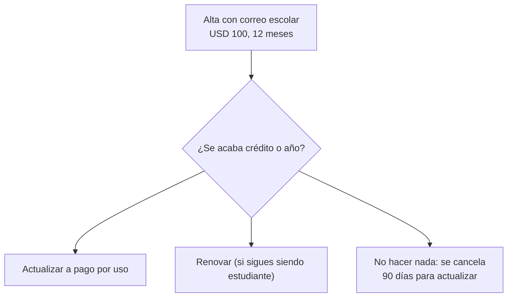

# Azure for Students

Parte de: [[07-Azure/02 Dónde probar Azure sin pagar/_Índice Dónde probar Azure sin pagar|Dónde probar Azure sin pagar]]

> [!info] Cómo avanzar
> `progreso`: **pendiente** → **viendo** (estudiando) → **visto** (contestaste la autoevaluación sin abrir las respuestas) → **dominado** (hiciste el laboratorio o lo aplicaste de verdad).

## Contenido

### Qué es
**Azure for Students** es una oferta para **estudiantes universitarios de tiempo completo** en instituciones acreditadas que otorgan títulos. Datos verificados en las páginas oficiales de Azure y Microsoft Learn en noviembre de 2026; las ofertas cambian, revísalas antes de crear algo.

Según la página oficial y las preguntas frecuentes de Microsoft Learn:
- **USD 100 de crédito** para usar en **12 meses** en la mayoría de los productos.
- **Sin tarjeta de crédito**.
- Acceso a servicios gratuitos (Microsoft Learn menciona más de 25: cómputo, red, almacenamiento y bases de datos).
- Verificación del estatus académico con el **correo de la institución**.
- Una suscripción por persona, intransferible; no aplica a MOOCs ni a capacitación profesional de organizaciones con fines de lucro.
- **Renovable cada año** mientras sigas siendo estudiante (volviendo a registrarte).

**Diferencias con la cuenta gratuita**
| | Cuenta gratuita | Azure for Students |
|---|---|---|
| Crédito | USD 200 | USD 100 |
| Vigencia del crédito | 30 días | 12 meses |
| Tarjeta | Sí (verificación) | No |
| Elegibilidad | Cliente nuevo | Estudiante de tiempo completo |
| Renovación | No | Anual mientras seas estudiante |

### Cómo funciona
El consumo se descuenta del crédito; las facturas que puedan aparecer muestran el uso, pero no las pagas porque las cubre el crédito. El saldo se consulta en el portal de patrocinios de Azure (Azure Sponsorships).

**Cuando se acaba el crédito o pasan los 12 meses** (lo que ocurra primero):
- Para seguir, **actualizas a pago por uso** en el portal; si fue por cumplirse el año, también puedes **renovar** registrándote otra vez.
- Si no haces nada, la suscripción se **cancela** y los productos desplegados se dan de baja. Microsoft Learn indica que tienes **90 días** desde el fin de la suscripción para actualizar.

**Restricciones típicas**
- El crédito **no aplica a Marketplace**.
- Uso orientado a educación, investigación no comercial y desarrollo o pruebas para esos fines; no para producción comercial.
- Las cuotas gratuitas tienen límites mensuales y algunas son solo para clientes nuevos.
- Restricciones de regiones o servicios específicas no aparecen en las páginas consultadas; algunos servicios o tamaños pueden no estar disponibles en este tipo de suscripción (Pendiente de confirmar caso por caso).

Existe también **Azure for Students Starter**: sin costo, sin límite de tiempo y sin tarjeta, con acceso a niveles gratuitos de App Service, Functions, Notification Hubs, Azure Database for MySQL, Application Insights y Azure DevOps.

### Ejemplo
Si tomas un diplomado o maestría de tiempo completo en una universidad acreditada, con tu correo institucional puedes darte de alta y tener un año para practicar AZ-104/AZ-305 sin tarjeta: crea los laboratorios por script, bórralos al terminar, y deja publicado tu portafolio en servicios con cuota siempre gratuita para no depender del crédito.

### Cuándo usarlo y cuándo no
Úsalo si cumples los requisitos: es la opción más segura porque no hay tarjeta asociada. Si ya no eres estudiante, tus opciones son la [[Cuenta gratuita de Azure (crédito de 30 días, servicios gratuitos y límite de gasto)]] o los [[Créditos de Azure para suscriptores de Visual Studio]].

### Errores comunes
1. **Usarlo para un cliente o negocio**: va contra los términos.
2. **Gastar los USD 100 en un mes** dejando recursos encendidos.
3. **Creer que la renovación es automática**: hay que volver a registrarse.
4. **Montar algo crítico** que desaparece al cancelarse la suscripción.

### Para profundizar
- [Azure for Students (página oficial)](https://azure.microsoft.com/free/students/)
- [Preguntas frecuentes de Azure Education Hub](https://learn.microsoft.com/es-mx/azure/education-hub/faq)

## Autoevaluación

Contesta primero en voz alta o en papel; luego despliega la respuesta.

> [!question]- ¿Qué es Azure for Students y qué lo distingue de la cuenta gratuita?
> Una oferta para estudiantes que da crédito y servicios gratuitos **sin tarjeta de crédito**, validando con correo o credenciales de la institución. Suele renovarse anualmente mientras sigas siendo estudiante (verificar en la página oficial).

> [!question]- ¿Qué pasa cuando se acaba el crédito de Azure for Students?
> Los recursos se detienen; no se cobra porque no hay tarjeta. Puedes pasar a pago por uso si quieres continuar (verificar en la página oficial).

> [!question]- ¿Hay restricciones típicas en esta oferta?
> Sí: algunos servicios o regiones pueden no estar disponibles y hay cuotas bajas (p. ej. de vCPU). Revisa los errores de cuota antes de culpar a tu plantilla (verificar en la página oficial).

