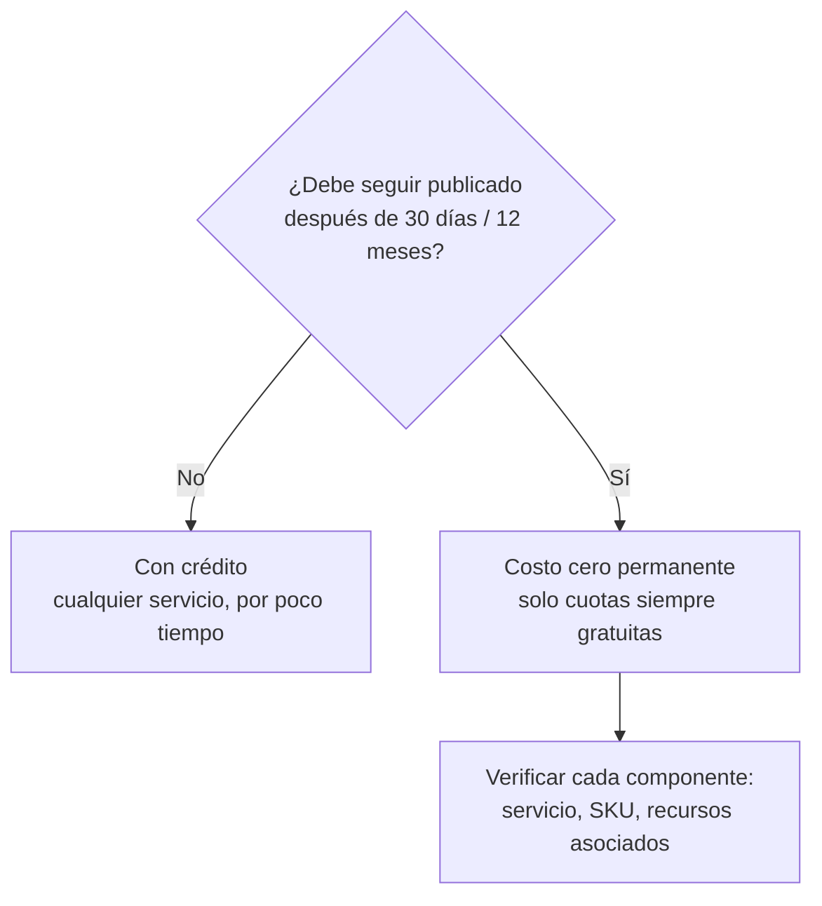
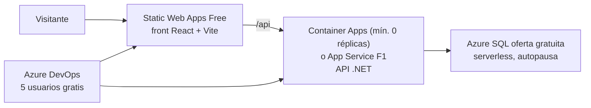

# Crédito promocional vs proyectos con costo cero permanente

Parte de: [[07-Azure/02 Dónde probar Azure sin pagar/_Índice Dónde probar Azure sin pagar|Dónde probar Azure sin pagar]]

> [!info] Cómo avanzar
> `progreso`: **pendiente** → **viendo** (estudiando) → **visto** (contestaste la autoevaluación sin abrir las respuestas) → **dominado** (hiciste el laboratorio o lo aplicaste de verdad).

## Contenido

### Qué es
Son dos estrategias distintas para usar Azure sin pagar:

- **Proyecto con crédito**: usa saldo promocional (cuenta gratuita, Students, Visual Studio) para pagar servicios que normalmente cuestan. Funciona **mientras haya crédito**; luego se detiene o empieza a cobrar.
- **Proyecto de costo cero permanente**: se diseña desde el inicio para que **todos** sus componentes queden dentro de **cuotas siempre gratuitas** o **tiers Free**. Puede quedarse publicado indefinidamente (mientras Microsoft mantenga esas cuotas).

### Cómo funciona

| Aspecto | Con crédito | Costo cero permanente |
|---|---|---|
| Servicios | Casi cualquiera | Solo los que tienen cuota siempre gratis |
| Duración | Hasta agotar crédito o vigencia | Indefinida (sujeta a cambios de oferta) |
| Rendimiento | El que pagues | Limitado (CPU, cold start, autopausa) |
| Para qué | Aprender servicios caros | Portafolio, demos, herramientas personales |
| Riesgo | Se apaga de golpe | Exceder la cuota o que cambie la oferta |

**Ojo con los "12 meses"**: no son permanentes. Un proyecto en VM B1s o PostgreSQL B1MS gratuitos **empieza a cobrar** el mes 13 (ver [[Servicios de Azure gratuitos durante 12 meses]]).

### Ejemplo: portafolio publicado indefinidamente
Arquitectura de costo cero con cuotas siempre gratuitas (verificadas en la página oficial en noviembre de 2026):

- **Front** (como [[Itzamna.Clio]] en su sitio público): [[Azure Static Web Apps]] tier Free.
- **API** .NET 10 de [[Itzamna.Dionisio]]: App Service F1 (60 minutos de CPU al día, sin dominio propio) o Container Apps con mínimo de réplicas en 0 dentro de su cuota mensual.
- **Datos**: [[Azure SQL Database]] con la oferta gratuita (100,000 vCore-segundos al mes y 32 GB), configurada para **pausarse** al agotar la cuota en lugar de cobrar.
- **CI/CD**: Azure DevOps (5 usuarios gratis).
- **Contenedores**: para Container Apps necesitas un registro; un ACR Basic cobra, así que evalúa usar un registro público gratuito para imágenes sin secretos, o App Service con despliegue de código, que no requiere registro.
- **Observabilidad**: Application Insights tiene una cantidad de ingesta gratuita mensual; mantén los logs al mínimo (Pendiente de confirmar la cuota vigente en la página de precios de Azure Monitor).

Verificación mensual: Cost Management agrupado por recurso, buscando cualquier costo > 0.

### Riesgo de diseñar "solo con lo gratis"
- **Rendimiento y límites**: F1 se detiene al consumir su CPU diaria; la base se pausa; Container Apps tiene cold start. Para un portafolio es aceptable; para usuarios reales, no.
- **Sin SLA** o con SLA reducido en tiers gratuitos.
- **Decisiones de arquitectura distorsionadas**: eliges servicios por precio y no por adecuación; luego migrar a la arquitectura "correcta" cuesta.
- **Las ofertas cambian**: Microsoft puede ajustar cuotas o retirar tiers; ten la infraestructura en [[Bicep]] para mover rápido.
- **Un pico de tráfico** te saca de la cuota y empieza a cobrar si estás en pago por uso.

### Cuándo usarlo y cuándo no
Crédito para aprender lo caro en sprints cortos; costo cero para lo que quieres mostrar siempre. No pongas un sistema de un cliente sobre cuotas gratuitas.

### Errores comunes
1. **Construir el portafolio con el crédito** y verlo caer al día 30.
2. **Contar los 12 meses como permanentes.**
3. **No revisar recursos asociados** que sí cobran (registro de contenedores, Log Analytics, almacenamiento).
4. **No fijar autopausa** en la base gratuita y pasar a cobro por exceso.

### Para profundizar
- [Servicios gratuitos de Azure](https://azure.microsoft.com/pricing/free-services/)
- [Nivel gratuito de Azure SQL Database](https://learn.microsoft.com/es-mx/azure/azure-sql/database/free-tier)
- [Planes de hospedaje de Azure Static Web Apps](https://learn.microsoft.com/es-mx/azure/static-web-apps/plans)

## Autoevaluación

Contesta primero en voz alta o en papel; luego despliega la respuesta.

> [!question]- ¿Qué diferencia hay entre un proyecto montado con crédito y uno de costo cero permanente?
> Con crédito, el proyecto **deja de funcionar o empieza a cobrar** cuando el crédito termina. El de costo cero usa solo niveles **siempre gratuitos** (p. ej. Static Web Apps Free + Functions de consumo + base con oferta gratuita) (verificar en la página oficial).

> [!question]- Quieres tener tu portafolio publicado indefinidamente sin pagar. ¿Qué arquitectura eliges?
> Front estático en Static Web Apps Free, API ligera en Functions (consumo o API integrada de SWA), datos en un servicio con nivel gratuito permanente. Revisa que cada pieza siga gratuita (verificar en la página oficial).

> [!question]- Riesgo de diseñar «solo con lo gratis».
> Los niveles gratuitos tienen límites (arranque en frío, cuotas, sin SLA, sin dominio propio o sin slots). Están bien para demos; para clientes reales evalúa el costo mínimo de un nivel con SLA.

