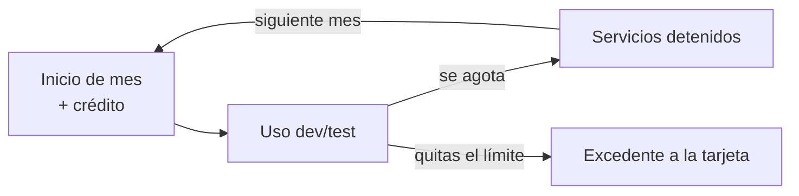

# Créditos de Azure para suscriptores de Visual Studio

Parte de: [[07-Azure/02 Dónde probar Azure sin pagar/_Índice Dónde probar Azure sin pagar|Dónde probar Azure sin pagar]]

> [!info] Cómo avanzar
> `progreso`: **pendiente** → **viendo** (estudiando) → **visto** (contestaste la autoevaluación sin abrir las respuestas) → **dominado** (hiciste el laboratorio o lo aplicaste de verdad).

## Contenido

### Qué es
Si tienes una **suscripción de Visual Studio** (antes MSDN), personal o de tu empresa, incluye un beneficio de **crédito mensual de Azure** para **desarrollo y pruebas individuales**. Datos verificados en las páginas oficiales de Azure y Microsoft Learn en noviembre de 2026; las ofertas cambian, revísalas antes de crear algo.

Montos mensuales según la página oficial:

| Suscripción | Crédito mensual |
|---|---|
| Visual Studio Enterprise | USD 150 |
| MSDN Platforms | USD 100 |
| Visual Studio Professional | USD 50 |
| Visual Studio Test Professional | USD 50 |

### Cómo funciona
- Se activa desde el portal de suscripciones de Visual Studio (*my.visualstudio.com > Beneficios*); crea una suscripción de Azure asociada a tu cuenta.
- **No requiere tarjeta** para activar el crédito.
- El crédito **se renueva cada mes**; la página oficial no indica que el saldo no usado se acumule, así que trátalo como "lo usas o lo pierdes".
- Viene con **límite de gasto** activado: al consumir el crédito del mes, los servicios se detienen hasta que llega el crédito del siguiente; según Microsoft Learn, la suscripción se reactiva automáticamente al inicio del siguiente periodo.
- Hay precios con descuento de desarrollo y prueba para algunos servicios en este tipo de suscripción (Pendiente de confirmar el detalle actual).



**¿Puedes correr producción con ese crédito?** No. La oferta es exclusivamente para desarrollo y pruebas individuales; producción requiere una suscripción de pago. La página oficial añade que Azure puede **suspender VMs o servicios que corran continuamente más de 120 horas** o que parezcan usarse para producción, que la capacidad es "best effort" y que no hay SLA respaldado financieramente. Además el crédito no se puede juntar entre varios suscriptores de una organización.

**¿Qué pasa si quitas el límite de gasto?** Necesitas agregar una tarjeta, y a partir de ahí lo que exceda el crédito mensual **se cobra a esa tarjeta** como pago por uso. Puedes quitarlo solo por el periodo actual (se reactiva solo al siguiente) o de forma indefinida. Algunos servicios que el crédito no cubre (por ejemplo, planes de soporte) solo se pueden contratar quitando el límite.

### Ejemplo
Con Visual Studio Professional (USD 50 al mes) una rutina razonable para tus laboratorios:
- Ambiente de pruebas de [[Itzamna.Dionisio]] en App Service B1 **solo cuando lo uses** (borrar o bajar a F1 al terminar).
- Experimentos de redes ([[Virtual Network]], [[Private Endpoints]]) que se crean y borran el mismo día.
- Presupuesto al 50% y 80% del crédito para enterarte antes de que se detenga todo.

```bash
#- Confirmar en qué suscripción estás antes de crear (la de Visual Studio suele llamarse así)
az account list --query "[].{nombre:name, id:id, estado:state}" -o table
az account set --subscription "Visual Studio Professional"
```

### Cuándo usarlo y cuándo no
Es la mejor opción si ya pagas (o tu empresa paga) Visual Studio: crédito todos los meses sin tarjeta. No la uses para demos permanentes de clientes ni para algo que deba estar 24/7; para eso, una suscripción de pago con presupuesto.

### Errores comunes
1. **Usarla para producción** o para clientes: riesgo de suspensión y viola los términos.
2. **Quitar el límite** "para que no se detenga" y recibir cargos.
3. **Dejar una VM encendida todo el mes**: agota el crédito y puede ser suspendida por correr más de 120 horas seguidas.
4. **Perder el beneficio al cambiar de empresa**: si la licencia es del empleador, la suscripción de Azure asociada se va con ella; no dejes ahí nada que no puedas recrear.

### Para profundizar
- [Crédito mensual de Azure para suscriptores de Visual Studio](https://azure.microsoft.com/pricing/member-offers/credit-for-visual-studio-subscribers/)
- [Usar el crédito de Azure de Visual Studio](https://learn.microsoft.com/es-mx/visualstudio/subscriptions/vs-azure)
- [Límite de gasto de Azure](https://learn.microsoft.com/es-mx/azure/cost-management-billing/manage/spending-limit)

## Autoevaluación

Contesta primero en voz alta o en papel; luego despliega la respuesta.

> [!question]- ¿Qué ofrece la suscripción de Visual Studio en Azure?
> Un **crédito mensual** para desarrollo y pruebas, cuyo monto depende del nivel de la suscripción (Professional, Enterprise…) (verificar en la página oficial).

> [!question]- ¿Puedes correr producción con ese crédito?
> No: es solo para **desarrollo y pruebas** según los términos de la oferta.

> [!question]- ¿Qué pasa si quitas el límite de gasto en esa suscripción?
> El excedente sobre el crédito mensual se cobra a tu tarjeta. Con el límite activo, los recursos se detienen hasta el siguiente ciclo.

