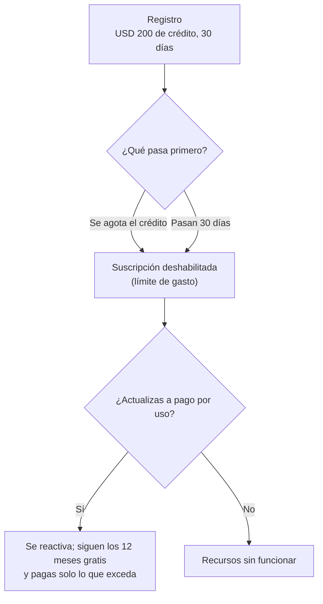

# Cuenta gratuita de Azure (crédito de 30 días, servicios gratuitos y límite de gasto)

Parte de: [[07-Azure/02 Dónde probar Azure sin pagar/_Índice Dónde probar Azure sin pagar|Dónde probar Azure sin pagar]]

> [!info] Cómo avanzar
> `progreso`: **pendiente** → **viendo** (estudiando) → **visto** (contestaste la autoevaluación sin abrir las respuestas) → **dominado** (hiciste el laboratorio o lo aplicaste de verdad).

## Contenido

### Qué es
La **cuenta gratuita de Azure** es la oferta para clientes nuevos que quieren probar la plataforma. Combina tres cosas:
1. Un **crédito** de **USD 200** para usar en los **primeros 30 días** en casi cualquier servicio.
2. Cantidades mensuales gratuitas de **más de 20 servicios populares durante 12 meses** ([[Servicios de Azure gratuitos durante 12 meses]]).
3. Cantidades mensuales de **más de 65 servicios siempre gratuitos** ([[Servicios de Azure siempre gratuitos]]).

Datos verificados en las páginas oficiales de Azure y Microsoft Learn en noviembre de 2026; las ofertas cambian, revísalas antes de crear algo.

Requisitos para registrarte, según las preguntas frecuentes oficiales: número de teléfono, una tarjeta de crédito o débito **no prepagada** (para verificar identidad; puede aparecer una retención temporal de alrededor de USD 1 que luego se libera) y una cuenta Microsoft o GitHub. Hay **una sola cuenta con crédito y servicios gratuitos por cliente nuevo**.

### Cómo funciona
**El límite de gasto (spending limit)** es la protección central. En la cuenta gratuita viene activado y es igual al monto del crédito: cuando el crédito se acaba, Azure **no cobra a tu tarjeta**; en su lugar **deshabilita** la suscripción. Según Microsoft Learn, al alcanzarlo los recursos se sacan de producción, las VMs se detienen y desasignan, y los datos de las cuentas de almacenamiento quedan disponibles **solo en lectura**. No se te cobra nada mientras no actualices a pago por uso.



**Qué pasa a los 30 días sin actualizar**: Microsoft Learn indica que Azure deshabilita la suscripción al final de los 30 días para protegerte de cobros. Tus recursos dejan de funcionar y, para volver a usarlos (y para aprovechar los servicios gratuitos de 12 meses), debes **actualizar a pago por uso**. Cuánto tiempo conserva Microsoft los datos de una suscripción deshabilitada antes de eliminarlos no aparece en las páginas consultadas (Pendiente de confirmar).

**Actualizar antes de tiempo** no te hace perder el crédito: según las preguntas frecuentes, el crédito restante sigue disponible hasta completar los 30 días desde que creaste la cuenta. Pero al actualizar **desaparece el límite de gasto**: desde ese momento lo que exceda las cuotas gratuitas se cobra a la tarjeta (ver [[Pay as you go y cuándo se pierde la protección de gasto]]).

**Lo que el crédito no cubre**: algunos productos de Marketplace y de terceros, planes de soporte y ciertas licencias se cobran aparte aunque tengas límite de gasto; revisa antes de contratar algo de Marketplace.

### Ejemplo
Plan para aprovechar la cuenta en tu caso:
1. **Semana 1**: lo caro que no podrás pagar después: un clúster AKS pequeño, Application Gateway, Azure SQL de mayor nivel, Container Apps con varias réplicas. Borrar cada noche (ver [[Probar servicios de pago con el crédito de la cuenta gratuita]]).
2. **Semana 2–4**: montar [[Itzamna.Dionisio]] en la configuración "gratuita permanente" (App Service F1, Azure SQL con la oferta gratuita serverless, Static Web Apps para el front) y comprobar en Cost Management que cuesta cero.
3. **Día 25**: revisar qué queda encendido y decidir si actualizas.

```bash
#- Ver el saldo y el estado de la suscripción
az account show --query "{nombre:name, estado:state, oferta:id}" -o table
```
El crédito restante se consulta en el portal: *Cost Management + Billing > Créditos* o en la tarjeta de la suscripción.

### Cuándo usarlo y cuándo no
Úsala cuando empiezas con Azure o quieres un mes intenso de pruebas. Si eres estudiante, [[Azure for Students]] da crédito por 12 meses sin tarjeta; si tienes Visual Studio, [[Créditos de Azure para suscriptores de Visual Studio]] da crédito mensual. No sirve para producción: al mes se deshabilita.

### Errores comunes
1. **Pensar que el crédito dura 12 meses**: dura 30 días; lo de 12 meses son cuotas de ciertos servicios.
2. **Actualizar "para no perder nada"** sin configurar presupuestos: pierdes la protección de gasto.
3. **Crear varias cuentas** con distintos correos: la oferta es una por cliente y puede bloquearse.
4. **No borrar lo caro** al terminar la prueba: el crédito se va en días.

### Para profundizar
- [Preguntas frecuentes de la cuenta gratuita de Azure](https://azure.microsoft.com/free/free-account-faq/)
- [Límite de gasto de Azure](https://learn.microsoft.com/es-mx/azure/cost-management-billing/manage/spending-limit)
- [Reactivar una suscripción de Azure deshabilitada](https://learn.microsoft.com/es-mx/azure/cost-management-billing/manage/subscription-disabled)

## Autoevaluación

Contesta primero en voz alta o en papel; luego despliega la respuesta.

> [!question]- ¿Qué incluye, en concepto, la cuenta gratuita de Azure?
> Un **crédito** para gastar en los primeros 30 días, algunos servicios **gratuitos por 12 meses** y servicios **siempre gratuitos** hasta cierta cantidad. Pide tarjeta para verificar identidad. Monto y lista de servicios cambian (verificar en la página oficial).

> [!question]- ¿Qué es el **límite de gasto** (spending limit) de la cuenta gratuita?
> Una protección: cuando se acaba el crédito, Azure **deshabilita** los recursos en vez de cobrar a la tarjeta. Mientras no actualices a pago por uso, no se te cobra.

> [!question]- Pasaron los 30 días y no actualizaste. ¿Qué pasa con tus recursos?
> La suscripción se deshabilita y los recursos dejan de funcionar; para seguir usándolos (incluidos los 12 meses gratuitos) debes **actualizar** a pago por uso (verificar en la página oficial).

