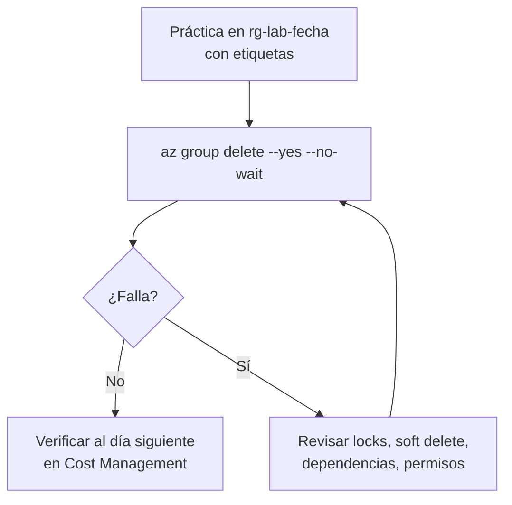

# Cómo borrar recursos al terminar una práctica

Parte de: [[07-Azure/02 Dónde probar Azure sin pagar/_Índice Dónde probar Azure sin pagar|Dónde probar Azure sin pagar]]

> [!info] Cómo avanzar
> `progreso`: **pendiente** → **viendo** (estudiando) → **visto** (contestaste la autoevaluación sin abrir las respuestas) → **dominado** (hiciste el laboratorio o lo aplicaste de verdad).

## Contenido

### Qué es
Limpiar un laboratorio significa eliminar **todo** lo que creaste para que deje de cobrar. En Azure la forma más segura y completa es **borrar el grupo de recursos** completo: ARM elimina todos los recursos que contiene en el orden correcto de dependencias. Por eso cada práctica debe vivir en **su propio grupo**.

### Cómo funciona


**Por qué el grupo de recursos y no recurso por recurso**: si borras solo la VM, quedan el disco, la NIC, la IP pública y el NSG cobrando o estorbando. Si borras el grupo, se va todo. Además no dependes de recordar qué creaste.

**Recursos creados fuera de tu grupo** que debes revisar:
- Grupos administrados que crean algunos servicios: `MC_...` de AKS, `NetworkWatcherRG`, grupos de Container Apps o Databricks. En general se borran con el recurso padre, pero confírmalo.
- Asignaciones de rol y registros de aplicaciones en Entra ID.
- Diagnósticos enviados a un Log Analytics compartido.

### Ejemplo
```bash
#- Ver qué hay antes de borrar
az resource list -g rg-lab-20261109 -o table

#- Borrar sin confirmación interactiva y sin esperar
az group delete -n rg-lab-20261109 --yes --no-wait

#- Limpiar todos los grupos de laboratorio vencidos
for rg in $(az group list --query "[?tags.ambiente=='lab' && tags.expira<='$(date +%F)'].name" -o tsv); do
  echo "Borrando $rg"; az group delete -n "$rg" --yes --no-wait
done

#- Confirmar que ya no existe (tarda unos minutos)
az group exists -n rg-lab-20261109
```

**¿Es normal ver cargos al día siguiente?** Sí. Los datos de costo llegan con retraso (Microsoft Learn habla de 8 a 24 horas), así que verás el consumo de las horas en que el recurso existió. Lo que debes comprobar es que **no aparezcan cargos nuevos** de ese grupo a partir del segundo o tercer día.

### Un recurso no se deja borrar: qué revisar
1. **Bloqueos (locks)** en el recurso, el grupo o la suscripción: `az lock list -g <rg>` y elimínalos (ver [[Azure - Resource Manager]]).
2. **Elementos protegidos**: un *Recovery Services vault* con respaldos activos no se borra hasta detener la protección y eliminar los datos de respaldo (con eliminación temporal, quedan retenidos un tiempo).
3. **Dependencias en otro grupo**: una subred usada por una NIC o un private endpoint de otro grupo, un peering de VNet, un plan de App Service con apps de otro grupo.
4. **Permisos**: necesitas permiso de borrado en el ámbito (Contributor u Owner); Reader no basta.
5. **Operaciones en curso**: espera a que termine una creación o un escalado.

**Eliminación temporal (soft delete)**: [[Key Vault]], algunos servicios de IA y otros recursos quedan en estado "eliminado" un tiempo y **reservan el nombre**. No cobran como activos en general, pero si quieres reutilizar el nombre debes **purgarlos**:
```bash
az keyvault list-deleted -o table
az keyvault purge -n kv-lab-20261109
```

### Cuándo usarlo y cuándo no
Borra el grupo completo siempre que la práctica termine. Si quieres continuar mañana, mejor ten la infraestructura en script o [[Bicep]] y recrea; es más barato que dejarla encendida. No borres grupos compartidos: por eso la convención de un grupo por práctica.

### Errores comunes
1. **Borrar recursos sueltos** y dejar discos, IPs o NICs huérfanos.
2. **Mezclar laboratorio y algo permanente** en el mismo grupo.
3. **Olvidar el `--yes`** en scripts: el comando se queda esperando confirmación.
4. **No verificar** en Cost Management días después.
5. **Purgar sin pensar** un Key Vault de producción: es irreversible.

### Para profundizar
- [Eliminación de grupos de recursos y recursos](https://learn.microsoft.com/es-mx/azure/azure-resource-manager/management/delete-resource-group)
- [Información general de la eliminación temporal de Key Vault](https://learn.microsoft.com/es-mx/azure/key-vault/general/soft-delete-overview)
- [Evitar cargos con la cuenta gratuita](https://learn.microsoft.com/es-mx/azure/cost-management-billing/manage/avoid-charges-free-account)

## Autoevaluación

Contesta primero en voz alta o en papel; luego despliega la respuesta.

> [!question]- ¿Cuál es la forma más segura de limpiar un laboratorio?
> Crear todo en **un grupo de recursos dedicado** y borrar el grupo: `az group delete -n rg-lab --yes`. Luego verificar con `az group list -o table`.

> [!question]- Borraste el grupo pero Cost Management sigue mostrando cargos al día siguiente. ¿Es normal?
> Puede ser: los costos se reportan con retraso. Si continúa, busca recursos fuera del grupo (otra región, otro grupo creado automáticamente como `NetworkWatcherRG` o el grupo de nodos `MC_` de AKS).

> [!question]- Un recurso no se deja borrar. ¿Qué revisas?
> **Bloqueos** (locks) en el recurso o el grupo, recursos dependientes, protección de borrado (p. ej. *purge protection* en Key Vault: el vault queda en *soft-delete* y su nombre reservado un tiempo).

## Práctica

- [[Lab 1 - Crear y borrar recursos con Azure CLI en el sandbox]]

