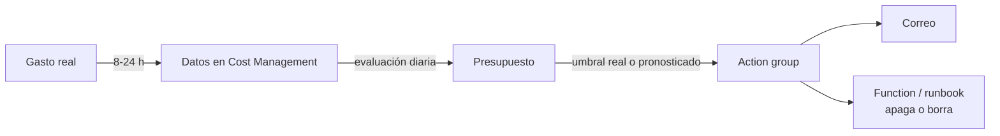

# Cómo evitar cobros inesperados en la nube (presupuestos y alertas)

Parte de: [[07-Azure/02 Dónde probar Azure sin pagar/_Índice Dónde probar Azure sin pagar|Dónde probar Azure sin pagar]]

> [!info] Cómo avanzar
> `progreso`: **pendiente** → **viendo** (estudiando) → **visto** (contestaste la autoevaluación sin abrir las respuestas) → **dominado** (hiciste el laboratorio o lo aplicaste de verdad).

## Contenido

### Qué es
Un **presupuesto** de Cost Management es un monto (mensual, trimestral o anual) para un ámbito (suscripción, grupo de recursos, grupo de administración) con **umbrales** que disparan **alertas**. Es la herramienta principal para enterarte a tiempo de que gastas más de lo previsto. Pero ojo: según Microsoft Learn, cuando se alcanza un umbral **los recursos no se ven afectados y el consumo no se detiene**. Un presupuesto avisa; no frena.

### Cómo funciona
- Microsoft Learn indica que los datos de costo y uso suelen estar disponibles **en 8 a 24 horas** y que los presupuestos se **evalúan cada 24 horas**; los correos se envían normalmente en la hora siguiente a la evaluación. Es decir, entre que ocurre el gasto y te llega el aviso puede pasar más de un día.
- Cada umbral puede ser sobre costo **real** (lo ya consumido) o **pronosticado** (la proyección al cierre del periodo).
- En presupuestos de **suscripción o grupo de recursos** puedes conectar un **action group** de Azure Monitor que, además de correo, puede llamar un webhook, una Azure Function, un runbook de Automation o una Logic App.
- En suscripciones nuevas pueden pasar hasta 48 horas antes de poder usar todas las funciones de Cost Management.

**¿Por qué alertas por gasto pronosticado además del real?** Porque el real llega tarde: si dejaste algo caro encendido el día 3, el umbral real del 80% puede cruzarse hasta el día 20. El pronóstico proyecta la tendencia y te avisa **días antes** de que el gasto real alcance el límite, cuando todavía puedes corregir.



### Fuentes clásicas de cobros inesperados
1. **VMs apagadas desde el SO** pero no desasignadas, y sus **discos** y **IPs públicas** después de borrar la VM.
2. **Escalar un plan** (App Service, SQL) "para probar" y no regresarlo.
3. **Gateways y servicios por hora**: VPN Gateway, Application Gateway, Firewall, Bastion, NAT Gateway; cobran por existir.
4. **Log Analytics / Application Insights** con ingesta alta (logs de depuración en producción).
5. **Tráfico de salida** a Internet o entre regiones.
6. **Recursos creados indirectamente**: grupos `MC_` de AKS, cuentas de almacenamiento de Functions, snapshots, réplicas.
7. **Credenciales comprometidas** usadas para minar criptomonedas.

### Ejemplo: apagar algo al llegar al presupuesto
Automatización con presupuesto + action group + Function que **desasigna las VMs del grupo de laboratorio**:
1. Function App (PowerShell o C#) con Managed Identity y rol *Virtual Machine Contributor* sobre `rg-lab`.
2. Action group que llame a la Function (acción "Azure Function" o webhook).
3. Presupuesto en `rg-lab` con umbral 100% real conectado al action group.

```csharp
// Function con trigger HTTP llamada por el action group; usa Azure.ResourceManager.Compute
using Azure.Identity;
using Azure.ResourceManager;
using Azure.ResourceManager.Compute;
using Microsoft.Azure.Functions.Worker;
using Microsoft.Azure.Functions.Worker.Http;

public class ApagarLab
{
    [Function("ApagarLab")]
    public async Task<HttpResponseData> Run(
        [HttpTrigger(AuthorizationLevel.Function, "post")] HttpRequestData req)
    {
        var arm = new ArmClient(new DefaultAzureCredential());
        var sub = await arm.GetDefaultSubscriptionAsync();
        var rg = (await sub.GetResourceGroupAsync("rg-lab")).Value;

        await foreach (VirtualMachineResource vm in rg.GetVirtualMachines())
            await vm.DeallocateAsync(Azure.WaitUntil.Started); // desasignar: deja de cobrar cómputo

        return req.CreateResponse(System.Net.HttpStatusCode.OK);
    }
}
```
Para algo más drástico en laboratorios, la Function podría borrar el grupo entero. Ten presente el retraso de datos: la automatización reacciona tarde, así que úsala como red de seguridad, no como control fino.

### Cuándo usarlo y cuándo no
Configura presupuestos en **toda** suscripción con tarjeta, desde el primer día, y en cada grupo de recursos de proyectos con costo. La automatización de apagado tiene sentido en laboratorios y dev; en producción, apagar automáticamente por costo puede ser peor que el gasto.

### Errores comunes
1. **Creer que el presupuesto detiene el gasto.**
2. **Solo umbral al 100% real**: te enteras cuando ya pasó.
3. **Correos a una dirección que no lees.**
4. **Montos irreales** (muy altos) que nunca disparan.

### Para profundizar
- [Tutorial: Creación y administración de presupuestos](https://learn.microsoft.com/es-mx/azure/cost-management-billing/costs/tutorial-acm-create-budgets)
- [Administrar costos con presupuestos y automatización](https://learn.microsoft.com/es-mx/azure/cost-management-billing/manage/cost-management-budget-scenario)
- [Identificar anomalías y gastos inesperados](https://learn.microsoft.com/es-mx/azure/cost-management-billing/understand/analyze-unexpected-charges)

## Autoevaluación

Contesta primero en voz alta o en papel; luego despliega la respuesta.

> [!question]- ¿Qué hace exactamente un presupuesto de Cost Management?
> Compara el gasto **real o pronosticado** contra un monto en un periodo y dispara alertas por correo o *action group* al cruzar umbrales. **No apaga** recursos por sí solo.

> [!question]- ¿Por qué usar alertas por gasto **pronosticado** además del real?
> Porque los datos de costo llegan con retraso (horas). El pronóstico avisa antes de que el gasto real cruce el umbral.

> [!question]- ¿Cuáles son las fuentes clásicas de cobros inesperados?
> VMs no desasignadas, discos e IP públicas que quedan tras borrar la VM, gateways/Front Door/AKS por hora, ingesta de logs, egreso de datos, niveles escalados «para probar» y recursos olvidados en otra región.

> [!question]- ¿Cómo automatizarías apagar algo al llegar al presupuesto?
> Presupuesto → *action group* → Azure Function, Logic App o runbook que desasigna/escala a la baja. Pruébalo antes: un fallo silencioso te deja sin protección.

