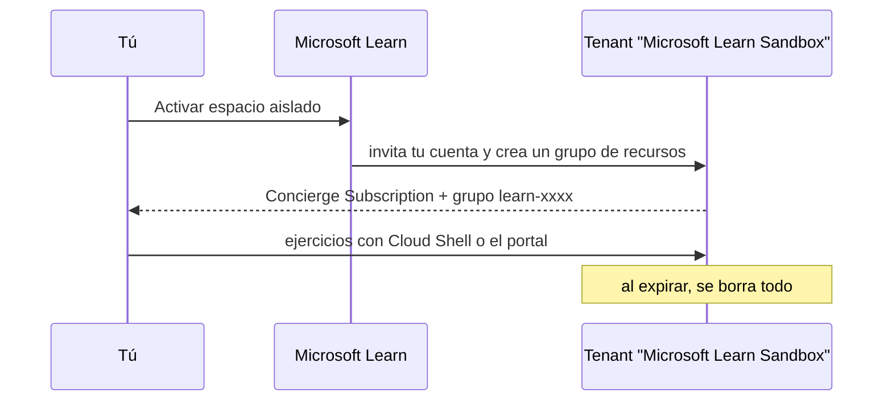

# Microsoft Learn sandbox (suscripción temporal sin tarjeta)

Parte de: [[07-Azure/02 Dónde probar Azure sin pagar/_Índice Dónde probar Azure sin pagar|Dónde probar Azure sin pagar]]

> [!info] Cómo avanzar
> `progreso`: **pendiente** → **viendo** (estudiando) → **visto** (contestaste la autoevaluación sin abrir las respuestas) → **dominado** (hiciste el laboratorio o lo aplicaste de verdad).

## Contenido

### Qué es
El **sandbox de Microsoft Learn** era un entorno gratuito y temporal que Microsoft Learn creaba al pulsar **"Activar espacio aislado"** en ciertos ejercicios. Daba acceso a una suscripción de Azure llamada **Concierge Subscription**, sin tarjeta ni costo, para completar el ejercicio del módulo.

**Estado actual (verificado en noviembre de 2026)**: la página oficial de Microsoft Learn *"Run Microsoft Learn training exercises in your own subscription"* dice textualmente que los sandboxes de Learn **ya no están disponibles**, y que para los ejercicios necesitas tu propia suscripción (prueba gratuita de 30 días o pago por uso). En Microsoft Q&A hay reportes desde finales de 2025 de que el botón "Activar espacio aislado" desapareció. La fecha exacta del retiro no aparece en las páginas consultadas (Pendiente de confirmar). Esta nota explica cómo funcionaba (útil para entender guías y laboratorios antiguos, incluido [[Lab 1 - Crear y borrar recursos con Azure CLI en el sandbox]]) y qué usar en su lugar.

### Cómo funcionaba

- Tu cuenta se agregaba como invitada a un tenant de Microsoft; en el portal tenías que cambiar a ese directorio.
- Recibías **un solo grupo de recursos ya creado** (nombre del tipo `learn-<guid>`) con permisos limitados: no podías crear otros grupos ni asignar roles a nivel de suscripción.
- Duraba unas horas (la comunidad reportaba alrededor de 4) y había un límite de sandboxes por día.
- Solo se permitían **ciertos servicios, SKUs y regiones**, los necesarios para los módulos; servicios caros o fuera de esa lista fallaban por política.
- Al expirar se borraba todo automáticamente: no había que limpiar.

**Limitaciones para experimentos propios** (cuando existía): tiempo corto, un solo grupo de recursos fijo, catálogo restringido de servicios, sin permisos de Entra ID (no podías registrar apps ni crear service principals libremente) y sin persistencia. Servía para el ejercicio, no para proyectos.

**Encontrar el grupo de recursos desde Cloud Shell** (aplicaba al sandbox y sirve en cualquier suscripción con un solo grupo):
```bash
az group list --query "[0].name" -o tsv
#- o guardarlo y usarlo como predeterminado
RG=$(az group list --query "[0].name" -o tsv)
az config set defaults.group=$RG
```

### Qué usar ahora
| Necesidad | Opción |
|---|---|
| Hacer ejercicios de Learn | [[Cuenta gratuita de Azure (crédito de 30 días, servicios gratuitos y límite de gasto)]] |
| Sin tarjeta | [[Azure for Students]] (si eres estudiante) |
| Crédito mensual | [[Créditos de Azure para suscriptores de Visual Studio]] |
| Ya en pago por uso | Laboratorios con presupuesto y borrado ([[Cómo borrar recursos al terminar una práctica]]) |
| Practicar contenedores sin Azure | [[Play with Docker]], [[Play with Kubernetes]] |

La gran diferencia: el sandbox se limpiaba solo; en tu suscripción **la limpieza es tu responsabilidad**.

### Ejemplo
Adaptar un ejercicio antiguo que decía "usa el grupo del sandbox":
```bash
#- En tu suscripción: crea tu propio grupo con expiración
RG=rg-learn-$(date +%Y%m%d)
az group create -n $RG -l eastus --tags ambiente=lab expira=$(date -d '+1 day' +%F)
az config set defaults.group=$RG
#- ... sigue los pasos del módulo ...
az group delete -n $RG --yes --no-wait
```

### Cuándo usarlo y cuándo no
Ya no se puede usar. Si una guía o curso lo menciona, sustitúyelo por tu propia suscripción y agrega el paso de limpieza. Algunos contenidos de Learn todavía incluyen laboratorios interactivos alojados que no requieren suscripción; revisa cada módulo.

### Errores comunes
1. **Buscar el botón "Activar espacio aislado"** y perder tiempo con errores de inicio de sesión: ya no existe.
2. **Seguir guías antiguas al pie de la letra** en tu suscripción, sin limpiar: el sandbox borraba solo; tu suscripción no.
3. **Usar nombres de recursos fijos** de la guía que ya están ocupados globalmente (cuentas de almacenamiento, apps web): agrega un sufijo aleatorio.

### Para profundizar
- [Ejecutar ejercicios de Microsoft Learn en tu propia suscripción](https://learn.microsoft.com/es-mx/training/support/use-your-own-subscription)
- [Preguntas frecuentes de la cuenta gratuita de Azure](https://azure.microsoft.com/free/free-account-faq/)
- [Azure Cloud Shell](https://learn.microsoft.com/es-mx/azure/cloud-shell/overview)

## Autoevaluación

Contesta primero en voz alta o en papel; luego despliega la respuesta.

> [!question]- ¿Qué es el sandbox de Microsoft Learn?
> Era una suscripción **temporal** que Learn activaba dentro de ciertos módulos con ejercicios: sin tarjeta y sin costo, con un **grupo de recursos ya creado** y permisos limitados, y se borraba sola al expirar. **Ya no está disponible**: Microsoft Learn indica que los sandboxes se retiraron y que los ejercicios se hacen en tu propia suscripción (cuenta gratuita de 30 días o pago por uso).

> [!question]- ¿Qué limitaciones debes tener en cuenta al usarlo para tus propios experimentos?
> Hoy la pregunta práctica es al revés: ya no existe, así que tus experimentos van en tu cuenta gratuita, Azure for Students o créditos de Visual Studio. Cuando existía tenía duración limitada por sesión, activaciones diarias contadas, solo ciertos servicios/SKU y regiones, y no permitía crear grupos de recursos ni asignar roles. En tu suscripción no hay esos límites, pero **la limpieza y el costo son tu responsabilidad**: grupo de recursos desechable, presupuesto con alerta y borrado al terminar.

> [!question]- ¿Cómo encuentras el nombre del grupo de recursos del sandbox desde Cloud Shell?
> En el sandbox (ya retirado) bastaba `az group list -o table`: aparecía un único grupo con nombre generado (empezaba con `learn-`). En tu suscripción, si una guía antigua dice "usa el grupo del sandbox", crea el tuyo y úsalo en su lugar: `RG=rg-lab-learn; az group create -n $RG -l eastus --tags ambiente=lab`, y al final `az group delete -n $RG --yes`.

## Práctica

- [[Lab 1 - Crear y borrar recursos con Azure CLI en el sandbox]]

