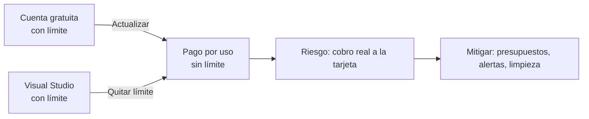

# Pay as you go y cuándo se pierde la protección de gasto

Parte de: [[07-Azure/02 Dónde probar Azure sin pagar/_Índice Dónde probar Azure sin pagar|Dónde probar Azure sin pagar]]

> [!info] Cómo avanzar
> `progreso`: **pendiente** → **viendo** (estudiando) → **visto** (contestaste la autoevaluación sin abrir las respuestas) → **dominado** (hiciste el laboratorio o lo aplicaste de verdad).

## Contenido

### Qué es
**Pago por uso (Pay as you go)** es el modelo estándar de suscripción de Azure: sin compromiso ni pago inicial, pagas mensualmente con tarjeta lo que consumas por encima de las cuotas gratuitas. Según la página oficial, las cantidades mensuales gratuitas siguen aplicando, pero **no hay tope de uso**: lo que consumas se cobra. Datos verificados en las páginas oficiales de Azure y Microsoft Learn en noviembre de 2026; las ofertas cambian, revísalas antes de crear algo.

### Cómo funciona
**La protección del límite de gasto** solo existe en ofertas con crédito: cuenta gratuita, Visual Studio y similares. Microsoft Learn es explícito: en suscripciones de pago por uso o con compromisos, el límite de gasto **no aparece en el portal y no se puede activar**. O tienes límite igual al crédito, o no tienes límite.

**Cuándo se pierde la protección**
1. Al **actualizar la cuenta gratuita** a pago por uso (sea al día 30, al agotar el crédito o antes). La suscripción se reactiva y lo que exceda se cobra.
2. Al **quitar el límite de gasto** en una suscripción con crédito (Visual Studio): por el periodo actual o de forma indefinida; el excedente se cobra a la tarjeta registrada.
3. Al **crear directamente** una suscripción de pago por uso.
4. Además, incluso con límite, ciertos productos de **Marketplace y de terceros**, licencias y planes de soporte se cobran aparte.



Hay que recordar que los presupuestos **no detienen** recursos: en pago por uso tu única protección real es la combinación de alertas tempranas, automatización y disciplina de limpieza.

### Ejemplo: lo que configuras el primer día
1. **Presupuesto con alertas** en la suscripción: por ejemplo, un monto mensual pequeño con umbrales al 50% y 80% de costo **real** y al 100% de costo **pronosticado**, enviando correo (ver [[Cómo evitar cobros inesperados en la nube (presupuestos y alertas)]]).
2. **Alertas de anomalías de costo** en Cost Management, y revisar que el correo de notificaciones sea uno que lees.
3. **Disciplina de grupos y etiquetas**: cada práctica en su grupo con `ambiente=lab` y `expira`, para borrar sin miedo ([[Cómo borrar recursos al terminar una práctica]]).

Opcionales muy recomendables: Azure Policy para limitar **regiones** y **tamaños de VM** permitidos; MFA en tu cuenta (una cuenta robada puede minar criptomonedas con tu tarjeta); y no compartir credenciales de Owner.

```bash
#- Política integrada: solo permitir ciertos tamaños de VM en la suscripción
SUB_ID=$(az account show --query id -o tsv)
DEF=$(az policy definition list --query "[?displayName=='Allowed virtual machine size SKUs'].name" -o tsv)
az policy assignment create -n solo-vms-chicas --policy $DEF --scope /subscriptions/$SUB_ID \
  --params '{"listOfAllowedSKUs":{"value":["Standard_B1s","Standard_B2s"]}}'
```

### Cuándo usarlo y cuándo no
Pasas a pago por uso cuando necesitas que algo **siga funcionando** después del crédito, o para cargas reales. Si solo estudias, quédate con ofertas que tienen límite el mayor tiempo posible y diseña tus proyectos permanentes sobre cuotas gratuitas.

### Errores comunes
1. **Creer que el presupuesto es un tope** en pago por uso: avisa, no frena.
2. **Actualizar sin revisar lo que quedó encendido**: los recursos deshabilitados se reactivan y empiezan a cobrar.
3. **Cuenta sin MFA**: es un objetivo atractivo para abuso.
4. **Ignorar Marketplace**: imágenes o SaaS de terceros cobran aparte.

### Para profundizar
- [Límite de gasto de Azure](https://learn.microsoft.com/es-mx/azure/cost-management-billing/manage/spending-limit)
- [Actualizar la cuenta gratuita a pago por uso](https://learn.microsoft.com/es-mx/azure/cost-management-billing/manage/upgrade-azure-subscription)
- [Preguntas frecuentes de la cuenta gratuita](https://azure.microsoft.com/free/free-account-faq/)

## Autoevaluación

Contesta primero en voz alta o en papel; luego despliega la respuesta.

> [!question]- ¿Qué es Pay as you go?
> Pago por uso: pagas lo que consumes cada mes, sin compromiso. Es a lo que se actualiza la cuenta gratuita.

> [!question]- ¿Cuándo se pierde la protección del límite de gasto?
> Al **actualizar** la cuenta gratuita a pago por uso, o al **quitar** el límite en ofertas con crédito (Visual Studio). Desde ahí, nada detiene los recursos automáticamente: solo tus presupuestos y alertas te avisan.

> [!question]- Ya estás en pago por uso. ¿Qué tres cosas configuras el primer día?
> 1) **Presupuesto** con alertas a 50/80/100 %; 2) **etiquetas** y grupos por proyecto para ver costos; 3) hábito de **borrar** el grupo del lab al terminar. Ver [[Cómo evitar cobros inesperados en la nube (presupuestos y alertas)]].

